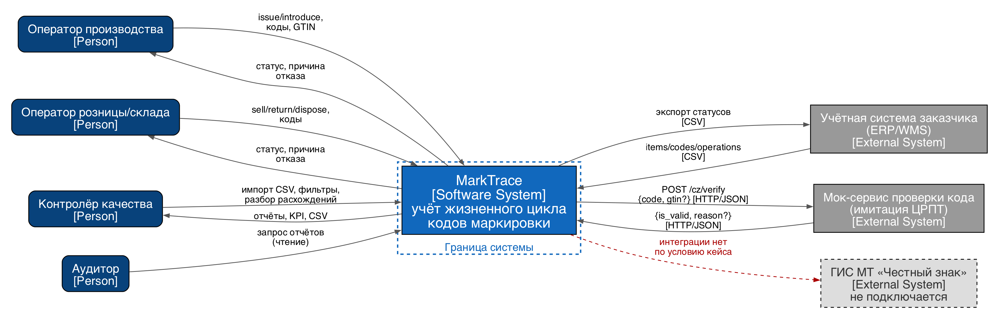

# 10. C4 Context Diagram

Исходник: [`diagrams/c4-context.dot`](diagrams/c4-context.dot) (Graphviz), вектор: [`c4-context.svg`](diagrams/c4-context.svg). Версия 0.1, 19.10.2026.

Перерисовка: `dot -Tpng -Gdpi=130 c4-context.dot -o c4-context.png`.

## Легенда

| Элемент | Значение |
|---|---|
| Тёмно-синий скруглённый | Person: роль человека |
| Синий прямоугольник в пунктирной рамке | Наша система MarkTrace и граница ответственности |
| Серый прямоугольник | External System: готовая внешняя система |
| Светло-серый пунктир | Система вне границ MVP, интеграции нет |
| Стрелка с подписью | Что передаётся и по какому протоколу |

## Краткое описание контекста

MarkTrace — единая система, которая принимает от операторов операции над кодами маркировки и проверяет их по правилам жизненного цикла: выпуск, ввод, реализация, возврат, вывод. Операторы производства, розницы и склада вводят операции и получают в ответ новый статус кода или причину отказа. Контролёр качества загружает CSV, запускает проверки и получает отчёты по статусам и расхождениям со сводкой KPI; аудитор читает те же отчёты без права изменения.

С внешним миром система обменивается через два канала. Учётная система заказчика поставляет файлы `items`, `codes`, `operations` и принимает выгрузку статусов в CSV. Мок-сервис проверки кода по HTTP получает `POST /cz/verify {code, gtin?}` и возвращает `{is_valid, reason?}`; он заменяет боевую проверку у оператора. Боевая ГИС МТ «Честный знак» на диаграмме показана пунктиром: по условию кейса интеграции с ней нет.

Граница ответственности: команда разрабатывает всё внутри рамки (формы, проверки, отчёты) и мок-сервис как учебный заменитель; учётная система заказчика и боевая ГИС МТ нам не принадлежат.

## Связи

| № | От → к | Что передаётся | Протокол |
|---|---|---|---|
| 1 | Оператор производства → MarkTrace | Операции issue/introduce, код, GTIN | Веб-интерфейс |
| 2 | Оператор розницы/склада → MarkTrace | Операции sell/return/dispose, код | Веб-интерфейс |
| 3 | MarkTrace → операторы | Статус кода, причина отказа | Веб-интерфейс |
| 4 | Контролёр качества → MarkTrace | Импорт CSV, фильтры, разбор расхождений (комментарий, закрытие) | Веб-интерфейс, файлы CSV |
| 5 | MarkTrace → контролёр качества | Отчёты, сводка KPI, CSV | Веб-интерфейс, файл CSV |
| 6 | Аудитор → MarkTrace | Запрос отчётов (чтение) | Веб-интерфейс |
| 7 | Учётная система заказчика → MarkTrace | items, codes, operations | Файлы CSV (JSON не реализован, Could C1) |
| 8 | MarkTrace → учётная система заказчика | Экспорт `code, item_code, status, last_ts` | Файл CSV |
| 9 | MarkTrace → мок-сервис | `{code, gtin?}` | HTTP `POST /cz/verify`, JSON |
| 10 | Мок-сервис → MarkTrace | `{is_valid, reason?}` | HTTP, JSON |

## Прогон Use Case

| Use Case | Кто начинает | Внешние системы | Связи |
|---|---|---|---|
| UC1 Выпуск и ввод партии | оператор производства (1) | мок | 1 → 9 → 10 → 3 |
| UC2 Продать код | оператор склада (2) | мок | 2 → 9 → 10 → 3 |
| UC3 Возврат от покупателя | оператор склада (2) | мок | 2 → 9 → 10 → 3 |
| UC4 Списать код | оператор склада (2) | мок | 2 → 9 → 10 → 3 |
| UC5 Разобрать расхождения | контролёр | мок | 4 → 9 → 10 → 5 |
| UC6 Статусы и экспорт CSV | контролёр, аудитор | учётная система | 4/6 → 5, 8 |
| UC7 Загрузить данные | контролёр | учётная система | 7, 4 → 5 |

Неиспользуемых связей нет; все акторы и внешние системы из [реестра](08-actors-registry.md) отражены.

## Чек-лист

- Каждый первичный актор нарисован отдельно — да.
- Каждая внешняя система из сценариев нарисована снаружи границы — да.
- Все связи подписаны содержимым и протоколом — да.
- Внутри границы один прямоугольник, без БД, API, очередей — да.

## Кандидаты в контейнеры (следующий этап)

Веб-интерфейс (формы, отчёты, история кода), backend API (проверки, протокол, импорт и экспорт), база данных, REST-мок, хранилище CSV и эталонов.
