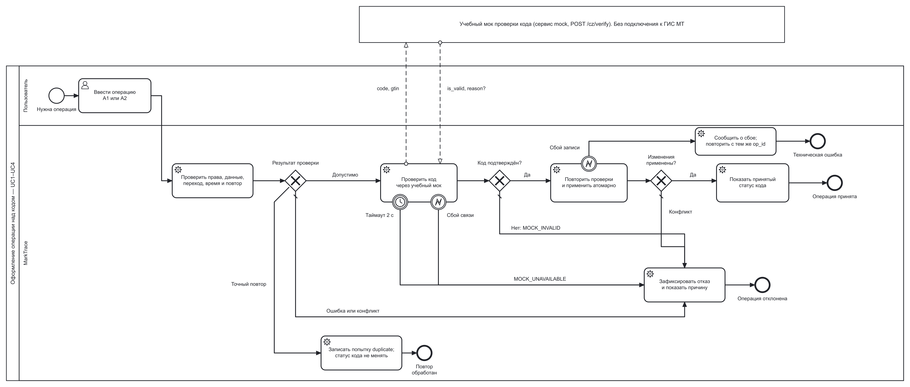
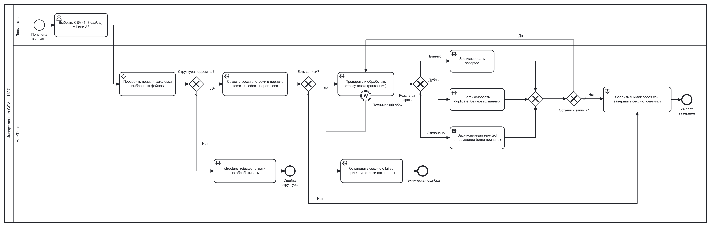

# 11. BPMN: операция над кодом и импорт CSV

**MarkTrace · версия 1.1 · 16.11.2026**

## 1. Назначение и основание

Две модели BPMN 2.0 описывают оформление операции над кодом через форму (UC1–UC4 по нумерации [09](09-use-cases.md)) и импорт данных CSV (UC7). Они раскрывают ветвления, повторы, отказы и технические сбои, которые в Use Case перечислены текстом. Разбор расхождений (UC5) и отчёты (UC6) используют результаты этих процессов и описаны в [22](22-ui-flow.md) и [27](27-architecture.md) §8.3.

Версия 1.1 приведена в соответствие с реализацией MVP: [`SPEC.md`](../SPEC.md) §2–§3, `backend/internal/ops/form.go`, `backend/internal/importer/importer.go`. Чем она отличается от первой модели (версия 1.0 от 19.10.2026, построена до реализации), — в разделе 9.

Основание: [Use Case](09-use-cases.md), [MoSCoW](03-moscow.md), [реестр акторов](08-actors-registry.md), [устав](02-project-charter.md). Данные — [ERD](12-erd.md) и [словарь данных](13-data-dictionary.md) v2.0; связь узлов схем с таблицами — [27](27-architecture.md) §8.

Модели описательные: в XML `isExecutable="false"`. Мок — учебная система E2 (сервис `mock`); подключения к ГИС МТ нет.

## 2. Участники и обозначения

| Элемент | Значение |
|---|---|
| Пул MarkTrace | Дорожки «Пользователь» (ввод) и «MarkTrace» (автоматическая обработка) |
| A1, оператор производства | Форма: `issue`, `introduce`; импорт CSV |
| A2, оператор розницы/склада | Форма: `sell`, `return`, `dispose` |
| A3, контролёр качества | Импорт CSV; результаты разбирает в UC5 |
| A4, аудитор | В процессах не участвует, только читает отчёты (UC6) |
| admin | Техническая учётная запись: любые операции и импорт |
| Отдельный пул мока | «Чёрный ящик» `POST /cz/verify`: внутренний процесс не моделируется |
| Сплошная стрелка | Поток управления, в том числе между дорожками |
| Пунктирная стрелка | Сообщение между MarkTrace и мок-сервисом |
| Ромб с X | Исключающий шлюз; поток с косой чертой — ветвь по умолчанию |
| Событие на границе задачи | Прерывающий таймер (2 с) или ошибка; обычная ветвь задачи не продолжается |

## 3. Процесс UC1–UC4: оформление операции



[Векторная схема SVG](diagrams/bpmn-operation.svg) · [Редактируемая BPMN 2.0](diagrams/bpmn-operation.bpmn)

### 3.1. Допустимые переходы

| Операция | До операции | После операции | Сценарий |
|---|---|---|---|
| `issue` | У кода нет принятой истории | `issued` | UC1 |
| `introduce` | `issued` | `introduced` | UC1 |
| `sell` | `introduced` или `returned` | `sold` | UC2 |
| `return` | `sold` | `returned` | UC3 |
| `dispose` | `introduced`, `sold` или `returned` | `disposed` (финальный) | UC4 |

Время операции должно быть **строго позже** последней принятой операции кода, иначе `TIME_REVERSED` (`SPEC.md` §1.4). Пара `(code, ts)` уникальна: то же время с тем же содержанием — повтор, с другим — `IDEMPOTENCY_CONFLICT`. Точный повтор распознаётся раньше проверки перехода, поэтому повтор уже принятого `issue` не превращается в отказ «код уже выпущен».

### 3.2. Основной и альтернативные пути

| Узел XML | Действие и результат в MVP |
|---|---|
| `Op_Input` | Оператор выбирает тип, вводит один код, для `issue` — товар; время по умолчанию — время сервера, `op_id` — новый UUID |
| `Op_Preflight` | Роль (иначе 403 `AUTH_DENIED`, попытка не записывается), затем проверки `SPEC.md` §2.3 шаги 1–10 без блокировок: поля, повтор `op_id`, тип, время, маска кода, повтор `(code, ts)`, существование, уникальность, переход, время; для `issue` — товар и GTIN |
| `Op_Local` | `valid` → мок; `duplicate` → запись повтора; первая неуспешная проверка → отказ с одной причиной |
| `Op_Return` | Попытка с `decision=duplicate`; мок не вызывается, операция и нарушение не создаются |
| `Op_Verify` | `POST /cz/verify {code, gtin}`, где `gtin` — GTIN товара; ответ сохраняется в `operation_attempts.mock_result` |
| `Op_MockResult` | `is_valid=true` → применение; `false` → отказ `MOCK_INVALID` (в сообщении — причина мока) |
| `Op_Timeout`, `Op_Unavailable` | Таймаут 2 с, сетевая ошибка, HTTP ≠ 200 или ответ без `is_valid` → сразу отказ `MOCK_UNAVAILABLE`. Статуса `pending` нет; оператор повторяет операцию с тем же `op_id`, такая попытка проверяется заново |
| `Op_Commit` | Одна транзакция: блокировка кода (`SELECT … FOR UPDATE`), повторная проверка, запись попытки, операции и проекции `codes`; при `issue` — и привязки в `code_registry` |
| `Op_Applied` | Изменения применены → подтверждение; состояние изменилось за время вызова мока → отказ по результату повторной проверки |
| `Op_WriteError` | Ошибка БД: транзакция откатывается, ответ 500, ничего не записано; повтор с тем же `op_id` безопасен |
| `Op_Reject` | Попытка `rejected` и одно нарушение с машинной причиной и сообщением на русском; статус кода не меняется |

### 3.3. Гарантии записи

1. Предварительная проверка без блокировок нужна только чтобы не звать мок зря. Перед записью проверки повторяются под блокировкой кода.
2. Принятая операция, проекция `codes` и попытка фиксируются в одной транзакции; частично проведённой операции не бывает.
3. История принятых операций не редактируется и не удаляется. Отказы и повторы видны в `operation_attempts` и `violations`.
4. Повтор после `MOCK_UNAVAILABLE` или ошибки записи проверяется с нуля: отклонённая попытка не считается окончательной для `op_id` (`SPEC.md` §2.3, шаг 2).

## 4. Процесс UC7: импорт CSV



[Векторная схема SVG](diagrams/bpmn-import.svg) · [Редактируемая BPMN 2.0](diagrams/bpmn-import.bpmn)

### 4.1. Проверка структуры

A1, A3 или admin выбирает от одного до трёх файлов: `items.csv`, `codes.csv`, `operations.csv` — допустим любой непустой набор. Создаётся сессия `running`. Если заголовок какого-либо файла не совпадает с форматом (те же столбцы в том же порядке), вся сессия получает `structure_rejected` с причиной, строки не обрабатываются.

Неверное число полей в отдельной строке — не ошибка структуры: строка отклоняется с `VALUE_FORMAT`, остальные обрабатываются. Неверное значение поля (контрольная цифра GTIN, время, маска) тоже отклоняет только строку.

### 4.2. Обработка строк

| Узел XML | Содержание в MVP |
|---|---|
| `Imp_Structure`, `Imp_Valid` | Права и заголовки всех выбранных файлов |
| `Imp_Open` | Сессия создана; порядок обработки всегда items → codes → operations, внутри файла — порядок строк (без сортировки) |
| `Imp_Queue` | Файлы с одними заголовками — сессия завершается с нулевыми счётчиками |
| `Imp_Row` | Проверки `SPEC.md` §2.3 по типу файла, каждая строка в своей транзакции; для операций — те же правила, что в форме, но без вызова мока |
| `Imp_Result` | Ровно один итог строки: `accepted`, `duplicate` или `rejected` |
| `Imp_Accept` | `items` → справочник; `codes` → привязка и ожидаемый снимок в `code_registry`; `operations` → журнал и проекция `codes` |
| `Imp_Duplicate` | Пропуск без новых предметных данных; для операций пишется попытка `duplicate` |
| `Imp_RejectRow` | Нарушение с одной причиной; остальные строки продолжают обрабатываться |
| `Imp_Merge`, `Imp_More` | Цикл до последней строки последнего файла |
| `Imp_Summary` | Если в сессии были `codes.csv` или `operations.csv` — сверка снимка (`SNAPSHOT_MISMATCH`); сессия `completed`, счётчики по файлам и `rows_created` |
| `Imp_Fault`, `Imp_Failed` | Технический сбой — сессия `failed` с причиной; строки, уже зафиксированные в своих транзакциях, остаются |

### 4.3. Трактовка `codes.csv` (P2)

`codes.csv` — привязка кода к товару и **ожидаемый итоговый снимок** статуса. Статус кода вычисляется только из принятых операций; после обработки операций система сравнивает фактический `codes.status` и `codes.ts` со снимком. Несовпадение даёт нарушение `SNAPSHOT_MISMATCH` (источник `codes`, ссылка — код). Одинаковое открытое расхождение повторно не создаётся. Снимок историю не перезаписывает.

### 4.4. Повтор и конфликт

Строка `operations.csv` ищется по `op_id`, затем по `(code, ts)`. Совпадение содержания → `duplicate`, отличие → `IDEMPOTENCY_CONFLICT` без перезаписи истории. Для `items.csv` ключ — `item_code`, для `codes.csv` — `code` (другая привязка → `DUPLICATE_CODE`). Ранее отклонённая строка с тем же ключом и тем же содержимым тоже считается повтором и не создаёт второго нарушения.

Повторная сессия и её строки протокола создаются намеренно. Критерий «0 новых строк» (M7, K3) относится к предметным таблицам: `items`, `code_registry`, `codes`, `operations`, `violations`. На T1 повторный импорт даёт `rows_created = 0`.

## 5. Связь с остальными сценариями

| Сценарий | Как использует результат процессов |
|---|---|
| UC6, статусы и экспорт | Читает проекцию `codes`; отказы не меняют показанный статус. Период и исполнитель фильтруются по `last_ts` и `last_actor` |
| UC5, расхождения | Читает `violations` и историю кода. Комментарий или закрытие добавляет запись в `violation_resolutions`, нарушение не удаляется. Исправление — новая операция или повторный импорт исправленного файла |
| Экран «Проверка кода» | `POST /api/verify` вызывает мок и показывает ответ; ничего не сохраняет и в процессы не входит |

## 6. Проектные решения

| ID | Решение | Статус в MVP |
|---|---|---|
| P1 | Принятый журнал отделён от попыток | Решено: `operations` и `operation_attempts`; статуса `pending` нет, недоступность мока — отказ `MOCK_UNAVAILABLE` |
| P2 | `codes.csv` — ожидаемый снимок; история — источник статуса | Решено: `code_registry` + `SNAPSHOT_MISMATCH` |
| P3 | Повтор сравнивается по содержанию; конфликт не перезаписывает историю | Решено: `SPEC.md` §2.3 |
| P4 | Время со смещением UTC, сравнение в единой шкале | Решено: RFC 3339 со смещением, точность до секунды, хранение `timestamptz` |
| P5 | Принятая история неизменяема; разбор хранится отдельно | Решено: `violation_resolutions`; исправление принятой операции не предусмотрено |
| P6 | Формат кода задаётся версией правил | Решено: маска `^01(\d{14})21([A-Za-z0-9]{6})$`, версия правил `2026.11-1` (`SPEC.md` §1.2) |

KPI K1 определён в `SPEC.md` §5: принятые / (принятые + отклонённые) по `operation_attempts`, повторы исключены. На T1 K1 = 99,19 % (862 / 869), см. [30](30-tz.md) §10.3.

## 7. Контрольные сценарии

Ожидаемые результаты проверяются автотестами (`ops/form_test.go`, `importer/importer_test.go`) и сквозной проверкой `make verify`.

| Сценарий | Результат в MVP |
|---|---|
| `issue → introduce → sell → return → sell → dispose` с возрастающим временем | Шесть принятых операций, итог `disposed` |
| `sell` сразу после `issued` | `TRANSITION_NOT_ALLOWED`, статус прежний |
| Вторая продажа без `return` | `TRANSITION_NOT_ALLOWED` |
| Любая операция после `disposed` | `TRANSITION_NOT_ALLOWED` |
| Время не позже последней принятой операции | `TIME_REVERSED` |
| Точный повтор принятой операции | `duplicate`, мок не вызывается |
| Тот же `op_id`, другое содержание | `IDEMPOTENCY_CONFLICT`, запись не меняется |
| GTIN с неверной контрольной цифрой | Локальный отказ до вызова мока |
| Мок вернул `false` / таймаут или сбой | `MOCK_INVALID` / `MOCK_UNAVAILABLE`, код не меняется |
| Заголовок одного CSV неверный | `structure_rejected`, строки не обрабатываются |
| Строка с неверным числом полей | `VALUE_FORMAT` только для этой строки |
| Часть строк ошибочна | Валидные строки загружены, у ошибочных одна причина |
| Повторный импорт T1 | Все строки `duplicate`, `rows_created = 0` |
| Снимок `codes.csv` расходится с историей | `SNAPSHOT_MISMATCH`, история не меняется |

## 8. Формат и проверка артефакта

Источник — файлы `.bpmn` (BPMN 2.0 XML с координатами DI). Изображения строятся из них:

```
python3 docs/export/tools/bpmn2svg.py docs/diagrams/bpmn-operation.bpmn docs/diagrams/bpmn-operation.svg
rsvg-convert -z 2.5 docs/diagrams/bpmn-operation.svg -o docs/diagrams/bpmn-operation.png
```

Файлы открываются и в bpmn.io / Camunda Modeler. Отчёт проверки (ПР-17): [`diagrams/bpmn-validation.txt`](diagrams/bpmn-validation.txt) — корректность XML (`xmllint`), структурные правила (`docs/export/tools/bpmncheck.py`: ссылки, входы/выходы, достижимость, дорожки, DI) и прогон ветвей T1–T7. Проверка по официальной XSD BPMN 2.0 после правки 1.1 не повторялась: XSD в офлайн-окружении нет.

Нотация: [OMG BPMN 2.0.2](https://www.omg.org/spec/BPMN/2.0.2/).

## 9. Отличия от модели версии 1.0

Версия 1.0 (19.10.2026) строилась до реализации. В версии 1.1 схемы исправлены под MVP; полный перечень отличий реализации от аналитических документов — [30](30-tz.md) §5.5 и [27](27-architecture.md) §10.

| Версия 1.0 | Версия 1.1 (MVP) |
|---|---|
| Пулы «UC1» (операция) и «UC2» (импорт), UC3–UC5 в старом смысле | UC1–UC4 и UC7 по нумерации [09](09-use-cases.md) |
| Таймаут и сбой мока → `Op_Pending` «Сохранить pending», конечное событие «Проверка отложена» | Оба граничных события ведут в `Op_Reject`: `MOCK_UNAVAILABLE`, повтор с тем же `op_id` |
| Попытки в `operation_requests`, вызовы мока в `verification_checks` | Одна таблица `operation_attempts`, ответ мока в `mock_result` |
| Повтор «без новой записи» | Пишется попытка `decision=duplicate`, операция не создаётся |
| `Op_WriteError`: попытка получает `failed` | Транзакция откатывается, попытка не пишется; `failed` бывает только у сессии импорта |
| «Выбрать три CSV»; отсутствие файла или неверное число полей → `structure_rejected` | Любой непустой набор файлов; неверное число полей — `VALUE_FORMAT` строки |
| Операции импорта упорядочиваются по времени внутри кода | Строки строго в порядке файла (`SPEC.md` §2.2) |
| `Imp_Failed`: оставшиеся строки `staged` | Состояния `staged` нет: строка пишется и решается в одной транзакции |
| Отдельная проверка UC5 создаёт попытку `code_check` | Экран «Проверка кода» ничего не сохраняет |
| P6: маски нет в материалах; K1 — открытый вопрос | Маска и K1 зафиксированы в `SPEC.md` §1.2 и §5 |
| Время «не убывает» | Время строго позже последней принятой операции |
