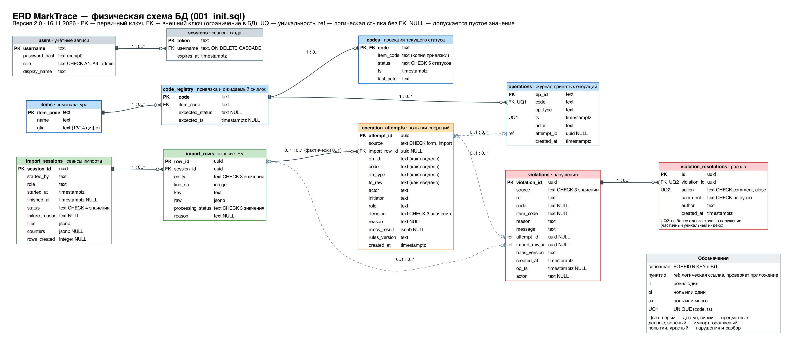

# 12. ERD: модель данных MarkTrace

**MarkTrace · версия 2.0 · 16.11.2026**

Версия 2.0 описывает схему, которая реально работает в MVP: `backend/internal/store/migrations/001_init.sql` (PostgreSQL 16). Миграции вшиты в backend и применяются при старте. Версия 1.0 от 19.10.2026 была логической моделью до реализации. Её решения сохранены там, где они вошли в код. Упрощения перечислены в разделе 9. Если документ расходится с миграцией, верна миграция.

[Векторная схема SVG](diagrams/erd.svg) · [Исходник Graphviz](diagrams/erd.dot)

Источник диаграммы — `diagrams/erd.dot`: из него собираются PNG и SVG. Файл `diagrams/erd.drawio` остался от версии 1.0 и показывает прежнюю логическую модель с `operation_requests` и `verification_checks`. Он не обновлялся, и опираться на него нельзя.

Нотация — crow's foot. Сплошная линия обозначает `FOREIGN KEY`, который проверяет БД. Пунктир обозначает логическую ссылку `ref`: её держит приложение, ограничения в БД нет. `||` — ровно один, `o|` — ноль или один, `o<` — ноль или много. Полный состав полей — в [словаре данных](13-data-dictionary.md), нормализация — в [24-normalization.md](24-normalization.md).

## 1. Состав схемы

| Таблица | Группа | Что хранит | Строк после импорта T1 |
|---|---|---|---|
| `users` | доступ | Учётные записи; при старте создаются 5 демо-пользователей | 5 |
| `sessions` | доступ | Сеансы входа: cookie `mt_session`, срок 12 ч | по числу входов |
| `items` | предметные данные | Номенклатура: товар и GTIN | 96 |
| `code_registry` | предметные данные | Привязка «код → товар» и ожидаемый итоговый снимок из `codes.csv` | 512 |
| `codes` | предметные данные | Проекция: текущий статус кода по последней принятой операции | 512 |
| `operations` | предметные данные | Журнал только принятых операций | 862 |
| `import_sessions` | импорт | Сеанс загрузки CSV: статус, файлы, счётчики, `rows_created` | 1 |
| `import_rows` | импорт | Каждая строка каждого загруженного файла и её итог | 1487 |
| `operation_attempts` | попытки | Каждая попытка операции: строка `operations.csv` или отправка формы | 870 |
| `violations` | нарушения | Нарушения правил с машинной причиной и текстом на русском | 18 |
| `violation_resolutions` | нарушения | Комментарии и закрытие нарушений контролёром | 0 |

Служебную таблицу `schema_migrations(name text PK, applied_at timestamptz)` создаёт мигратор (`store.Migrate`). Предметных данных в ней нет, поэтому на ERD её нет.

Числа в последнем столбце — состояние после `make verify`: чистая БД и один импорт трёх файлов T1. Повторный импорт добавляет 1 сеанс, ещё 1487 строк `import_rows` и 870 строк `operation_attempts`; в предметных таблицах и в `violations` новых строк нет (K3 = 0).

## 2. Связи и кардинальности

| ID | Связь | Как обеспечена | Кардинальность | Смысл |
|---|---|---|---|---|
| R1 | `sessions.username → users.username` | FK, `ON DELETE CASCADE` | 1 : 0..* | У пользователя может быть несколько сеансов; удаление пользователя удаляет его сеансы |
| R2 | `code_registry.item_code → items.item_code` | FK | 1 : 0..* | Код привязан ровно к одному товару; у товара может не быть кодов |
| R3 | `codes.code → code_registry.code` | FK, он же PK | 1 : 0..1 | Строка проекции появляется только после первой принятой операции `issue` |
| R4 | `operations.code → code_registry.code` | FK | 1 : 0..* | Операцию можно принять только по коду из реестра |
| R5 | `import_rows.session_id → import_sessions.session_id` | FK | 1 : 0..* | Если заголовок отвергнут, у сеанса нет строк |
| R6 | `operation_attempts.import_row_id → import_rows.row_id` | FK, NULL допускается | 0..1 : 0..* по схеме, 0..1 на деле | Попытка из CSV ссылается на свою строку; у попытки формы ссылки нет. UNIQUE на поле нет, но импорт создаёт одну попытку на строку `operations.csv` |
| R7 | `violation_resolutions.violation_id → violations.violation_id` | FK; частичный UNIQUE на `close` | 1 : 0..* | Комментариев сколько угодно, закрытие не больше одного |
| R8 | `operations.attempt_id → operation_attempts.attempt_id` | ref, без FK | 0..1 : 0..1 | Принятая операция ссылается на попытку, которая её создала |
| R9 | `violations.attempt_id → operation_attempts.attempt_id` | ref, без FK | 0..1 : 0..1 | Отклонённая попытка даёт ровно одно нарушение |
| R10 | `violations.import_row_id → import_rows.row_id` | ref, без FK | 0..1 : 0..1 | Отклонённая строка CSV даёт ровно одно нарушение |

Ещё несколько логических ссылок не нарисованы, чтобы схема читалась:

- `codes.item_code` — копия `code_registry.item_code`, см. раздел 4;
- `import_sessions.started_by`, `operation_attempts.initiator` и `violation_resolutions.author` содержат `users.username`;
- `violations.code` и `violations.item_code` — значения из входных данных. Ссылок на справочники у них нет намеренно: нарушение по неизвестному коду или товару тоже надо записать.

Источник нарушения зависит от пути (R9/R10):

| Путь | `attempt_id` | `import_row_id` |
|---|---|---|
| Строка `items.csv` или `codes.csv` | NULL | есть |
| Строка `operations.csv` | есть | есть |
| Форма операции | есть | NULL |
| Сверка снимка `SNAPSHOT_MISMATCH` | NULL | NULL |

Для расхождения снимка исходной строки нет: оно сравнивает итоговое состояние после импорта. В версии 1.0 требовалось «ровно одна ссылка, XOR»; в реализации от этого правила отказались (раздел 9).

Связей M:N в модели нет. Многие-ко-многим «товар — операция» раскладывается через `code_registry`, а «сеанс — операция» — через `import_rows` и `operation_attempts`.

## 3. Ключи и ограничения

| Таблица | PK | UNIQUE | CHECK | Индексы |
|---|---|---|---|---|
| `users` | `username` | — | `role ∈ {A1, A2, A3, A4, admin}` | — |
| `sessions` | `token` | — | — | — |
| `items` | `item_code` | — | — | — |
| `code_registry` | `code` | — | — | — |
| `codes` | `code` | — | `status ∈ {issued, introduced, sold, returned, disposed}` | `codes_item_idx(item_code)`, `codes_status_idx(status)` |
| `operations` | `op_id` | `(code, ts)` | — | уникальный индекс `(code, ts)` |
| `import_sessions` | `session_id` | — | `status ∈ {running, completed, structure_rejected, failed}` | — |
| `import_rows` | `row_id` | — | `entity ∈ {items, codes, operations}`; `processing_status ∈ {accepted, duplicate, rejected}` | `import_rows_session_idx(session_id)`, `import_rows_key_idx(entity, key)` |
| `operation_attempts` | `attempt_id` | — | `source ∈ {form, import}`; `decision ∈ {accepted, rejected, duplicate}` | `operation_attempts_op_idx(op_id)`, `operation_attempts_code_idx(code)` |
| `violations` | `violation_id` | — | `source ∈ {items, codes, operations}` | `violations_code_idx(code)`, `violations_reason_idx(reason)`, `violations_created_idx(created_at)` |
| `violation_resolutions` | `id` | `(violation_id) WHERE action = 'close'` | `action ∈ {comment, close}`; `comment <> ''` | `violation_resolutions_vid_idx(violation_id)` |

Значения UUID генерирует приложение (`google/uuid`, v4), а не БД. Длина строк в БД не ограничена: формат полей проверяют правила `rules_version = 2026.11-1` (раздел 6 словаря).

Часть ограничений проверяется только в коде. Значения `operations.op_type` и `code_registry.expected_status` проходят проверку в `backend/internal/rules` до записи, но CHECK в БД на них нет. Межстрочные правила — допустимый переход, порядок времени, идемпотентность, согласованность `codes` с `operations` — держит транзакционный обработчик (раздел 5). Записывает в БД только backend.

`items.gtin` не уникален: исходный кейс не запрещает две карточки с одним GTIN. Длина и контрольная цифра GTIN проверяются отдельно от уникальности.

## 4. Журнал, проекция и ожидаемый снимок

**`operations` — источник истины о принятой истории.** `codes` хранит проекцию для отчёта «Коды» и K4. Инвариант такой: для каждого кода `codes.status` равен результату последней по `ts` принятой операции, `codes.ts` — её бизнес-времени, `codes.last_actor` — её исполнителю. K2 проверяет этот инвариант пересчётом по `operations` (`GET /api/kpi`). После T1 он выполняется на 100%.

`codes.item_code` дублирует `code_registry.item_code`. Значение копируется при первой принятой операции и потом не меняется, потому что привязку кода нельзя изменить. Копия нужна, чтобы фильтр отчёта по товару работал без соединения таблиц (индекс `codes_item_idx`).

Отклонённые попытки, дубли и действия разбора проекцию не меняют. В выгрузке `code,item_code,status,last_ts` поле `last_ts` — это внешнее имя `codes.ts`; отдельного столбца нет.

`code_registry` отделяет привязку кода от его истории. Строка `codes.csv` описывает две вещи: к какому товару привязан код и какой итоговый снимок `(expected_status, expected_ts)` ожидается после применения операций. Принятая строка попадает в `code_registry`, но не в `codes`. Статус коду даёт только принятый `issue`. После обработки операций сверка снимка сравнивает ожидание с проекцией. При расхождении записывается `SNAPSHOT_MISMATCH`, а журнал не переписывается.

Привязку, созданную формой (`issue` с `item_code`), записывают с `expected_status = expected_ts = NULL`, и сверка снимка её пропускает.

Уникальная пара `(code, ts)` в `operations` исключает два принятых события одного кода в одну секунду. Поэтому пересчёт проекции всегда однозначен.

## 5. Транзакции и конкурентный доступ

| Сценарий | Что пишется в одной транзакции |
|---|---|
| Строка `items.csv` | `import_rows`; при приёме — `items`; при отказе — `violations` |
| Строка `codes.csv` | `import_rows`; при приёме — `code_registry`; при отказе — `violations` |
| Строка `operations.csv` | `import_rows`, `operation_attempts`; при приёме — `operations` и upsert `codes`; при отказе — `violations` |
| Форма, приём | `operation_attempts`, `operations`, upsert `codes`; для `issue` — новая строка `code_registry` |
| Форма, отказ | `operation_attempts` и `violations`; предметные таблицы не меняются |
| Дубль | только `operation_attempts` (и `import_rows` для CSV); нарушения нет |
| Сверка снимка | отдельные вставки `violations` после всех строк сеанса, без дублей по `(reason, code, message)` |
| Разбор | `violation_resolutions`; второй `close` → 409 (проверка в коде и частичный уникальный индекс) |

Конкурентный доступ:

- строку импорта сериализует advisory lock по ключу `row:<entity>:<key>`;
- операцию сериализуют advisory locks `op:<op_id>` и `code:<code>`, а также `SELECT … FROM codes WHERE code = … FOR UPDATE`;
- форма вызывает мок без блокировок. Затем в транзакции записи берёт блокировки и проверяет правила заново, потому что за время вызова состояние кода могло измениться. Долгий HTTP-вызов не держит блокировку кода.

Сеанс импорта создаётся до обработки строк в статусе `running` и закрывается вызовом `finish`, даже если HTTP-запрос был отменён. Техническая ошибка останавливает сеанс со статусом `failed`. Строки, принятые до ошибки, не откатываются.

## 6. История, изменения и удаление

- Принятые операции, строки импорта, попытки, нарушения и действия разбора не изменяются и не удаляются. API для удаления нет. Каскад есть только у `sessions`.
- Справочник товаров повторным импортом не обновляется. Тот же `item_code` с теми же `name, gtin` — дубль; с другими — `IDEMPOTENCY_CONFLICT`.
- Принятую операцию нельзя исправить повтором: тот же `op_id` с другим содержимым даёт `IDEMPOTENCY_CONFLICT`. Отклонённую попытку исправляют новой попыткой.
- Признака «закрыто» в `violations` нет. Состояние выводится из `violation_resolutions`: при наличии `close` нарушение закрыто, иначе открыто. Повторно открыть закрытое нарушение в MVP нельзя.

## 7. Доступ к записи

| Таблица | Кто пишет (роль из сеанса) | Через что |
|---|---|---|
| `users` | backend при старте | `store.SeedUsers` |
| `sessions` | любой пользователь при входе | `POST /api/auth/login` |
| `items`, `code_registry`, `codes`, `operations`, `import_*`, `operation_attempts`, `violations` | A1, A3, admin — импорт; A1 и A2 — форма, каждый своими типами операций; admin — все | `POST /api/imports`, `POST /api/operations` |
| `violation_resolutions` | A3, admin | `POST /api/violations/{id}/resolutions` |

A4 ничего не пишет и получает 403 `AUTH_DENIED` на любой запрос записи. `operations.actor` — исполнитель из входных данных, а не учётная запись. Права определяет только роль сеанса; она записывается в `operation_attempts.role` и `import_sessions.role`.

## 8. Отчёты и индексы

| Потребитель | Таблицы | Индексы |
|---|---|---|
| «Коды», экспорт CSV, свод статусов, K4 | `codes` | `codes_status_idx`, `codes_item_idx` |
| Карточка кода | `code_registry`, `items`, `operations`, `operation_attempts`, `violations` | PK, `(code, ts)`, `operation_attempts_code_idx`, `violations_code_idx` |
| «Расхождения», экспорт | `violations`, `violation_resolutions` | `violations_reason_idx`, `violations_created_idx`, `violation_resolutions_vid_idx` |
| Протокол импорта | `import_sessions`, `import_rows`, `violations` | `import_rows_session_idx` |
| Идемпотентность импорта | `import_rows`, `operation_attempts` | `import_rows_key_idx`, `operation_attempts_op_idx` |
| KPI K1–K3 | `operation_attempts`, `operations`, `codes`, `import_sessions` | полный просмотр (на T1 — сотни строк) |

## 9. Отличия логической модели от реализации

| Версия 1.0 (логическая модель) | Реализация 2.0 | Причина |
|---|---|---|
| `operation_requests` с `source_kind ∈ {manual_operation, csv_operation, code_check}` | `operation_attempts` с `source ∈ {form, import}` | Ручная проверка кода (`POST /api/verify`) ничего не сохраняет, поэтому `code_check` не нужен |
| `verification_checks`: по строке на вызов мока, `attempt_no`, `http_status` | Поле `operation_attempts.mock_result jsonb` | Мок вызывается синхронно, не больше одного раза на попытку; ответ хранится как есть |
| Решения `received`, `pending`, `failed` | Только `accepted`, `rejected`, `duplicate` | Отложенной перепроверки нет: недоступный мок сразу даёт `MOCK_UNAVAILABLE`, попытку можно повторить с тем же `op_id` |
| `operation_requests.operation_id → operations.op_id` | `operations.attempt_id` (ref); дубль связан с операцией через равенство `op_id` | Дубли не порождают ссылок; у операции одна попытка-создатель |
| Поля `*_raw` у попытки | Сырые `op_id`, `code`, `op_type`, `ts_raw`, `actor`; `item_code` и `gtin` не хранятся | Для `issue` из формы привязка сразу попадает в `code_registry` |
| `codes(code, item_code, status, ts)` с FK на `items` | `code_registry` (привязка и снимок) + `codes` (проекция с `last_actor`) | Код из `codes.csv` надо помнить до `issue`, а снимок — сверять после операций |
| `operations.code → codes.code` | `operations.code → code_registry.code` | `issue` вставляется раньше строки проекции |
| `import_sessions.status`: `staging` | Без `staging`: `running`, `completed`, `structure_rejected`, `failed` | Заголовки всех файлов проверяются до первой строки, промежуточной загрузки нет |
| Счётчики сеанса не хранятся | `import_sessions.counters jsonb`, `rows_created`, `files jsonb` | Намеренная денормализация для K3 и протокола ([24](24-normalization.md)) |
| `import_rows(entity_type, record_no, raw_record text, processed_at)`, AK `(session_id, entity_type, record_no)`, статус `staged` | `entity`, `line_no` (физическая строка файла, заголовок — 1), `key`, `raw jsonb`, `reason`; AK не создан, `staged` нет | Строка пишется и решается в одной транзакции; номер строки совпадает с тем, что видно в редакторе |
| `violations(rule_code, reason, detected_at)`, XOR `request_id`/`import_row_id` | `reason` (код), `message` (текст), `created_at`, плюс `source`, `ref`, `code`, `item_code`, `op_ts`, `actor`, `rules_version`; XOR нет | Формат golden `code,reason,source,ref` и фильтры отчёта; у снимка нет источника-строки |
| `violation_resolutions(resolution_id, author_role)` | `id`, `author` (имя пользователя) | Роль автора следует из учётной записи; имя нужно для аудита |
| Роли `A1–A4` | `A1–A4` и `admin` | Учётная запись для демонстрации и сверки, допускается ко всем действиям |
| Коды `ITEM_MISMATCH`, `DEPENDENCY_REJECTED`, `TECHNICAL_FAILURE` | Нет | Привязку проверяют `DUPLICATE_CODE`/`GTIN_MISMATCH`; техническая ошибка останавливает сеанс (`failed`, `failure_reason`) |
| `String(n)`, предельные длины | `text` без длины; длины задают маска кода (24 символа) и GTIN (13/14) | Ограничение длины на уровне БД не даёт пользы при проверке форматом |
| Маска кода не определена | `^01(\d{14})21([A-Za-z0-9]{6})$`, `rules_version = 2026.11-1` | Зафиксирована в SPEC §1.2 |
| Нет таблиц доступа | `users`, `sessions` | Вход по cookie и проверка ролей на сервере |

## 10. Связанные документы

- [13. Словарь данных](13-data-dictionary.md) — все поля, типы, перечисления и коды причин.
- [24. Нормализация и описание БД](24-normalization.md) — 3НФ и намеренная денормализация.
- [25. DFD](25-dfd.md) — хранилища D1–D11 соответствуют таблицам из раздела 1.
- [26. Маппинг данных](26-data-mapping.md) — откуда приходит каждое поле и куда уходит.
- [11. BPMN](11-bpmn-process.md) — процессы, которые пишут в эти таблицы.
- `SPEC.md` §4 — контракт реализации; `README.md` — допущения MVP.
