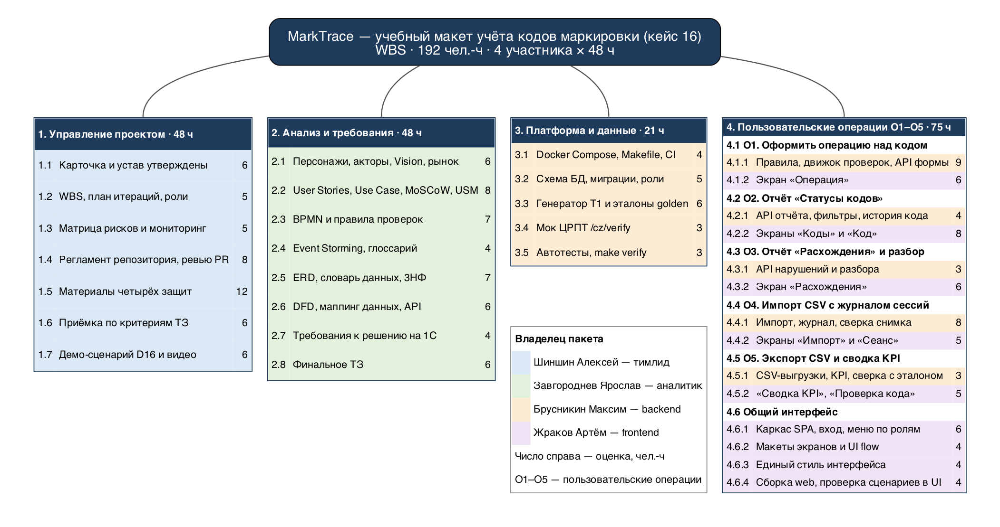

# 15. Иерархическая структура работ (WBS)

**MarkTrace · версия 1.0 · 16.11.2026**

Документ к практике 2 «Составление WBS» и первой защите. Связанные артефакты: [карточка проекта](01-project-card.md), [MoSCoW](03-moscow.md), [матрица рисков](16-risk-matrix.md), [план разработки MVP](23-mvp-plan.md). Диаграмма: [`diagrams/wbs.png`](diagrams/wbs.png) (исходник `diagrams/wbs.dot`, векторная версия `diagrams/wbs.svg`).

## 1. Принципы декомпозиции

| Принцип | Как соблюдён |
|---|---|
| Иерархия | Уровень 0 — проект, уровень 1 — четыре ветви, уровни 2–3 — пакеты работ. Пакет выполняет один владелец за 3–12 чел.-ч |
| Правило 100% | Каждая работа проекта входит ровно в один пакет; сумма пакетов равна ресурсу проекта, 192 чел.-ч |
| Ориентация на результат | Пакет назван по результату: экран, API, документ, набор данных. Для каждого указан проверяемый артефакт в репозитории |
| Не более пяти пользовательских операций | Функциональная ветвь 4 разбита ровно на пять операций О1–О5 (раздел 2). Остальные экраны — чтение и детализация внутри этих операций |
| Привязка к KPI | Для пакетов критического пути указан KPI из карточки, который без них не достигается (раздел 5) |

Ресурс: 4 участника × 6 ч в неделю × 8 недель = 192 чел.-ч, по 48 ч на человека. Резерва в WBS нет: буфером служат требования Could из MoSCoW, которые переносятся первыми (риск R04 в [матрице рисков](16-risk-matrix.md)).

## 2. Пользовательские операции MVP

Ограничение кейса — не более пяти пользовательских операций. Операция здесь — действие пользователя, которое создаёт данные или выдаёт результат наружу. Экраны только для чтения («Код», «Сводка KPI», «Проверка кода») относятся к операциям, результат которых они показывают.

| № | Операция | Роли | Экраны MVP | MoSCoW | API (SPEC §6) |
|---|---|---|---|---|---|
| О1 | Оформить операцию над кодом: issue / introduce / sell / return / dispose | A1, A2, admin | «Операция» | M1–M4, M10 | `POST /api/operations` |
| О2 | Получить отчёт «Статусы кодов» с фильтрами и историей кода | все | «Коды», «Код» | M5, S1, S2 | `GET /api/codes`, `GET /api/codes/{code}` |
| О3 | Разобрать расхождения: отчёт, комментарий, закрытие | все; запись — A3, admin | «Расхождения» | M6, C5 | `GET /api/violations`, `POST /api/violations/{id}/resolutions` |
| О4 | Импортировать CSV items / codes / operations с журналом сессий | A1, A3, admin | «Импорт», «Сеанс импорта» | M7, M8 | `POST /api/imports`, `GET /api/imports/{id}` |
| О5 | Выгрузить CSV и сверить KPI с эталоном | все | кнопки «Экспорт CSV», «Сводка KPI», «Проверка кода» | M5, M6, M9, S3 | `GET /api/codes/export.csv`, `GET /api/violations/export.csv`, `GET /api/kpi`, `GET /api/golden/compare`, `POST /api/verify` |

Отклонение от карточки: в карточке экспорт CSV и сводка KPI перечислены вместе с отчётами. В WBS они вынесены в отдельную операцию О5, потому что выгрузка и сверка с эталоном — самостоятельное действие контролёра с результатом вне системы (файл, процент совпадения).

## 3. Таблица WBS

Статус — по состоянию реализации на 16.11.2026: **DONE** — результат есть в репозитории; **В работе** — результат частично готов; **OPEN** — работа не начата. Недели — по календарю [карточки проекта](01-project-card.md).

### 1. Управление проектом — 48 ч, Шиншин Алексей

| ID | Пакет работ (результат) | Владелец | Оценка, ч | Неделя | Артефакт | Статус |
|---|---|---|---|---|---|---|
| 1.1 | Карточка проекта и устав утверждены | Шиншин А. | 6 | 1 | `docs/01`, `docs/02` | DONE |
| 1.2 | WBS, план итераций и распределение ролей зафиксированы | Шиншин А. | 5 | 1–2 | `docs/15`, `docs/23` | DONE |
| 1.3 | Матрица рисков составлена, риски пересматриваются еженедельно | Шиншин А. | 5 | 1, далее еженедельно | `docs/16` | DONE |
| 1.4 | Регламент репозитория принят, PR проходят ревью | Шиншин А. | 8 | 2, далее постоянно | `docs/17` | В работе |
| 1.5 | Материалы четырёх защит подготовлены | Шиншин А. | 12 | 3, 5, 7, 8 | `docs/14`, презентации | В работе: защита 1 готова |
| 1.6 | Приёмка MVP по критериям ТЗ проведена | Шиншин А. | 6 | 8 | протокол приёмки | OPEN |
| 1.7 | Демо-сценарий D16 и видео 3–5 мин записаны | Шиншин А. | 6 | 8 | README «Демонстрация D16», `scripts/demo.sh`, видео | В работе: сценарий готов, видео нет |

### 2. Анализ и требования — 48 ч, Завгороднев Ярослав

| ID | Пакет работ (результат) | Владелец | Оценка, ч | Неделя | Артефакт | Статус |
|---|---|---|---|---|---|---|
| 2.1 | Персонажи, реестр акторов, Vision, расчёт рынка и конкуренты описаны | Завгороднев Я. | 6 | 1–2 | `docs/04`–`docs/08` | DONE |
| 2.2 | User Stories, Use Case, MoSCoW и карта историй утверждены | Завгороднев Я. | 8 | 2 | `docs/03`, `docs/09`, User Stories и USM | В работе: MoSCoW и Use Case готовы |
| 2.3 | BPMN операции и импорта, правила проверок описаны | Завгороднев Я. | 7 | 3–4 | `docs/11`, BPMN-файлы | DONE |
| 2.4 | Event Storming, глоссарий и перечень сущностей оформлены | Завгороднев Я. | 4 | 4 | диаграмма событий, глоссарий | В работе |
| 2.5 | ERD, словарь данных, модель в 3НФ описаны | Завгороднев Я. | 7 | 4 | `docs/12`, `docs/13` | DONE с отклонением: реализована упрощённая модель SPEC §4 |
| 2.6 | DFD, таблица маппинга данных, спецификация API описаны | Завгороднев Я. | 6 | 6–7 | DFD, маппинг, `SPEC.md` §6 | В работе: API описан в SPEC |
| 2.7 | Требования к решению на платформе 1С сформулированы | Завгороднев Я. | 4 | 7 | раздел ТЗ, модель объектов 1С | В работе |
| 2.8 | Финальное ТЗ с критериями приёмки собрано | Завгороднев Я. | 6 | 8 | ТЗ | OPEN |

### 3. Платформа и данные — 21 ч, Брусникин Максим

| ID | Пакет работ (результат) | Владелец | Оценка, ч | Неделя | Артефакт | Статус |
|---|---|---|---|---|---|---|
| 3.1 | Стек поднимается одной командой, CI описан | Брусникин М. | 4 | 2 | `docker-compose.yml`, `Makefile`, `.gitverse/workflows/ci.yaml` | В работе: CI не запускался на GitVerse |
| 3.2 | Схема БД, миграции, пользователи и сессии созданы | Брусникин М. | 5 | 4 | `backend/internal/store/migrations/001_init.sql`, `internal/auth` | DONE |
| 3.3 | Набор T1, реестр мока, демо-коды и эталоны golden генерируются детерминированно | Брусникин М. | 6 | 3–4 | `tools/gen`, `data/C16`, `golden/` | DONE |
| 3.4 | Мок ЦРПТ `POST /cz/verify` с режимами сбоев работает | Брусникин М. | 3 | 5 | `mock/` | DONE |
| 3.5 | Автотесты и сквозная сверка `make verify` проходят | Брусникин М. | 3 | 7 | `*_test.go`, `scripts/verify.sh` | DONE |

### 4. Пользовательские операции О1–О5 — 75 ч

| ID | Пакет работ (результат) | Владелец | Оценка, ч | Неделя | Артефакт | Статус |
|---|---|---|---|---|---|---|
| 4.1 | **О1. Оформить операцию над кодом** | | 15 | | | |
| 4.1.1 | Правила, движок проверок и API формы, вызов мока | Брусникин М. | 9 | 4–5 | `internal/rules`, `internal/ops` | DONE |
| 4.1.2 | Экран «Операция»: выбор типа, код, товар, время, решение и причина | Жраков А. | 6 | 5 | `web/src/pages/OperationPage.tsx` | DONE |
| 4.2 | **О2. Отчёт «Статусы кодов»** | | 12 | | | |
| 4.2.1 | API отчёта с фильтрами и счётчиками, история кода | Брусникин М. | 4 | 5 | `internal/reports/codes.go` | DONE |
| 4.2.2 | Экраны «Коды» и «Код» | Жраков А. | 8 | 5–6 | `CodesPage.tsx`, `CodePage.tsx` | DONE |
| 4.3 | **О3. Отчёт «Расхождения» и разбор** | | 9 | | | |
| 4.3.1 | API нарушений, счётчики по причинам, комментарий и закрытие | Брусникин М. | 3 | 6 | `internal/reports/violations.go` | DONE |
| 4.3.2 | Экран «Расхождения» | Жраков А. | 6 | 6 | `ViolationsPage.tsx`, `ViolationsTable.tsx` | DONE |
| 4.4 | **О4. Импорт CSV с журналом сессий** | | 13 | | | |
| 4.4.1 | Импорт трёх файлов, журнал сессий, сверка снимка, идемпотентность | Брусникин М. | 8 | 5–6 | `internal/importer` | DONE |
| 4.4.2 | Экраны «Импорт» и «Сеанс импорта» | Жраков А. | 5 | 6 | `ImportPage.tsx`, `ImportDetailPage.tsx` | DONE |
| 4.5 | **О5. Экспорт CSV и сводка KPI** | | 8 | | | |
| 4.5.1 | CSV-выгрузки, расчёт K1–K5, сверка с golden | Брусникин М. | 3 | 6 | `internal/reports/kpi.go` | DONE |
| 4.5.2 | Экраны «Сводка KPI», «Проверка кода», кнопки экспорта | Жраков А. | 5 | 6 | `KpiPage.tsx`, `VerifyPage.tsx` | DONE |
| 4.6 | **Общий интерфейс** | | 18 | | | |
| 4.6.1 | Каркас SPA: вход, меню по ролям, nginx-прокси `/api` | Жраков А. | 6 | 5 | `App.tsx`, `auth.tsx`, `web/nginx.conf` | DONE |
| 4.6.2 | Макеты экранов и схема переходов (UI flow) | Жраков А. | 4 | 3–4 | UI flow для защиты 2 | В работе: экраны сделаны сразу в коде |
| 4.6.3 | Единый стиль интерфейса | Жраков А. | 4 | 7 | `web/src/styles.css` | В работе |
| 4.6.4 | Сборка web проходит, сценарии D16 проверены в UI | Жраков А. | 4 | 7–8 | `npm run build`, прогон D16 | В работе |

## 4. Загрузка участников

| Участник | Роль | Пакеты | Итого, ч |
|---|---|---|---|
| Шиншин Алексей | Тимлид | 1.1–1.7 | 48 |
| Завгороднев Ярослав | Аналитик | 2.1–2.8 | 48 |
| Брусникин Максим | Backend | 3.1–3.5, 4.1.1, 4.2.1, 4.3.1, 4.4.1, 4.5.1 | 21 + 27 = 48 |
| Жраков Артём | Frontend | 4.1.2, 4.2.2, 4.3.2, 4.4.2, 4.5.2, 4.6.1–4.6.4 | 48 |
| **Всего** | | 34 пакета | **192** |

## 5. Критический путь

Критический путь — цепочка пакетов, без которых не считаются KPI K1–K5 и не проходит демонстрация. Пакеты интерфейса идут параллельно серверной части и имеют запас по времени, пока API стабилен; поэтому они на путь не попадают.

| Шаг | Пакет | Неделя | Почему на критическом пути | KPI / бизнес-цель |
|---|---|---|---|---|
| 1 | 2.2 MoSCoW и критерии приёмки заморожены | 2 | Без замороженного объёма нельзя оценить и начать разработку | Границы MVP, ≤ 5 операций |
| 2 | 2.3 Правила проверок и BPMN | 3–4 | Правила переходов и форматов — вход для движка проверок и генератора данных | K1, K2 |
| 3 | 3.2 Схема БД и миграции | 4 | Все пакеты backend пишут и читают эти таблицы | K2, K3 |
| 4 | 4.1.1 Движок проверок и API формы | 4–5 | Единый пакет правил используют и форма, и импорт; без него нет решений «принято / отклонено» | K1, K2 |
| 5 | 4.4.1 Импорт CSV и сверка снимка | 5–6 | Набор T1 попадает в систему только через импорт; идемпотентность проверяется здесь | K3, K1 на T1 |
| 6 | 4.5.1 KPI и сверка с golden | 6 | Значения KPI и процент совпадения с эталоном считает только этот пакет | K1–K5 |
| 7 | 3.5 Автотесты и `make verify` | 7 | Доказательство KPI на чистой БД перед демонстрацией | K3 = 0, K5 = 100% |
| 8 | 1.7 Демо-сценарий D16 | 8 | Приёмка и защита проходят по сценарию D16 | Критерии приёмки кейса 1–4 |

Пакет 3.3 (генератор T1 и golden) идёт параллельно шагам 3–5 и сливается с путём на шаге 6. Запас у него около недели: если эталоны не готовы к неделе 6, K5 не считается и путь сдвигается.

Почти критические пакеты: 4.6.1 и 4.1.2. Четвёртая защита требует демонстрацию UI-прототипа, поэтому задержка каркаса SPA или формы операции больше чем на неделю сдвигает шаг 8.

## 6. Что не вошло в WBS

| Работа | Причина |
|---|---|
| Реализация форм, регистров и отчётов на платформе 1С | MVP построен на Go, PostgreSQL и React. В WBS есть только пакет 2.7 (требования и модель объектов 1С); реализация на платформе — реализовавшийся риск R02, см. [матрицу рисков](16-risk-matrix.md) |
| Набор T2, экспорт отчёта в JSON, диаграмма состояний в UI (C1–C3) | Could. Буфер плана, перенесены после v1.0 |
| Интеграция с ЦРПТ, УКЭП, агрегация, DataMatrix, ЭДО (W1–W5) | Won't по условиям кейса |
