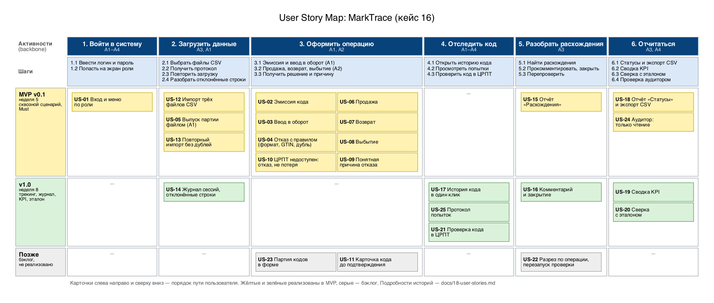

# 19. User Story Map

**MarkTrace · версия 1.0 · 16.11.2026**

Практические работы 3.3–3.4 (ПР-7, ПР-8). Истории — из [18-user-stories.md](18-user-stories.md), приоритеты — [03-moscow.md](03-moscow.md), вехи релизов — [02-project-charter.md](02-project-charter.md) §5. Исходник диаграммы: [`diagrams/user-story-map.dot`](diagrams/user-story-map.dot).

## Логика декомпозиции

| Ось | Что на ней | Как выбрано |
|---|---|---|
| X (горизонталь) | 6 активностей — путь пользователя от входа до отчёта | Порядок сквозного сценария кейса: данные загружены → операции оформлены → код отслежен → расхождения разобраны → отчёт сдан |
| Шаги | 2–4 шага на активность | По основным сценариям UC1–UC7 ([09-use-cases.md](09-use-cases.md)) |
| Y (вертикаль) | Истории под шагом, сверху — обязательные | Must выше Should и Could |
| Срезы релизов | MVP v0.1, v1.0, Позже | v0.1 — сквозной сценарий из Must; v1.0 — трекинг, журнал, KPI, сверка с эталоном; Позже — улучшения вне MVP |

Активности сгруппированы по целям ролей, а не по экранам: одна активность может идти через несколько экранов (например, «Разобрать расхождения» — экраны «Расхождения», «Код», «Проверка кода»).

## Цели и шаги пользователей

| Роль | Цель | Активность | Шаги |
|---|---|---|---|
| A1–A4 | Работать только в своих разделах | 1. Войти в систему | 1.1 Ввести логин и пароль. 1.2 Попасть на экран своей роли |
| A3, A1 | Загрузить данные без дублей и увидеть отказы | 2. Загрузить данные | 2.1 Выбрать файлы CSV. 2.2 Получить протокол. 2.3 Повторить загрузку. 2.4 Разобрать отклонённые строки |
| A1, A2 | Оформить операцию за 2–3 действия или понять причину отказа | 3. Оформить операцию | 3.1 Эмиссия и ввод в оборот (A1). 3.2 Продажа, возврат, выбытие (A2). 3.3 Получить решение и причину |
| A1–A4 | Восстановить, что происходило с кодом | 4. Отследить код | 4.1 Открыть историю кода. 4.2 Просмотреть попытки. 4.3 Проверить код в ЦРПТ |
| A3 | Объяснить и закрыть каждое расхождение | 5. Разобрать расхождения | 5.1 Найти расхождения. 5.2 Прокомментировать, закрыть. 5.3 Перепроверить |
| A3, A4 | Сдать отчёт о статусах и качестве учёта | 6. Отчитаться | 6.1 Статусы и экспорт CSV. 6.2 Сводка KPI. 6.3 Сверка с эталоном. 6.4 Проверка аудитором |

## Карта в табличном виде

| Активность | MVP v0.1 | v1.0 | Позже |
|---|---|---|---|
| 1. Войти в систему | US-01 | — | — |
| 2. Загрузить данные | US-12, US-05, US-13 | US-14 | — |
| 3. Оформить операцию | US-02, US-03, US-06, US-07, US-08, US-04, US-09, US-10 | — | US-23, US-11 |
| 4. Отследить код | — | US-17, US-25, US-21 | — |
| 5. Разобрать расхождения | US-15 | US-16 | US-22 |
| 6. Отчитаться | US-18, US-24 | US-19, US-20 | — |

## Описание шагов

**1. Войти в систему.** Пользователь входит по логину и паролю; меню строится по роли: A1 и A2 попадают на «Операцию», A3 и A4 — на «Коды». v0.1: US-01.

**2. Загрузить данные.**
- 2.1–2.2. Контролёр (или оператор производства для партии) выбирает от одного до трёх файлов (`items.csv`, `codes.csv`, `operations.csv`) и получает счётчики «принято / повтор / отклонено» по каждому файлу. v0.1: US-12, US-05.
- 2.3. Повторная загрузка тех же файлов даёт 0 новых строк. v0.1: US-13.
- 2.4. Журнал сессий и отклонённые строки с причиной и исходными данными. v1.0: US-14.

**3. Оформить операцию.**
- 3.1–3.2. Одна форма на все пять типов операций, список типов зависит от роли. v0.1: US-02, US-03, US-06, US-07, US-08.
- 3.3. Решение «Принято / Отклонено / Повтор», код причины и сообщение; при сбое мока — отказ `MOCK_UNAVAILABLE`, а не потеря операции. v0.1: US-04, US-09, US-10.
- Позже: пакет кодов в форме (US-23), карточка кода до подтверждения (US-11).

**4. Отследить код.** Экран «Код»: текущее состояние, привязка к товару, хронология операций, все попытки, расхождения; ручная проверка кода в имитации ЦРПТ. v1.0: US-17, US-25, US-21.

**5. Разобрать расхождения.**
- 5.1. Отчёт со счётчиками по причинам и фильтрами, экспорт в формате эталона. v0.1: US-15.
- 5.2. Комментарий и закрытие с автором и временем. v1.0: US-16.
- 5.3. Перепроверка — повторный импорт или ручная проверка кода (US-21). Позже: разрез по операции и кнопка перезапуска проверки (US-22).

**6. Отчитаться.**
- 6.1. Отчёт «Статусы кодов» со счётчиками, фильтрами и экспортом CSV. v0.1: US-18.
- 6.2–6.3. Сводка K1–K5 и построчная сверка с `golden/`. v1.0: US-19, US-20.
- 6.4. Аудитор видит всё то же только на чтение. v0.1: US-24.

## Срезы релизов

| Срез | Срок по уставу | Историй | SP | Что даёт пользователю | Состояние на 16.11.2026 |
|---|---|---|---|---|---|
| MVP v0.1 | неделя 5 | 15 | 49 | Сквозной сценарий: загрузка T1, операции, отказы с причиной, отчёты «Статусы» и «Расхождения», разграничение прав | Реализован |
| v1.0 | неделя 8 | 7 | 22 | Журнал импорта, история и протокол кода, резолюции, KPI, сверка с эталоном, проверка в ЦРПТ | Реализован |
| Позже | после v1.0 | 3 | 19 | Пакет кодов в форме, карточка кода до подтверждения, разрез по операции и перезапуск проверки | Бэклог |

Отклонение от календаря [01-project-card.md](01-project-card.md): экспорт CSV там отнесён к неделе 6, на карте экспорт входит в US-18 и US-15 среза v0.1, потому что без него не проверяется совпадение с эталоном (M5, M6).

## Связь функций с техническими модулями

| Активность | Экраны ([22-ui-flow.md](22-ui-flow.md)) | Модули backend | Методы API |
|---|---|---|---|
| 1. Войти в систему | Вход | `internal/auth`, `internal/httpapi` (проверка роли) | `POST /api/auth/login`, `GET /api/auth/me`, `POST /api/auth/logout` |
| 2. Загрузить данные | Импорт, Сессия импорта | `internal/importer`, `internal/rules`, `internal/ops` (движок операций) | `POST /api/imports`, `GET /api/imports`, `GET /api/imports/{id}` |
| 3. Оформить операцию | Операция | `internal/ops` (форма, движок, клиент мока), `internal/rules` | `GET /api/items`, `POST /api/operations`; мок `POST /cz/verify` |
| 4. Отследить код | Код, Проверка кода | `internal/reports` (`CodeDetail`), `internal/ops` (клиент мока) | `GET /api/codes/{code}`, `POST /api/verify` |
| 5. Разобрать расхождения | Расхождения, Код | `internal/reports` (violations) | `GET /api/violations`, `GET /api/violations/export.csv`, `POST /api/violations/{id}/resolutions` |
| 6. Отчитаться | Коды, Сводка KPI | `internal/reports` (codes, kpi) | `GET /api/codes`, `GET /api/codes/export.csv`, `GET /api/status-summary.csv`, `GET /api/kpi`, `GET /api/golden/compare` |

Все модули пишут в одну базу PostgreSQL (`backend/internal/store/migrations`); правила проверок живут в одном пакете `internal/rules` и общие для формы и импорта.

## Выводы

| Вопрос | Ответ |
|---|---|
| Ключевые функциональные блоки | Импорт CSV с идемпотентностью; форма операций с проверкой правил и мока; отчёты «Статусы» и «Расхождения» с экспортом; история кода; KPI и сверка с эталоном; ролевой доступ |
| Как закрываются задачи пользователей | Андрей (A2) оформляет операцию в 2–3 действия и сразу видит причину отказа; Ирина (A3) загружает данные без дублей, разбирает расхождения с историей кода в один клик и показывает долю корректных операций; аудитор проверяет всё без права изменения |
| Как закрываются KPI | K1 — отказ с причиной на входе (US-04, US-09, US-10); K2 — история и проекция статуса (US-17); K3 — повторный импорт (US-13); K4 — время отчёта на экране «Коды» (US-18); K5 — сверка с эталоном (US-20) |
| Направления развития | Пакетный ввод в форме (US-23), предпросмотр кода (US-11), разрез по операции и перезапуск проверки (US-22), экспорт в JSON (C1), диаграмма состояний в UI (C3) |
