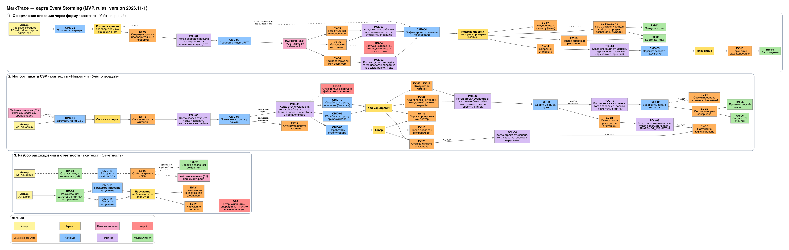
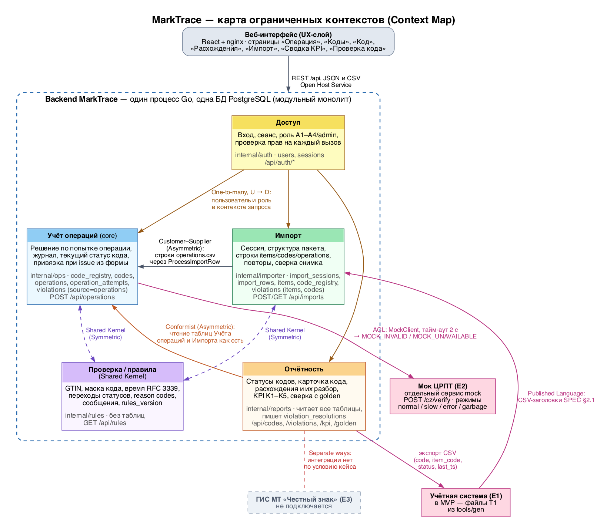

# 20. Event Storming: события, команды, политики, агрегаты и контексты

**MarkTrace · версия 1.0 · 16.11.2026**

## 1. Назначение и основание

Документ закрывает практики 9–13 блока «Event Storming и DDD» (контрольная точка 2): выбор процессов и поддоменов (ПР-9), карта событий (ПР-10), команды и политики (ПР-11), внешние системы, агрегаты и ограниченные контексты (ПР-12), стратификация и протокол (ПР-13). Термины — в [глоссарии](21-glossary.md).

Карта построена по **реализованному MVP**, а не по предварительным моделям. Источник истины — `SPEC.md` (rules_version `2026.11-1`), код `backend/internal/*` и схема `backend/internal/store/migrations/001_init.sql`. Где ранние документы ([BPMN](11-bpmn-process.md), [ERD](12-erd.md), [словарь](13-data-dictionary.md)) расходятся с MVP, расхождение названо в разделе 7 как решённый hotspot.

Диаграммы:

- карта событий: [`diagrams/event-storming.png`](diagrams/event-storming.png) · [SVG](diagrams/event-storming.svg) · исходник [`event-storming.dot`](diagrams/event-storming.dot);
- карта контекстов: [`diagrams/contexts.png`](diagrams/contexts.png) · [SVG](diagrams/contexts.svg) · исходник [`contexts.dot`](diagrams/contexts.dot).

Перерисовка: `dot -Tpng -Gdpi=100 event-storming.dot -o event-storming.png`, `dot -Tpng -Gdpi=110 contexts.dot -o contexts.png` (и `-Tsvg`).

Ссылка на доску сессии: [ссылка на доску Miro/Excalidraw]. Диаграммы в `docs/diagrams/` воспроизводят финальное состояние доски.

### 1.1. Обозначения

| Цвет стикера | Элемент | Формулировка | Префикс ID |
|---|---|---|---|
| Оранжевый | Доменное событие | Прошедшее время, бизнес-факт: «Код продан» | EV-NN |
| Синий | Команда | Повелительное наклонение: «Продать код» | CMD-NN |
| Сиреневый | Политика | «Когда …, тогда …» | POL-NN |
| Зелёный | Модель чтения (read model) | Что видит актор для принятия решения | RM-NN |
| Светло-жёлтый | Актор | Роль A1–A4, admin или «Система» | — |
| Жёлтый | Агрегат | Граница согласованности | — |
| Розовый | Внешняя система | E1–E3 из [реестра акторов](08-actors-registry.md) | E1–E3 |
| Красный | Hotspot | Вопрос, спорное место | HS-NN |

Префиксы выбраны так, чтобы не пересекаться с уже занятыми обозначениями: A1–A4 — роли, E1–E3 — внешние системы, K1–K5 — KPI, P1–P6 — проектные решения в [BPMN](11-bpmn-process.md), UC1–UC7 — Use Case.

> В раздаточном материале ПР-11 в советах по визуализации команды названы зелёными, а политики синими. Здесь принята классическая схема Event Storming (команда — синяя, политика — сиреневая, read model — зелёная), как в шаблонах Miro, на которые ссылается ПР-9. Смысл элементов от этого не меняется.

## 2. Сфера деятельности, цели и поддомены (ПР-9)

**Сфера деятельности заказчика.** Производитель или ритейлер маркируемого товара, который готовится к работе с ГИС МТ «Честный знак». Ему нужно вести жизненный цикл каждого кода (выпуск → ввод в оборот → продажа → возврат → вывод) и находить ошибки в данных до внешней проверки.

**Бизнес-цели проекта** (из [карточки](01-project-card.md)): доля корректно оформленных операций на макете ≥ 99% (K1), статусы без расхождений с журналом (K2), повторный импорт без дублей (K3), отчёт по статусам ≤ 2 с (K4), совпадение отчётов с эталоном 100% (K5). Реальной интеграции с ЦРПТ нет по условию кейса.

### 2.1. Поддомены

| Тип | Поддомен | Почему такой тип | Где в MVP |
|---|---|---|---|
| Основной | Жизненный цикл кода маркировки: допустимые переходы, порядок времени, идемпотентность операций | Ради этого существует продукт; правила специфичны для кейса | `internal/rules`, `internal/ops` |
| Основной | Выявление и разбор расхождений: причины, снимок, KPI K1–K2 | Главная ценность для контролёра качества | `internal/importer` (снимок), `internal/reports` |
| Вспомогательный | Импорт и экспорт CSV, журнал сессий импорта | Нужен для загрузки данных, но не уникален | `internal/importer`, экспорт в `internal/reports` |
| Вспомогательный | Проверка кода во внешней системе (мок ЦРПТ) | Имитация внешнего сервиса, логика тонкая | `mock/`, `internal/ops/mock.go` |
| Вспомогательный | Отчётность и сверка с эталоном golden | Потребитель данных основного поддомена | `internal/reports`, `golden/` |
| Универсальный | Аутентификация и разграничение доступа по ролям | Типовое решение (bcrypt, cookie-сеанс) | `internal/auth` |
| Универсальный | Хранение данных, миграции | Стандартная PostgreSQL | `internal/store` |

### 2.2. Выбранные бизнес-процессы

| № | Процесс | Обоснование выбора |
|---|---|---|
| 1 | Оформление операции над кодом через форму (UC1–UC4) | Основной поток кейса; здесь все правила переходов, вызов мока и конкурентная запись |
| 2 | Импорт пакета CSV (UC7) | Источник набора T1 и проверки K3, K5; здесь снимок `codes.csv` и повторы |
| 3 | Разбор расхождений и отчётность (UC5, UC6) | Результат для контролёра и аудитора; замыкает цикл «ошибка → причина → закрытие» |

### 2.3. Организация заказчика и участники

| Подразделение заказчика | Роль в системе | Интерес |
|---|---|---|
| Производство | A1 — оператор производства | Выпуск и ввод кодов в оборот, загрузка данных |
| Склад и розница | A2 — оператор розницы/склада | Продажа, возврат, вывод из оборота |
| Служба качества | A3 — контролёр качества | Импорт, разбор расхождений, KPI |
| Внутренний аудит | A4 — аудитор | Только чтение отчётов и протокола |
| ИТ-поддержка стенда | admin — технический администратор | Все действия на учебном стенде; в [реестре акторов](08-actors-registry.md) не выделен |

Роли участников сессии Event Storming:

| Участник | Роль в сессии | Вклад по практикам 9–13 |
|---|---|---|
| Шиншин Алексей, тимлид | Фасилитатор | Контроль полноты сценариев, фиксация договорённостей, назначение ответственных за контексты, протокол |
| Завгороднев Ярослав, аналитик | Эксперт предметной области | Перечень доменных событий, поток событий, политики, глоссарий и перечень сущностей |
| Брусникин Максим, backend | Технический эксперт | Кандидаты в сервисы, связи событий с модулями, агрегаты и транзакции, архитектура модулей |
| Жраков Артём, frontend | Технический эксперт | Модели чтения, точки входа UI, акторы у команд |

## 3. Карта событий (ПР-10)

Логика выявления: сначала события жизненного цикла кода из правил кейса (пять статусов), затем вокруг них — события решения по попытке (принято, повтор, отказ), события внешней проверки, события импорта и разбора. Технические факты («строка записана в БД») не выносились; события, которые MVP не сохраняет, помечены.

**Начальное и конечное события.** Жизненный цикл кода начинается с EV-07 «Код привязан к товару» и EV-08 «Код выпущен», заканчивается EV-12 «Код выведен из оборота». Процесс контроля начинается с EV-16 «Сессия импорта открыта» (или первой операции из формы) и заканчивается EV-25 «Нарушение закрыто» и EV-26 «Отчёт выгружен в CSV».

### 3.1. Перечень событий

| ID | Событие | Агрегат | Комментарий | Где зафиксировано в MVP |
|---|---|---|---|---|
| EV-01 | Пользователь вошёл в систему | — (Доступ) | Сеанс 12 ч, cookie `mt_session` | `sessions` |
| EV-02 | Действие запрещено по роли | — (Доступ) | `AUTH_DENIED`, HTTP 403 | Не сохраняется (SPEC §3) |
| EV-03 | Операция прошла предварительные проверки | Код маркировки | Проверки 1–10 без блокировки; только для формы | Не сохраняется, промежуточный факт |
| EV-04 | Код подтверждён мок-сервисом | Код маркировки | `{is_valid: true}` | `operation_attempts.mock_result` |
| EV-05 | Код отклонён мок-сервисом | Код маркировки | `is_valid=false`, причина мока: `INVALID_FORMAT`, `UNKNOWN_CODE`, `GTIN_MISMATCH` | `mock_result`, причина `MOCK_INVALID` |
| EV-06 | Мок-сервис не ответил | Код маркировки | Тайм-аут 2 с, сеть, не 200, нет `is_valid` | Причина `MOCK_UNAVAILABLE` |
| EV-07 | Код привязан к товару | Код маркировки | Из формы при `issue` (снимка нет) или из строки `codes.csv` (с ожидаемым снимком) | `code_registry` |
| EV-08 | Код выпущен | Код маркировки | `issue` → `issued` | `operations`, `codes` |
| EV-09 | Код введён в оборот | Код маркировки | `introduce` → `introduced` | `operations`, `codes` |
| EV-10 | Код продан | Код маркировки | `sell` → `sold` | `operations`, `codes` |
| EV-11 | Код возвращён | Код маркировки | `return` → `returned`; повторная продажа разрешена | `operations`, `codes` |
| EV-12 | Код выведен из оборота | Код маркировки | `dispose` → `disposed`, финальный статус | `operations`, `codes` |
| EV-13 | Повтор операции распознан | Код маркировки | Тот же `op_id` или та же пара (`code`, `ts`) с тем же содержимым | `operation_attempts.decision = duplicate` |
| EV-14 | Операция отклонена | Код маркировки | Ровно одна причина — первая не пройденная проверка | `operation_attempts.decision = rejected` |
| EV-15 | Нарушение зафиксировано | Нарушение | С причиной, сообщением, `rules_version` | `violations` |
| EV-16 | Сессия импорта открыта | Сессия импорта | Статус `running` | `import_sessions` |
| EV-17 | Структура пакета отклонена | Сессия импорта | Заголовок не совпал; строки не обрабатываются | `status = structure_rejected`, `failure_reason` |
| EV-18 | Товар добавлен в справочник | Товар | Строка `items.csv` принята | `items` |
| EV-19 | Строка импорта пропущена как повтор | Сессия импорта | Идентичное содержимое уже принято или уже отклонено | `import_rows.processing_status = duplicate` |
| EV-20 | Строка импорта отклонена | Сессия импорта | Причина строки, далее EV-15 | `import_rows.processing_status = rejected` |
| EV-21 | Снимок кода расходится с историей | Код маркировки | Ожидаемые статус/время из `codes.csv` ≠ фактические | `violations.reason = SNAPSHOT_MISMATCH` |
| EV-22 | Сессия импорта завершена | Сессия импорта | Счётчики по сущностям и `rows_created` | `status = completed`, `counters` |
| EV-23 | Сессия импорта прервана технической ошибкой | Сессия импорта | Уже принятые строки сохраняются | `status = failed` |
| EV-24 | Комментарий к нарушению добавлен | Нарушение | Только A3, admin | `violation_resolutions.action = comment` |
| EV-25 | Нарушение закрыто | Нарушение | Не более одного закрытия, комментарий обязателен | `violation_resolutions.action = close` |
| EV-26 | Отчёт выгружен в CSV | — (Отчётность) | `code,item_code,status,last_ts` или `code,reason,source,ref` | Не сохраняется, файл у пользователя |

### 3.2. Лента времени: операция через форму

Пример — продажа кода оператором розницы. Для `issue` из формы добавляется привязка к товару (EV-07).

| Шаг | Актор / система | Команда | Агрегат | Событие | Политика | Модель чтения |
|---|---|---|---|---|---|---|
| 1 | A2 | CMD-01 Войти в систему | — | EV-01 | — | RM-10 Профиль и роль |
| 2 | A2 | CMD-02 Оформить операцию `sell` | Код маркировки | — | POL-11 (роль A2 допущена) | RM-02 Карточка кода |
| 3 | Система | (проверки 1–10 без блокировки) | Код маркировки | EV-03 | POL-01 | — |
| 4 | Система | CMD-03 Проверить код в ЦРПТ | — → E2 | EV-04 / EV-05 / EV-06 | POL-02 / POL-03 | — |
| 5 | Система | CMD-04 Зафиксировать решение по операции | Код маркировки | EV-10 «Код продан» или EV-13 / EV-14 | POL-04 при EV-14 | — |
| 6 | Система | CMD-05 Зарегистрировать нарушение | Нарушение | EV-15 | — | RM-04 Расхождения |
| 7 | A2 | — | — | — | — | Ответ формы: решение, причина, строка кода; RM-03 |

Если на шаге 3 проверка не пройдена или распознан повтор, мок не вызывается: сразу шаг 5 с решением `rejected` или `duplicate`. На шаге 5 состояние кода проверяется повторно под `SELECT … FOR UPDATE`, потому что за время ответа мока его мог изменить другой запрос.

### 3.3. Лента времени: импорт пакета CSV

Пример — первичная загрузка набора T1 (99 товаров, 518 строк кодов, 870 строк операций).

| Шаг | Актор / система | Команда | Агрегат | Событие | Политика | Модель чтения |
|---|---|---|---|---|---|---|
| 1 | A3 (или A1, admin) + E1 | CMD-06 Загрузить пакет CSV | Сессия импорта | EV-16 | POL-05 | — |
| 2 | Система | CMD-07 Проверить структуру пакета | Сессия импорта | EV-17 (конец) или продолжение | POL-06 | RM-05 |
| 3 | Система | CMD-08 Обработать строку товара | Товар | EV-18 / EV-19 / EV-20 | POL-09, POL-04 | — |
| 4 | Система | CMD-09 Обработать строку привязки кода | Код маркировки | EV-07 / EV-19 / EV-20 | POL-09, POL-04 | — |
| 5 | Система | CMD-10 Обработать строку операции | Код маркировки | EV-08…EV-12 / EV-19 / EV-20 | POL-09, POL-04 | — |
| 6 | Система | CMD-11 Сверить снимок кодов | Код маркировки | EV-21 | POL-07, POL-08 | — |
| 7 | Система | CMD-12 Завершить сессию импорта | Сессия импорта | EV-22 или EV-23 | POL-10 | RM-05, RM-06 |
| 8 | A3 | — | — | — | — | RM-04 Расхождения, RM-07 Сверка с golden |

Ожидаемый итог T1 по эталону: статусы `issued 300, introduced 110, sold 78, returned 12, disposed 12`; 18 нарушений (items — 3, codes — 8, из них 2 `SNAPSHOT_MISMATCH`, operations — 7) и одна строка-повтор. Повторный импорт тех же файлов: все строки `duplicate`, новых предметных строк 0 (K3).

### 3.4. Лента времени: разбор расхождений и отчётность

| Шаг | Актор | Команда | Агрегат | Событие | Модель чтения |
|---|---|---|---|---|---|
| 1 | A3 | — (фильтр по причине, источнику, периоду, актору) | — | — | RM-04 Расхождения |
| 2 | A3 | — (переход к коду) | — | — | RM-02 Карточка кода |
| 3 | A3, admin | CMD-13 Прокомментировать нарушение | Нарушение | EV-24 | RM-04 |
| 4 | A3, admin | CMD-14 Закрыть нарушение | Нарушение | EV-25 | RM-04 (`state=closed`) |
| 5 | A1–A4, admin | CMD-15 Выгрузить отчёт в CSV | — | EV-26 | RM-03, RM-04 |
| 6 | A1–A4, admin | — (сверка с эталоном) | — | — | RM-07, RM-06 |

## 4. Команды и политики (ПР-11)

### 4.1. Таблица «Команда — Событие — Политика — Инициатор»

| Команда | Инициатор | Целевой агрегат | Инварианты (условия приёма) | Приводит к событию | Политика (когда → тогда) |
|---|---|---|---|---|---|
| CMD-01 Войти в систему | Любой пользователь | — (Доступ) | Пара логин/пароль верна (bcrypt) | EV-01 | — |
| CMD-02 Оформить операцию (`issue`, `introduce`, `sell`, `return`, `dispose`) | A1 (`issue`, `introduce`), A2 (`sell`, `return`, `dispose`), admin | Код маркировки | Роль допущена; проверки 1–10 SPEC §2.3; для `issue` — товар есть, GTIN товара = GTIN в коде, код не привязан к другому товару | EV-03 или EV-13 / EV-14 | POL-11 (роль), POL-01 |
| CMD-03 Проверить код в ЦРПТ | Система | — → E2 | Только для формы и только после EV-03 | EV-04 / EV-05 / EV-06 | POL-02, POL-03 |
| CMD-04 Зафиксировать решение по операции | Система | Код маркировки | Повторная проверка состояния под блокировкой кода; `op_id` уникален; пара (`code`, `ts`) уникальна | EV-07 (при новом `issue`), EV-08…EV-12, EV-13, EV-14 | POL-04 при EV-14 |
| CMD-05 Зарегистрировать нарушение | Система | Нарушение | Ровно одна причина из справочника; источник `items`/`codes`/`operations` | EV-15 | — |
| CMD-06 Загрузить пакет CSV | A1, A3, admin | Сессия импорта | Непустой набор из трёх файлов | EV-16 | POL-05 |
| CMD-07 Проверить структуру пакета | Система | Сессия импорта | Заголовок каждого файла совпадает точно (состав и порядок) | EV-17 или переход к строкам | POL-06 |
| CMD-08 Обработать строку товара | Система | Товар | Поля заполнены; GTIN 13/14 цифр с верной контрольной цифрой; `item_code` не занят другим содержимым | EV-18 / EV-19 / EV-20 | POL-09, POL-04 |
| CMD-09 Обработать строку привязки кода | Система | Код маркировки | Маска кода; статус из `CodeStatus`; время RFC 3339; товар есть; GTIN совпадает; код не привязан к другому товару | EV-07 / EV-19 / EV-20 | POL-09, POL-04 |
| CMD-10 Обработать строку операции | Система | Код маркировки | Те же проверки 1–10, что у CMD-02, без мока и без проверки роли по типу операции | EV-08…EV-12 / EV-19 / EV-20 | POL-09, POL-04 |
| CMD-11 Сверить снимок кодов | Система | Код маркировки | В пакете были `codes.csv` или `operations.csv`; привязки с `NULL`-снимком пропускаются | EV-21 | POL-08 |
| CMD-12 Завершить сессию импорта | Система | Сессия импорта | У каждой строки ровно один итог | EV-22 / EV-23 | — |
| CMD-13 Прокомментировать нарушение | A3, admin | Нарушение | Комментарий непустой | EV-24 | — |
| CMD-14 Закрыть нарушение | A3, admin | Нарушение | Комментарий непустой; нарушение ещё не закрыто | EV-25 | — |
| CMD-15 Выгрузить отчёт в CSV | A1–A4, admin | — (Отчётность) | Фильтры корректны | EV-26 | — |
| CMD-16 Проверить код вручную | A1–A4, admin | — → E2 | — | Событий не порождает: ответ мока показывается и не сохраняется | — |

### 4.2. Карточки политик

| ID | Когда (условие) | Тогда (команда) | Ограничения |
|---|---|---|---|
| POL-01 | Операция из формы прошла предварительные проверки (EV-03) | CMD-03 Проверить код в ЦРПТ, `gtin` = GTIN товара | Тайм-аут 2 с; импорт мок не вызывает |
| POL-02 | Мок подтвердил код (EV-04) | CMD-04 Зафиксировать решение: провести операцию после повторной проверки под блокировкой | Если состояние изменилось, решение — отказ или повтор по новой проверке |
| POL-03 | Мок отклонил код (EV-05) или не ответил (EV-06) | CMD-04 Зафиксировать решение: отказ `MOCK_INVALID` / `MOCK_UNAVAILABLE` | Статус кода не меняется; отложенного статуса нет (HS-04) |
| POL-04 | Операция или строка импорта отклонена (EV-14, EV-20) | CMD-05 Зарегистрировать нарушение | Одна причина на отказ, первая по порядку проверок |
| POL-05 | Сессия импорта открыта (EV-16) | CMD-07 Проверить структуру пакета | Неверный заголовок любого файла отклоняет весь пакет |
| POL-06 | Структура пакета верна | CMD-08, затем CMD-09, затем CMD-10 по строкам | Порядок файлов items → codes → operations; строки в порядке файла, без сортировки; каждая строка — своя транзакция |
| POL-07 | Строки сессии обработаны, в пакете были `codes.csv` или `operations.csv` | CMD-11 Сверить снимок кодов | Сверяются все привязки с непустым ожидаемым снимком, не только из этого пакета |
| POL-08 | Снимок кода расходится с историей (EV-21) | CMD-05 Зарегистрировать нарушение `SNAPSHOT_MISMATCH` | Не дублируется, если уже есть открытое такое же нарушение с теми же ожидаемыми и фактическими значениями |
| POL-09 | Ключ строки или операции уже встречался | Отметить повтор (EV-13 / EV-19) без нового нарушения при идентичном содержимом; иначе отказ `IDEMPOTENCY_CONFLICT` (для `codes.csv` — `DUPLICATE_CODE`) | Ранее отклонённая идентичная строка тоже даёт повтор; исключения — `MOCK_UNAVAILABLE` и `CODE_NOT_FOUND` после появления кода: такие попытки проверяются заново |
| POL-10 | Сверка снимка выполнена (или не требовалась) | CMD-12 Завершить сессию импорта, посчитать счётчики и `rows_created` | Технический сбой → `failed`, принятые строки не откатываются |
| POL-11 | Команда записи подана пользователем без нужной роли | Отказать `AUTH_DENIED` (403) | Попытка не записывается; аудитор A4 не выполняет ни одной команды записи |
| POL-12 | Отчёт «Статусы кодов» построен | Запомнить длительность запроса как K4 | Хранится в памяти процесса backend, после перезапуска пусто |

### 4.3. Отказы команд: примеры для защиты

Сообщения взяты из каталога `backend/internal/rules/reasons.go` и текстов деталей в `backend/internal/ops/engine.go`.

| Сценарий | Нарушенный инвариант | Причина | Сообщение пользователю |
|---|---|---|---|
| Продажа кода, который только выпущен | `sell` допустим из `introduced` или `returned` | `TRANSITION_NOT_ALLOWED` | «Недопустимый переход статуса: операция sell из статуса issued (выпущен)» |
| Продажа с временем раньше ввода в оборот | Время строго больше времени последней принятой операции кода | `TIME_REVERSED` | «Время операции не позже последней принятой операции по коду: 2026-…Z не позже 2026-…Z» |
| Код не найден в реестре мока | Мок подтверждает только известные коды | `MOCK_INVALID` | «Мок-сервис ЦРПТ отклонил код: причина: UNKNOWN_CODE» |
| Оператор розницы пытается выпустить код | `issue` разрешён только A1 и admin | `AUTH_DENIED` | «Недостаточно прав для этого действия» (403, попытка не записывается) |

## 5. Акторы, внешние системы и модели чтения (ПР-12)

### 5.1. Внешние системы

| ID | Система | Где на карте | Интерфейс | Поведение в MVP |
|---|---|---|---|---|
| E2 | Мок-сервис ЦРПТ | После POL-01 в потоке формы; ручная проверка CMD-16 | `POST /cz/verify {code, gtin?} → {is_valid, reason?}` | Отдельный сервис `mock`, без состояния; реестр из `data/C16/mock_registry.csv`; режимы `normal`, `slow` (5 с → тайм-аут), `error` (500), `garbage` (`{}`) |
| E1 | Учётная система заказчика | Перед CMD-06; после EV-26 | Файлы CSV по заголовкам SPEC §2.1 | Подключения нет: роль E1 играют файлы T1 из `tools/gen` |
| E3 | ГИС МТ «Честный знак» | Не показывается на ленте | — | Не подключается по условию кейса |

### 5.2. Модели чтения

| ID | Модель чтения | Кто использует | Решение, которое она поддерживает | API / страница |
|---|---|---|---|---|
| RM-01 | Справочник товаров | A1 | Выбор товара для `issue` | `GET /api/items`, «Операция» |
| RM-02 | Карточка кода: привязка, операции (по времени), попытки, нарушения | Все | Можно ли проводить операцию; почему отказ | `GET /api/codes/{code}`, «Код» |
| RM-03 | Статусы кодов: таблица, счётчики по статусам, фильтры | Все | Сколько кодов в каком статусе; экспорт | `GET /api/codes`, `/codes/export.csv`, `/status-summary.csv`, «Коды» |
| RM-04 | Расхождения: фильтры, счётчики по причинам, разборы | Все; действия — A3, admin | Что разбирать и закрывать | `GET /api/violations`, `/violations/export.csv`, «Расхождения» |
| RM-05 | Протокол сессий импорта, отклонённые строки | Все | Что загружено, что отклонено и почему | `GET /api/imports`, `/imports/{id}`, «Импорт» |
| RM-06 | Сводка KPI K1–K5 | Все | Достигнута ли цель 99% и идемпотентность | `GET /api/kpi`, «Сводка KPI» |
| RM-07 | Сверка с эталоном golden | Все | Совпадают ли отчёты с `golden/*.csv` | `GET /api/golden/compare`, «Сводка KPI» |
| RM-08 | Правила: `rules_version`, маска кода, переходы | Все | Какие правила действуют | `GET /api/rules` |
| RM-09 | Результат ручной проверки кода | Все | Знает ли мок этот код | `POST /api/verify`, «Проверка кода» |
| RM-10 | Профиль пользователя и роль | Все | Какие разделы и кнопки доступны | `GET /api/auth/me` |

## 6. Агрегаты (ПР-12)

| Агрегат | Корень и состав | Инварианты | Команды | События | Таблицы |
|---|---|---|---|---|---|
| **Код маркировки** | Корень — привязка кода (`code`). Внутри: привязка к товару и ожидаемый снимок; текущее состояние (статус, время, последний актор); журнал принятых операций; попытки по коду | Код соответствует маске; привязан ровно к одному товару, GTIN товара (нормализованный) = GTIN в коде; переходы только по таблице SPEC §1.4; `disposed` финален; время каждой следующей операции строго больше предыдущей; `op_id` уникален; пара (`code`, `ts`) уникальна; текущее состояние = результат последней принятой операции | CMD-02, CMD-04, CMD-09, CMD-10, CMD-11 | EV-03…EV-14, EV-21 | `code_registry`, `codes`, `operations`, `operation_attempts` |
| **Товар** | Корень — `item_code`; `name`, `gtin` | Все поля заполнены; GTIN — 13 или 14 цифр, верная контрольная цифра GS1; повторная загрузка с другим содержимым — `IDEMPOTENCY_CONFLICT` (товар после загрузки не меняется) | CMD-08 | EV-18 | `items` |
| **Сессия импорта** | Корень — `session_id`; строки импорта (сущность, номер строки, ключ, исходное содержимое, итог, причина) | Статус `running` → `completed` / `structure_rejected` / `failed`; при `structure_rejected` строк нет; у каждой строки ровно один итог `accepted` / `duplicate` / `rejected` | CMD-06, CMD-07, CMD-12 | EV-16, EV-17, EV-19, EV-20, EV-22, EV-23 | `import_sessions`, `import_rows` |
| **Нарушение** | Корень — `violation_id`; разборы (комментарии и закрытие) | Ровно одна причина; запись нарушения не меняется и не удаляется; комментарий непустой; не более одного закрытия (уникальный индекс, повтор → 409); разбирают только A3 и admin | CMD-05, CMD-13, CMD-14 | EV-15, EV-24, EV-25 | `violations`, `violation_resolutions` |

Агрегаты ссылаются друг на друга только по идентификаторам: код → товар по `item_code`, нарушение → попытка по `attempt_id` и строка импорта по `import_row_id`, строка импорта → сессия по `session_id`.

**Осознанное отступление от эвристики «одна транзакция — один агрегат».** В MVP попытка, принятая операция, обновление текущего состояния и нарушение пишутся в одной транзакции; для импорта в ту же транзакцию попадает строка импорта. Так протокол никогда не расходится с данными: нет отказа без нарушения и нет принятой операции без попытки. Цена — транзакция задевает два агрегата (Код маркировки и Нарушение или Сессия импорта). При объёме T1 это не создаёт конкуренции за блокировки: блокируется только строка конкретного кода.

**Value objects:** GTIN, код маркировки (строка по маске), время операции (RFC 3339 с часовым поясом), статус кода, тип операции, причина (reason code), версия правил.

**Shared Kernel** — общая часть модели для контекстов «Учёт операций» и «Импорт», один Go-пакет `backend/internal/rules`: перечисления `CodeStatus` и `OperationType`, таблица переходов, проверки GTIN, маски и времени, справочник причин с русскими сообщениями, `rules_version = 2026.11-1`. Правило сопровождения: любое изменение правил меняет `rules_version`, а затем перегенерируются T1 и golden (`tools/gen` с собственными проверками, независимыми от backend).

## 7. Hotspots: вопросы и как они решены

| ID | Вопрос | Решение в MVP | Источник решения |
|---|---|---|---|
| HS-01 | Маски кода нет в кейсе; ранние документы её не вводили (P6 в [BPMN](11-bpmn-process.md), [словарь](13-data-dictionary.md) §1) | Учебная маска `^01(\d{14})21([A-Za-z0-9]{6})$`, 24 символа; GTIN в коде сравнивается с GTIN товара | SPEC §1.2, допущение A1 [карточки](01-project-card.md) |
| HS-02 | `codes.csv` — начальный остаток или итоговый снимок | Ожидаемый итоговый снимок; статус считается только из операций; расхождение → `SNAPSHOT_MISMATCH` | SPEC §2.1, §2.3; совпадает с P2 в BPMN |
| HS-03 | Порядок обработки строк операций: по времени или по файлу (BPMN §4.3 п. 3 предлагал по времени) | В порядке файла, без сортировки; нарушение порядка времени даёт `TIME_REVERSED`. Генератор пишет корректные операции отсортированными | SPEC §2.2 |
| HS-04 | Недоступность мока: отложенная попытка (`pending`, P1 в BPMN) или отказ | Отказ `MOCK_UNAVAILABLE`; статуса `pending` нет. Повтор с тем же `op_id` проверяется заново, а не считается повтором | SPEC §3, `priorRejected` в `ops/engine.go` |
| HS-05 | Сколько причин у одного отказа ([словарь](13-data-dictionary.md) §8 допускал несколько) | Ровно одна — первая не пройденная проверка по фиксированному порядку | SPEC §1.5 |
| HS-06 | Формула K1 не определена (BPMN §6) | K1 = принятые / (принятые + отклонённые) по `operation_attempts` × 100, повторы исключены; учитываются и форма, и импорт | SPEC §5 |
| HS-07 | Две операции одного кода с одинаковым временем | Пара (`code`, `ts`) уникальна: то же содержимое — повтор, другое — `IDEMPOTENCY_CONFLICT` | SPEC §2.3 п. 6 |
| HS-08 | Допускать ли GTIN-13 | Да; для сравнения нормализуется в `"0" + GTIN-13`, хранится как введён | SPEC §1.1, кейс §2 п. 4 |
| HS-09 | Как исправлять ошибочную принятую операцию (кейс, «процедуры исправления») | История неизменяема, сторно нет. Нарушение закрывается с комментарием; исправление — новая операция через форму, если переход допустим. Открытый вопрос для следующей версии | SPEC §4; [Use Case](09-use-cases.md) UC5 А3 |
| HS-10 | Вызывать ли мок при импорте | Нет: импорт проверяет только локальные правила | SPEC §2; BPMN §4.2 |
| HS-11 | Кто загружает CSV ([реестр](08-actors-registry.md): только A3 в UC7) | A1, A3 и admin | SPEC §2.2 |
| HS-12 | Пишется ли ручная проверка кода (UC5 «код-чек» в BPMN §5) | Нет: `POST /api/verify` только передаёт ответ мока | `httpapi/handlers.go`, `verify` |
| HS-13 | Записывать ли попытку, отклонённую по правам | Нет: 403 до создания попытки | SPEC §3 |
| HS-14 | «Перезапуск проверок» контролёром (роль из кейса) | Отдельной команды нет: перепроверка — повторный импорт; K1, K2 пересчитываются при каждом запросе сводки | SPEC §5, §6 |
| HS-15 | K4 хранится только в памяти backend | После перезапуска K4 пуст до первого построения отчёта. Принято для MVP | `reports/codes.go` |

## 8. Ограниченные контексты (ПР-12)

| Контекст | Ответственность | Язык контекста | Модуль и данные | Ответственный |
|---|---|---|---|---|
| **Учёт операций** (основной) | Решение по попытке операции, журнал принятых операций, текущий статус кода, привязка при `issue` из формы, вызов мока | операция, попытка, решение (`accepted` / `duplicate` / `rejected`), актор, инициатор, статус кода, переход | `internal/ops`; `code_registry`, `codes`, `operations`, `operation_attempts`, `violations` (`source = operations`) | Брусникин Максим |
| **Импорт** | Сессия импорта, структура пакета, строки трёх файлов, повторы, сверка снимка | пакет, файл, заголовок, строка, ключ строки, повтор, снимок | `internal/importer`; `import_sessions`, `import_rows`, `items`, `code_registry` (с ожидаемым снимком), `violations` (`items`, `codes`) | Брусникин Максим |
| **Проверка / правила** | Чистые правила без хранения: GTIN, маска, время, переходы, причины, сообщения, версия правил | маска, GTIN, контрольная цифра, нормализация, переход, причина, версия правил | `internal/rules`; таблиц нет; `GET /api/rules` | Завгороднев Ярослав (правила), Брусникин Максим (код) |
| **Отчётность** | Статусы кодов, карточка кода, расхождения и их разбор, KPI, сверка с golden, экспорт CSV | отчёт, фильтр, счётчик, расхождение, разбор, KPI, эталон | `internal/reports`; читает все таблицы, пишет `violation_resolutions` | Жраков Артём (UI отчётов), Брусникин Максим (API) |
| **Доступ** | Вход, сеанс, роль, проверка прав на каждый вызов API | пользователь, роль, сеанс | `internal/auth`, проверка ролей в `internal/httpapi`; `users`, `sessions` | Брусникин Максим |

Границы контроля: тимлид Шиншин Алексей отвечает за согласованность контекстов и их языка с [карточкой](01-project-card.md) и [глоссарием](21-glossary.md).

### 8.1. Связи между контекстами

Стрелка на карте — направление зависимости: кто вызывает или читает кого.

| Связь | Тип (ПР-12) | Паттерн | Канал |
|---|---|---|---|
| Доступ → Учёт операций, Импорт, Отчётность | One-to-many | Upstream / downstream | Пользователь и роль в контексте HTTP-запроса |
| Учёт операций ↔ Проверка / правила | Symmetric | Shared Kernel | Вызов функций пакета `rules` |
| Импорт ↔ Проверка / правила | Symmetric | Shared Kernel | Вызов функций пакета `rules` |
| Импорт → Учёт операций | Asymmetric | Customer–Supplier | Строки `operations.csv` проходят через `ops.ProcessImportRow` — тот же движок, что у формы |
| Отчётность → Учёт операций, Импорт | Asymmetric | Conformist | Чтение их таблиц из общей БД без собственной модели |
| Учёт операций → Мок ЦРПТ (E2) | Asymmetric | Anti-Corruption Layer | `ops.MockClient`: HTTP/JSON, тайм-аут 2 с; любой непригодный ответ переводится в `MOCK_UNAVAILABLE`, отказ — в `MOCK_INVALID` с причиной мока |
| Учётная система (E1) → Импорт | Asymmetric | Published Language | CSV-заголовки SPEC §2.1 задаёт MarkTrace |
| Отчётность → Учётная система (E1) | Asymmetric | Published Language | Экспорт CSV `code,item_code,status,last_ts` |
| MarkTrace — ГИС МТ (E3) | Separate ways | — | Интеграции нет по условию кейса |
| Веб-интерфейс → все контексты | One-to-many | Open Host Service | REST `/api`, JSON и CSV, cookie-сеанс |

### 8.2. Один термин — разные модели

| Термин | Учёт операций | Импорт | Отчётность |
|---|---|---|---|
| Код | Агрегат с историей и текущим статусом | Строка `codes.csv`: привязка и ожидаемый итоговый снимок | Строка отчёта `code, item_code, status, last_ts` |
| Статус | Статус кода (5 значений) | Итог строки (`accepted`, `duplicate`, `rejected`) и статус сессии | Статус кода в фильтре; состояние нарушения `open` / `closed` |
| Операция | Принятая запись журнала или попытка | Строка `operations.csv` | Элемент истории в карточке кода |
| Сессия | — | Сессия импорта | Сессия импорта в протоколе. Не путать с сеансом пользователя (Доступ) |

## 9. Кандидаты в сервисы из событий

| Кандидат | События | Команды | Реализация в MVP | Выделять ли отдельно |
|---|---|---|---|---|
| Сервис учёта операций | EV-03…EV-14 | CMD-02…CMD-04 | Пакет `ops`, `POST /api/operations` | Нет: при 600–900 операциях выгоды нет |
| Сервис импорта | EV-16…EV-23 | CMD-06…CMD-12 | Пакет `importer`, `POST /api/imports` | Кандидат первой очереди, если импорт станет долгим (фоновая обработка) |
| Адаптер ЦРПТ | EV-04…EV-06 | CMD-03, CMD-16 | `ops/mock.go` + отдельный сервис `mock` | Мок уже отдельный процесс; при боевой интеграции адаптер заменяется |
| Сервис разбора расхождений | EV-15, EV-24, EV-25 | CMD-05, CMD-13, CMD-14 | `reports.Resolve`, таблицы нарушений | Нет |
| Сервис отчётности и KPI | EV-26; RM-02…RM-07 | CMD-15 | Пакет `reports` | Нет; при росте данных — реплика БД для чтения |
| Сервис доступа | EV-01, EV-02 | CMD-01 | Пакет `auth` | Нет: в бою заменяется корпоративным SSO |
| Библиотека правил | — | — | Пакет `rules` | Остаётся библиотекой, общей для всех |

Итог: MVP — модульный монолит (один процесс backend, одна БД) плюс отдельный сервис мока. Границы пакетов совпадают с границами контекстов, поэтому выделить контекст в сервис можно без перестройки модели.

## 10. Стратификация (ПР-13)

| Слой | Элементы MarkTrace |
|---|---|
| UX | Веб-интерфейс `web/` (React + TypeScript, nginx): «Операция», «Коды», «Код», «Расхождения», «Импорт», «Сводка KPI», «Проверка кода»; меню по роли, аудитор только читает |
| Application | `internal/httpapi`: маршруты, проверка входа и роли, JSON/CSV, ошибки `{error, message}`; оркестрация `ops.Service.Submit` (проверки → мок → блокировка → повторная проверка → запись); `importer.Run` (сессия → структура → строки → снимок → итог) |
| Domain | `internal/rules`: правила без ввода-вывода; решения `ops.Evaluate`; агрегаты и инварианты раздела 6; политики раздела 4.2 |
| Infrastructure | PostgreSQL 16 и встроенные миграции (`internal/store`), `pgx/v5`, HTTP-клиент мока с тайм-аутом, разбор CSV `encoding/csv`, файлы `golden/*.csv`, `docker compose` |

Проверка связности по чек-листу ПР-13:

- UX обращается только к Application через REST `/api`; бизнес-правил в UI нет, UI показывает причину, полученную от backend.
- Правила вынесены в чистый пакет `rules` без SQL и HTTP.
- **Отступление:** `ops.Evaluate` и `importer` читают состояние SQL-запросами напрямую, отдельного слоя репозиториев нет. Доменная логика решения частично смешана с доступом к данным. Для MVP это принято ради простоты; при выделении сервисов запросы выносятся в репозиторий.
- Бизнес-логики в инфраструктуре нет: ограничения БД (`CHECK`, `UNIQUE (code, ts)`, единственное закрытие) дублируют доменные инварианты как страховку и не заменяют их.

## 11. Протокол сессии Event Storming

| Поле | Содержание |
|---|---|
| Дата и формат | [дата сессии], [онлайн/очно], доска: [ссылка на доску Miro/Excalidraw] |
| Участники | Шиншин А. (фасилитатор), Завгороднев Я. (эксперт предметной области), Брусникин М., Жраков А. (технические эксперты) |
| Цель | Свести процессы кейса 16 к событиям, командам и политикам; выделить агрегаты и контексты для модулей MVP |
| Результат | 26 событий, 16 команд, 12 политик, 10 моделей чтения, 4 агрегата, 5 контекстов, 15 hotspots |

Принятые решения:

1. Источник статуса кода — только принятые операции; `codes.csv` — ожидаемый снимок для сверки (HS-02).
2. Одна причина на отказ; порядок проверок фиксирован и одинаков для формы и импорта (HS-05, Shared Kernel `rules`).
3. Недоступность мока — отказ без отложенного статуса (HS-04).
4. Повторы распознаются по `op_id` и по паре (`code`, `ts`); идентичная ранее отклонённая строка — повтор без нового нарушения (POL-09).
5. Контексты реализуются пакетами одного backend; мок — отдельный сервис (раздел 9).

Открытые вопросы на следующую версию: сторно и исправление принятой операции (HS-09); отдельная команда «перезапустить проверки» (HS-14); хранение K4 в БД (HS-15); слой репозиториев (раздел 10).

## 12. Чек-лист полноты

- [x] Для каждого события из перечня найдена команда-источник или политика (разделы 3.1, 4.1).
- [x] У каждой команды указаны инициатор, агрегат и инварианты.
- [x] Политики сформулированы «когда … тогда …» и запускают команды, а не события.
- [x] Внешние системы E1, E2, E3 отмечены; E3 — без связи.
- [x] Агрегаты с инвариантами и границами транзакций описаны; отступление названо.
- [x] Контексты, их язык, ответственные и типы связей определены; Shared Kernel перечислен с правилом изменения.
- [x] Все сценарии Use Case покрыты: UC1–UC4 — поток 1, UC7 — поток 2, UC5, UC6 — поток 3.
- [x] Слои UX, Application, Domain, Infrastructure выделены.
