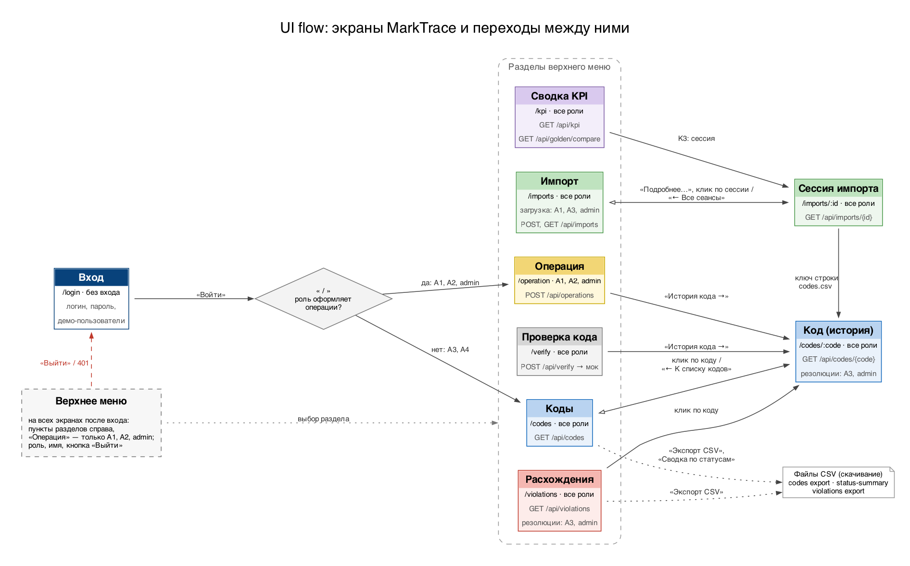

# 22. UI flow: экраны и переходы

**MarkTrace · версия 1.0 · 16.11.2026**

Материал контрольной точки 2 (связь экранов, роли пользователей, связь экранов с модулями системы). Источник — реализованный веб-интерфейс: маршруты `web/src/App.tsx`, права `web/src/auth.tsx`, страницы `web/src/pages/*.tsx`; контракт — `SPEC.md` §6 и §10. Истории — [18-user-stories.md](18-user-stories.md), карта — [19-user-story-map.md](19-user-story-map.md). Исходник диаграммы: [`diagrams/ui-flow.dot`](diagrams/ui-flow.dot).

## Общие правила навигации

| Правило | Как работает |
|---|---|
| Вход обязателен | Любой адрес, кроме `/login`, без сессии перенаправляет на «Вход»; после входа пользователь возвращается на запрошенный адрес |
| Стартовый экран | `/` → «Операция» для A1, A2, admin; → «Коды» для A3, A4 |
| Верхнее меню | Есть на всех экранах после входа: «Операция» (только A1, A2, admin), «Коды», «Расхождения», «Импорт», «Сводка KPI», «Проверка кода»; справа — роль, имя, «Выйти» |
| Закрытый раздел | Прямой переход на `/operation` для A3 и A4 перенаправляет на «Коды» |
| Истёкшая сессия | Любой ответ 401 сбрасывает пользователя, интерфейс возвращается на «Вход» |
| Неизвестный адрес | Перенаправление на `/` |
| Фильтры в адресе | Фильтры и страница отчётов «Коды» и «Расхождения» хранятся в строке адреса — ссылку можно передать коллеге |
| Права | Интерфейс скрывает недоступные кнопки, но решение принимает backend: запрос на запись без прав → 403 `AUTH_DENIED` |

## Перечень экранов

| № | Экран | Маршрут | Назначение | Истории |
|---|---|---|---|---|
| 1 | Вход | `/login` | Аутентификация, выбор демо-пользователя | US-01 |
| 2 | Операция | `/operation` | Оформить issue, introduce, sell, return, dispose над одним кодом и увидеть решение | US-02 – US-04, US-06 – US-10 |
| 3 | Коды | `/codes` | Отчёт «Статусы кодов»: счётчики, фильтры, таблица, экспорт CSV | US-18 |
| 4 | Код | `/codes/:code` | История одного кода: состояние, привязка, операции, попытки, расхождения | US-17, US-25 |
| 5 | Расхождения | `/violations` | Отчёт об ошибках с причиной, разбор и закрытие | US-15, US-16 |
| 6 | Импорт | `/imports` | Загрузка CSV и журнал сессий | US-05, US-12 – US-14 |
| 7 | Сессия импорта | `/imports/:id` | Итоги одной сессии и отклонённые строки | US-14 |
| 8 | Сводка KPI | `/kpi` | K1–K5 и сверка с эталоном | US-19, US-20 |
| 9 | Проверка кода | `/verify` | Ручной запрос к имитации ЦРПТ, без изменения данных | US-21 |

## Описание экранов

### 1. Вход

| Поле | Содержание |
|---|---|
| Элементы | Логин, пароль, кнопка «Войти» (неактивна без логина), сообщение об ошибке, список демо-пользователей `prod`, `retail`, `qc`, `auditor`, `admin` (нажатие подставляет логин и пароль) |
| Действия | Войти |
| Переходы | → исходный адрес или `/` (далее «Операция» или «Коды» по роли) |

### 2. Операция

| Поле | Содержание |
|---|---|
| Элементы | Форма: «Тип операции» (только типы роли: A1 — эмиссия, ввод в оборот; A2 — продажа, возврат, выбытие), «Код маркировки» со счётчиком «N / 24 символа», «Товар» (только для эмиссии, список из справочника), «Время события» с кнопками «Сейчас» и «Очистить» (пусто — время сервера), блок «Дополнительно»: исполнитель (`actor`, по умолчанию логин) и `op_id` (по умолчанию новый UUID). Блок «Результат»: решение «Принято / Отклонено / Повтор», код причины и русская подпись, сообщение, `op_id`, `attempt_id`, новый статус кода и последнее событие |
| Действия | «Отправить». После любого записанного решения время и `op_id` очищаются, чтобы следующая операция не дала `IDEMPOTENCY_CONFLICT` |
| Переходы | «История кода →» → Код |

### 3. Коды

| Поле | Содержание |
|---|---|
| Элементы | Плитки-счётчики «Все статусы», «Эмитирован», «В обороте», «Продан», «Возвращён», «Выбыл» (нажатие фильтрует по статусу); фильтры: статус, товар, исполнитель, период с / по, поиск по части кода; строка «Найдено N · время отчёта на сервере X мс» (зелёным при ≤ 2000 мс); таблица: код, товар, статус, последнее событие, исполнитель; постраничный вывод по 50 строк |
| Действия | «Применить», «Сбросить», «Экспорт CSV» (с текущими фильтрами), «Сводка по статусам (CSV)» |
| Переходы | Клик по коду → Код; скачивание файлов CSV |

### 4. Код

| Поле | Содержание |
|---|---|
| Элементы | «Текущее состояние» (статус, товар, последнее событие, исполнитель); «Привязка к товару» (товар, наименование, GTIN, ожидаемый статус и время из `codes.csv` или «не задан (создано формой)»); «Операции (хронология)»; «Попытки операций» (время, источник форма / импорт, тип, `ts` как передано, исполнитель и инициатор с ролью, решение, причина, `op_id`); «Расхождения по коду» |
| Действия | Для A3 и admin в таблице расхождений — «Комментировать / закрыть» |
| Переходы | «← К списку кодов» → Коды. Код, о котором системе ничего не известно, — ошибка `CODE_NOT_FOUND` |

### 5. Расхождения

| Поле | Содержание |
|---|---|
| Элементы | Кнопки-счётчики по причинам («Все причины», `TRANSITION_NOT_ALLOWED` 3 и т. д.; нажатие фильтрует); фильтры: причина, источник (товары, коды, операции), состояние (открытые, закрытые), товар, исполнитель, создано с / по, поиск по коду, ref и сообщению; таблица: причина, код, источник и ref, сообщение с исполнителем и временем операции, создано, состояние, резолюции; постраничный вывод по 50 |
| Действия | «Применить», «Сбросить», «Экспорт CSV» (формат `code,reason,source,ref`, как `golden/violations.csv`). A3 и admin: «Комментировать / закрыть» → поле комментария (обязательно) и кнопки «Комментарий», «Закрыть», «Отмена»; у закрытого расхождения — только комментарий |
| Переходы | Клик по коду → Код; скачивание CSV |

### 6. Импорт

| Поле | Содержание |
|---|---|
| Элементы | Для A1, A3, admin — форма «Новый сеанс импорта»: три поля файла (товары, коды, операции) с подсказкой формата заголовка; блок «Результат»: статус сессии, причина отказа структуры, таблица «принято / повтор / отклонено» по файлам, число `SNAPSHOT_MISMATCH`, «Создано новых строк» (0 при повторном импорте). Для A2 и A4 вместо формы — «Ваша роль может только просматривать сеансы импорта». Для всех — таблица «Сеансы импорта»: сеанс, начат, кем, статус, итог по строкам, новых строк |
| Действия | «Импортировать» (активна, если выбран хотя бы один файл), «Обновить» список |
| Переходы | «Подробнее и отклонённые строки →» или клик по сеансу → Сессия импорта |

### 7. Сессия импорта

| Поле | Содержание |
|---|---|
| Элементы | «Итоги» (те же счётчики, что в блоке «Результат»); «Сведения» (начат, завершён, инициатор с ролью, файлы с размером); «Отклонённые строки»: файл, номер строки, ключ, причина, сообщение, исходные данные строки |
| Действия | Только просмотр |
| Переходы | «← Все сеансы» → Импорт; ключ строки из `codes.csv` → Код |

### 8. Сводка KPI

| Поле | Содержание |
|---|---|
| Элементы | Плитки K1 «Доля корректных операций» (цель ≥ 99%, шкала), K2 «Согласованность статусов» (100%), K3 «Идемпотентность импорта» (0 новых строк), K4 «Время отчёта по статусам» (≤ 2 с), K5 «Совпадение с эталоном» (100%); у каждой — значение, цель и отметка «достигнута / не достигнута». Блок «Сверка с эталоном»: по файлам `status_summary.csv` и `violations.csv` — «Совпадает / Есть отличия», число строк эталона и факта, недостающие (−) и лишние (+) строки |
| Действия | «Обновить», «Сверить с эталоном» (доступно всем ролям: только чтение) |
| Переходы | K3: ссылка на сессию → Сессия импорта; K4: ссылка → Коды |

### 9. Проверка кода

| Поле | Содержание |
|---|---|
| Элементы | Код маркировки со счётчиком символов, GTIN (необязательно); ответ: «Код действителен / недействителен», причина мока (`INVALID_FORMAT`, `UNKNOWN_CODE`, `GTIN_MISMATCH`, `MOCK_UNAVAILABLE`) с пояснением, исходный JSON ответа |
| Действия | «Проверить». Статус кода не меняется, попытка не записывается |
| Переходы | «История кода →» → Код |

## Матрица видимости «экран × роль»

Обозначения: **И** — изменение (запись), **П** — только просмотр, **—** — экран недоступен.

| Экран | A1 производство | A2 розница | A3 контролёр | A4 аудитор | admin |
|---|---|---|---|---|---|
| Вход | И | И | И | И | И |
| Операция | И: issue, introduce | И: sell, return, dispose | — (→ Коды) | — (→ Коды) | И: все 5 типов |
| Коды (и экспорт CSV) | П | П | П | П | П |
| Код | П | П | П + резолюции | П | П + резолюции |
| Расхождения (и экспорт CSV) | П | П | П + резолюции | П | П + резолюции |
| Импорт | И: загрузка + журнал | П: журнал | И: загрузка + журнал | П: журнал | И: загрузка + журнал |
| Сессия импорта | П | П | П | П | П |
| Сводка KPI, сверка с эталоном | П | П | П | П | П |
| Проверка кода | П | П | П | П | П |

Матрица совпадает с наборами ролей backend (`backend/internal/httpapi/server.go`): операции — A1, A2, admin; импорт — A1, A3, admin; резолюции — A3, admin; остальное чтение — все роли.

## Связь экранов с модулями системы

| Экран | Компонент `web/src` | Методы API | Пакет backend | Таблицы БД |
|---|---|---|---|---|
| Вход | `pages/LoginPage.tsx`, `auth.tsx` | `POST /api/auth/login`, `GET /api/auth/me`, `POST /api/auth/logout` | `internal/auth` | `users`, `sessions` |
| Операция | `pages/OperationPage.tsx` | `GET /api/items`, `POST /api/operations` | `internal/ops` (форма, движок, клиент мока), `internal/rules` | `items`, `code_registry`, `codes`, `operations`, `operation_attempts`, `violations`; внешний мок `POST /cz/verify` |
| Коды | `pages/CodesPage.tsx` | `GET /api/codes`, `GET /api/codes/export.csv`, `GET /api/status-summary.csv`, `GET /api/items` | `internal/reports` (`codes.go`) | `codes`, `items` |
| Код | `pages/CodePage.tsx`, `ViolationsTable.tsx` | `GET /api/codes/{code}`, `POST /api/violations/{id}/resolutions` | `internal/reports` (`CodeDetail`) | `codes`, `code_registry`, `items`, `operations`, `operation_attempts`, `violations`, `violation_resolutions` |
| Расхождения | `pages/ViolationsPage.tsx`, `ViolationsTable.tsx` | `GET /api/violations`, `GET /api/violations/export.csv`, `POST /api/violations/{id}/resolutions` | `internal/reports` (`violations.go`) | `violations`, `violation_resolutions` |
| Импорт | `pages/ImportPage.tsx` | `POST /api/imports`, `GET /api/imports` | `internal/importer`, `internal/ops`, `internal/rules` | `import_sessions`, `import_rows`, `items`, `code_registry`, `codes`, `operations`, `operation_attempts`, `violations` |
| Сессия импорта | `pages/ImportDetailPage.tsx` | `GET /api/imports/{id}` | `internal/reports` (`kpi.go`: `Import`) | `import_sessions`, `import_rows` |
| Сводка KPI | `pages/KpiPage.tsx` | `GET /api/kpi`, `GET /api/golden/compare` | `internal/reports` (`kpi.go`) | `operation_attempts`, `codes`, `operations`, `import_sessions`; файлы `golden/*.csv` |
| Проверка кода | `pages/VerifyPage.tsx` | `POST /api/verify` | `internal/ops` (клиент мока) | — (только внешний мок) |

Все запросы идут через `web/src/api.ts` на префикс `/api`; nginx контейнера `web` проксирует их в backend.

## Скриншоты

Снимки экранов кладутся в `docs/screens/` (добавляются отдельным этапом после обновления оформления интерфейса). Ожидаемые файлы:

| Файл | Экран | Что должно быть на снимке |
|---|---|---|
| `screens/login.png` | Вход | Форма и список демо-пользователей |
| `screens/operation.png` | Операция | Отклонённая операция с причиной (например, sell по эмитированному коду) |
| `screens/codes.png` | Коды | Счётчики на наборе T1 и время отчёта |
| `screens/code.png` | Код | Хронология операций и таблица попыток |
| `screens/violations.png` | Расхождения | Счётчики по причинам и таблица |
| `screens/imports.png` | Импорт | Результат повторного импорта: 0 новых строк |
| `screens/import-detail.png` | Сессия импорта | Отклонённые строки T1 |
| `screens/kpi.png` | Сводка KPI | Плитки K1–K5 и сверка «Совпадает» |
| `screens/verify.png` | Проверка кода | Ответ мока с причиной |

## Отклонения и допущения

| Документ | Что сказано | Как в интерфейсе MVP |
|---|---|---|
| [09-use-cases.md](09-use-cases.md), UC1–UC4 | Отдельные формы «Выпуск и ввод в оборот», продажи, возврата, вывода | Одна форма «Операция» с выбором типа; список типов зависит от роли |
| [09-use-cases.md](09-use-cases.md), UC1 | Ввод списка кодов партии | Один код за отправку; партия — через «Импорт» |
| [09-use-cases.md](09-use-cases.md), UC2 шаг 2 | Карточка кода до подтверждения | Состояние кода показывается после отправки и на экране «Код» |
| [09-use-cases.md](09-use-cases.md), UC5 шаг 3 | Переключатель детализации по коду, операции, причине | Счётчики по причинам, фильтры и переход в историю кода |
| [09-use-cases.md](09-use-cases.md), UC6 А3 | Индикатор выполнения, если отчёт дольше 2 с | Индикатор загрузки и надпись «обновление…» показываются при любом запросе, независимо от длительности; время построения отчёта выводится в миллисекундах |
| [09-use-cases.md](09-use-cases.md) | Отдельного сценария проверки кода через мок нет | Есть вспомогательный экран «Проверка кода» (US-21) |
| [03-moscow.md](03-moscow.md), итог | Не более 5 пользовательских операций | Пользовательские операции: форма операции, отчёт «Коды», отчёт «Расхождения», импорт, экспорт CSV. Экраны «Код», «Сессия импорта», «Сводка KPI», «Проверка кода» — просмотр и проверка, данных не меняют, кроме резолюций расхождений |
| — | Оформление интерфейса | Описание дано по элементам и маршрутам; визуальное оформление обновляется отдельно и на состав экранов не влияет |
