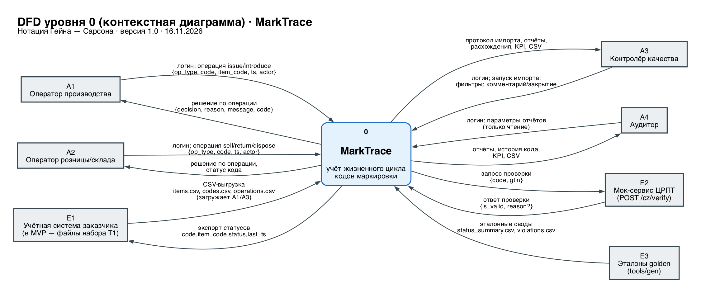
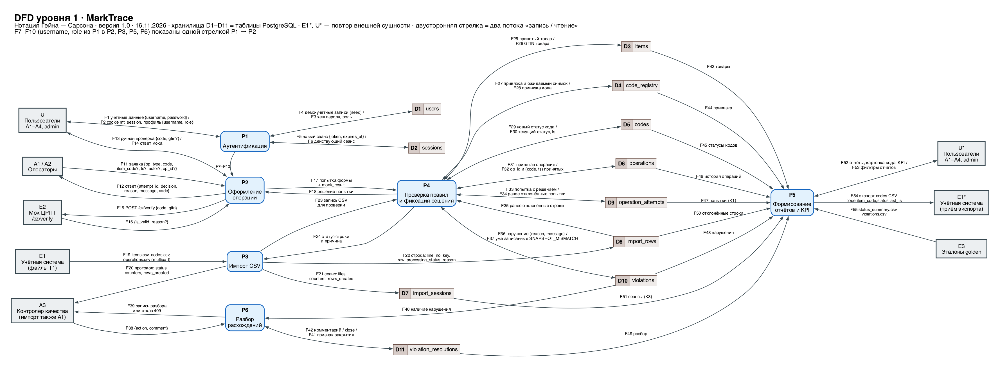

# 25. DFD: потоки данных MarkTrace

**MarkTrace · версия 1.0 · 16.11.2026**

Документ закрывает практику 23. На диаграммах показано, как данные идут между внешними сущностями, процессами и хранилищами реализованного MVP. Хранилища D1–D11 — это таблицы PostgreSQL из [ERD](12-erd.md). Процессы соответствуют пакетам backend и маршрутам `SPEC.md` §6.

**Нотация — Гейна — Сарсона:**

| Элемент | Обозначение |
|---|---|
| Процесс | Прямоугольник со скруглёнными углами; номер сверху |
| Хранилище | Прямоугольник без правой стороны с отделённым номером `Dn` |
| Внешняя сущность | Прямоугольник с жирной рамкой |
| Поток | Стрелка с именем `Fn`. Двусторонняя стрелка объединяет два потока противоположного направления, их имена разделены `/` |

Сущности с `*` (E1*, U*) повторены на DFD-1, чтобы линии не пересекали всю схему.

Исходники диаграмм: [dfd-0.dot](diagrams/dfd-0.dot), [dfd-1.dot](diagrams/dfd-1.dot) (Graphviz).

## 1. Внешние сущности

| ID | Сущность | Что передаёт | Что получает |
|---|---|---|---|
| A1 | Оператор производства (`prod`) | Операции `issue`/`introduce`, загрузку CSV | Решение по операции, отчёты |
| A2 | Оператор розницы/склада (`retail`) | Операции `sell`/`return`/`dispose` | Решение по операции, отчёты |
| A3 | Контролёр качества (`qc`) | Загрузку CSV, фильтры, комментарий и закрытие нарушения | Протокол импорта, «Расхождения», KPI, CSV |
| A4 | Аудитор (`auditor`) | Параметры отчётов | Те же отчёты, только чтение |
| E1 | Учётная система заказчика | `items.csv`, `codes.csv`, `operations.csv` | Экспорт статусов кодов CSV |
| E2 | Мок-сервис ЦРПТ (`mock`, `POST /cz/verify`) | `{is_valid, reason?}` | `{code, gtin}` |
| E3 | Эталоны golden (`tools/gen` → `golden/*.csv`) | `status_summary.csv`, `violations.csv` | — |

Учётная запись `admin` выполняет действия всех ролей. Отдельной сущностью она не показана.

Прямого канала с учётной системой в MVP нет. Её выгрузку изображают файлы набора T1, которые пользователь A1, A3 или admin загружает через страницу «Импорт». Экспорт пользователь скачивает и передаёт сам. Формат JSON, упомянутый в [08](08-actors-registry.md) и [10](10-c4-context.md), не реализован: импорт и экспорт работают только с CSV.

## 2. DFD уровня 0 (контекст)

[SVG](diagrams/dfd-0.svg)

| Поток | Откуда → куда | Данные | Формат и канал |
|---|---|---|---|
| Операция A1 | A1 → 0 | `{op_type: issue/introduce, code, item_code, ts?, actor?, op_id?}` | JSON, `POST /api/operations` |
| Операция A2 | A2 → 0 | `{op_type: sell/return/dispose, code, ts?, actor?, op_id?}` | JSON, `POST /api/operations` |
| Решение по операции | 0 → A1, A2 | `{attempt_id, op_id, decision, reason?, message?, code?}` | JSON |
| CSV-выгрузка | E1 → 0 | три файла T1 | multipart, `POST /api/imports` |
| Экспорт статусов | 0 → E1 | `code,item_code,status,last_ts` | CSV, `GET /api/codes/export.csv` |
| Команды A3 | A3 → 0 | вход, импорт, фильтры, `{action, comment}` | JSON, multipart |
| Отчёты A3/A4 | 0 → A3, A4 | «Коды», карточка кода, «Расхождения», протокол импорта, KPI, сверка с эталоном | JSON, CSV |
| Запрос проверки | 0 → E2 | `{code, gtin}` | JSON, HTTP POST, таймаут 2 с |
| Ответ проверки | E2 → 0 | `{is_valid, reason?}` | JSON |
| Эталонные своды | E3 → 0 | `status_summary.csv`, `violations.csv` | файлы в `GOLDEN_DIR` |

Вход в систему (логин и пароль) есть у всех ролей. На DFD-0 он входит в потоки команд, на DFD-1 вынесен в процесс P1.

## 3. DFD уровня 1

[SVG](diagrams/dfd-1.svg)

### 3.1. Процессы

| № | Процесс | Вход | Выход | Хранилища | Реализация |
|---|---|---|---|---|---|
| P1 | Аутентификация | F1 логин и пароль | F2 cookie и профиль; F7–F10 `username, role` для P2, P3, P5, P6 | D1 (чтение, seed), D2 (запись и чтение) | `backend/internal/auth`; `POST /api/auth/login`, `/logout`, `GET /api/auth/me`; проверка cookie в каждом запросе |
| P2 | Оформление операции | F11 заявка, F13 ручная проверка, F16 ответ мока, F18 решение | F12 ответ, F14 ответ мока, F15 запрос в мок, F17 попытка | — (пишет и читает через P4) | `backend/internal/ops/form.go`, `mock.go`; `POST /api/operations`, `POST /api/verify` |
| P3 | Импорт CSV | F19 файлы, F24 статус строки | F20 протокол, F21 сеанс, F22 строки, F23 запись для проверки | D7, D8 (запись) | `backend/internal/importer`; `POST /api/imports` |
| P4 | Проверка правил и фиксация решения | F17, F23; чтение D3–D6, D8–D10 | F18, F24; запись D3–D6, D9, D10 | D3, D4, D5, D6, D8, D9, D10 | `backend/internal/rules`, `ops/engine.go` (`Evaluate`, `Record`), `importer.processItem/processCode/SnapshotCheck` |
| P5 | Формирование отчётов и KPI | F43–F51 из хранилищ, F53 фильтры, F55 эталоны | F52 отчёты, F54 экспорт | D3–D11 (чтение) | `backend/internal/reports`; `GET /api/codes`, `/codes/export.csv`, `/codes/{code}`, `/status-summary.csv`, `/violations`, `/violations/export.csv`, `/kpi`, `/imports`, `/imports/{id}`, `/golden/compare`, `/items`, `/rules` |
| P6 | Разбор расхождений | F38 `{action, comment}`, F40, F41 | F39 результат, F42 запись разбора | D10 (чтение), D11 (запись и чтение) | `reports.Resolve`; `POST /api/violations/{id}/resolutions` |

Как работают процессы:

- **P2** принимает заявку и сначала проверяет роль. Если роль не подходит, P2 отвечает 403 `AUTH_DENIED` и ничего не записывает. Затем P2 подставляет значения по умолчанию (`op_id` — UUID, `ts` — время сервера, `actor` — имя пользователя) и запрашивает у P4 предварительное решение. Если правила пройдены, P2 вызывает мок, передаёт его ответ в P4 и получает окончательное решение. P4 перепроверяет состояние кода под блокировкой. Ручная проверка кода (F13/F14, страница «Проверка кода») проходит через P2 без записи в хранилища.
- **P3** создаёт сеанс в D7 и проверяет заголовки всех файлов. Если хотя бы один заголовок неверен, сеанс получает `structure_rejected`, и строки не обрабатываются. Иначе P3 записывает каждую строку в D8 и передаёт её в P4 в порядке items → codes → operations. После строк P3 запускает сверку снимка в P4 и закрывает сеанс со счётчиками и `rows_created`.
- **P4** — единственный процесс, который меняет предметные хранилища D3–D6. Он применяет проверки SPEC §2.3 в фиксированном порядке и выбирает одну причину. Приём пишется в D3, D4, D6 и D5, отказ — в D10, попытка операции — в D9. Прежние отказы (F34, F35) и уже записанные `SNAPSHOT_MISMATCH` (F37) он читает, чтобы повторный импорт не создавал новых строк.
- **P5** только читает. Экспорт `codes` уходит в E1*. Эталоны E3 сравниваются с текущими выгрузками `status_summary` и `violations`.

### 3.2. Хранилища

| ID | Таблица | Пишет | Читает |
|---|---|---|---|
| D1 | `users` | P1 (seed при старте, F4) | P1 (F3) |
| D2 | `sessions` | P1 (F5) | P1 (F6) |
| D3 | `items` | P4 (F25) | P4 (F26), P5 (F43) |
| D4 | `code_registry` | P4 (F27) | P4 (F28), P5 (F44) |
| D5 | `codes` | P4 (F29) | P4 (F30), P5 (F45) |
| D6 | `operations` | P4 (F31) | P4 (F32), P5 (F46) |
| D7 | `import_sessions` | P3 (F21) | P5 (F51) |
| D8 | `import_rows` | P3 (F22) | P4 (F35), P5 (F50) |
| D9 | `operation_attempts` | P4 (F33) | P4 (F34), P5 (F47) |
| D10 | `violations` | P4 (F36) | P4 (F37), P5 (F48), P6 (F40) |
| D11 | `violation_resolutions` | P6 (F42) | P6 (F41), P5 (F49) |

### 3.3. Потоки

| ID | Откуда → куда | Содержимое |
|---|---|---|
| F1 | U → P1 | `{username, password}` |
| F2 | P1 → U | cookie `mt_session` (12 ч), `{username, role, display_name}` |
| F3 | D1 → P1 | `password_hash`, `role`, `display_name` |
| F4 | P1 → D1 | 5 демо-учётных записей с bcrypt-хешем (при старте, если их нет) |
| F5 | P1 → D2 | `{token, username, expires_at}` |
| F6 | D2 → P1 | действующий сеанс по cookie (`expires_at > now`) |
| F7–F10 | P1 → P2, P3, P5, P6 | `username, role` текущего запроса (на схеме одна стрелка) |
| F11 | A1/A2 → P2 | `{op_type, code, item_code?, ts?, actor?, op_id?}` |
| F12 | P2 → A1/A2 | `{attempt_id, op_id, decision, reason?, message?, code?: {code, item_code, status, last_ts, last_actor}}` |
| F13 | U → P2 | `{code, gtin?}` |
| F14 | P2 → U | ответ мока или `{is_valid:false, reason:"MOCK_UNAVAILABLE"}` |
| F15 | P2 → E2 | `{code, gtin}`, где `gtin` = `items.gtin` товара кода |
| F16 | E2 → P2 | `{is_valid, reason?}`; `reason ∈ {INVALID_FORMAT, UNKNOWN_CODE, GTIN_MISMATCH}` |
| F17 | P2 → P4 | попытка формы и сырой ответ мока (`mock_result`) |
| F18 | P4 → P2 | `decision`, `reason`, `message` |
| F19 | E1 → P3 | multipart: поля `items`, `codes`, `operations` (до 20 МиБ на запрос) |
| F20 | P3 → A3 | `{session_id, status, counters, rows_created, snapshot_violations}`; отклонённые строки — в `GET /api/imports/{id}` |
| F21 | P3 → D7 | `started_by, role, status, failure_reason, files, counters, rows_created` |
| F22 | P3 → D8 | `entity, line_no, key, raw, processing_status, reason` |
| F23 | P3 → P4 | поля строки CSV, сущность, `row_id`, инициатор и роль |
| F24 | P4 → P3 | `accepted` / `duplicate` / `rejected` и код причины |
| F25 / F26 | P4 ⇄ D3 | новый товар / `name, gtin` для проверок |
| F27 / F28 | P4 ⇄ D4 | привязка и ожидаемый снимок / `item_code` кода и ожидания для сверки |
| F29 / F30 | P4 ⇄ D5 | upsert `status, ts, last_actor` / текущие `status, ts` |
| F31 / F32 | P4 ⇄ D6 | принятая операция / операции с тем же `op_id` или `(code, ts)` |
| F33 / F34 | P4 ⇄ D9 | попытка с решением / ранее отклонённая идентичная попытка |
| F35 | D8 → P4 | ранее отклонённая идентичная строка (`entity, key, raw`) |
| F36 / F37 | P4 ⇄ D10 | нарушение / уже записанный `SNAPSHOT_MISMATCH` с тем же текстом |
| F38 | A3 → P6 | `{action: comment/close, comment}` |
| F39 | P6 → A3 | запись разбора; 409 при повторном `close`; 403 для других ролей |
| F40 | D10 → P6 | факт существования нарушения |
| F41 | D11 → P6 | есть ли уже `close` |
| F42 | P6 → D11 | `{violation_id, action, comment, author}` |
| F43–F51 | D3–D11 → P5 | данные отчётов: товары, привязка, статусы, история, попытки (K1), нарушения, разбор, отклонённые строки, сеансы (K3) |
| F52 | P5 → U* | «Коды» (счётчики, строки, `elapsed_ms`), карточка кода, «Расхождения», протоколы, KPI K1–K5, сверка |
| F53 | U* → P5 | фильтры `status, item_code, actor, from, to, q, reason, source, state, limit, offset` |
| F54 | P5 → E1* | CSV `code,item_code,status,last_ts`, сортировка по `code` |
| F55 | E3 → P5 | `golden/status_summary.csv`, `golden/violations.csv` |

## 4. Проверка правил построения

| Правило ПР-23 | Выполнение |
|---|---|
| У процесса есть входной и выходной поток | P1: F1 → F2; P2: F11 → F12; P3: F19 → F20; P4: F17/F23 → F18/F24; P5: F53 → F52; P6: F38 → F39 |
| У хранилища есть вход и выход | Все D1–D11 есть в таблице 3.2 со столбцами «Пишет» и «Читает». D1 наполняется при старте (F4) |
| Внешняя сущность не обращается к хранилищу напрямую | Все потоки от U, A1–A3, E1–E3 идут в процессы |
| Имена потоков уникальны | F1–F55, каждый со своим содержимым. Роль из P1 разбита на F7–F10 по получателям |
| Уровень 1 согласован с уровнем 0 | Внешние сущности и потоки DFD-0 разложены по P1–P6: операции → P2, CSV → P3, отчёты и экспорт → P5, разбор → P6, мок → P2, golden → P5 |

## 5. Связь с другими артефактами

| Процесс | Use Case ([09](09-use-cases.md)) | BPMN ([11](11-bpmn-process.md)) |
|---|---|---|
| P1 | вход перед каждым UC | — |
| P2 + P4 | UC1–UC4 | раздел 3 «Оформление операции», `bpmn-operation` |
| P3 + P4 | UC7 | раздел 4 «Импорт CSV», `bpmn-import` |
| P5 | UC6, сводка KPI | — |
| P6 | UC5 | — |

## 6. Допущения и отличия от предыдущих документов

- Мок вызывается только из формы (P2) и с ручной проверки. Импорт (P3) мок не вызывает: коды проверяются по реестру D4 из `codes.csv`.
- Отложенной перепроверки (`pending`) нет. Если мок недоступен, попытка сразу отклоняется с `MOCK_UNAVAILABLE`, и её можно повторить.
- Ручная проверка кода ничего не сохраняет. В [08](08-actors-registry.md) UC5 упоминает «перепроверку через E2», но в MVP перепроверка выполняется со страницы «Проверка кода» и с самим нарушением не связана.
- Обмен с E1 идёт только файлами CSV через пользователя; JSON и прямой интерфейс не реализованы.
- Корреляция запросов идёт через `attempt_id` и `session_id`: их видно в ответе и в отчётах. Заголовка `X-Request-Id` нет.
