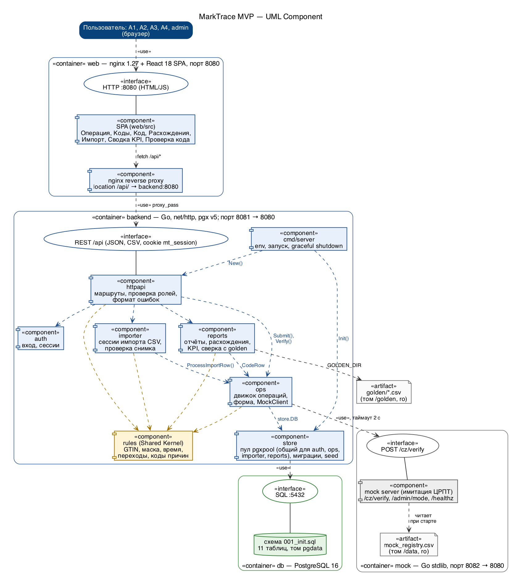
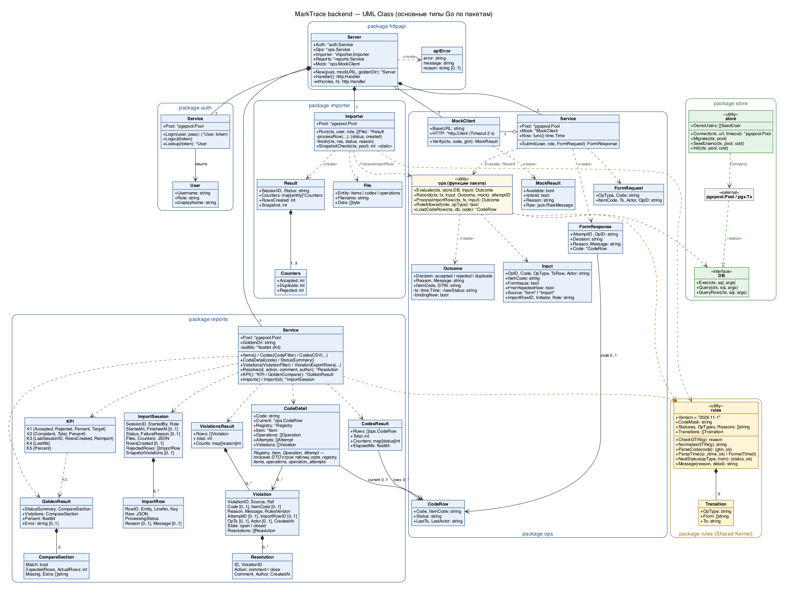
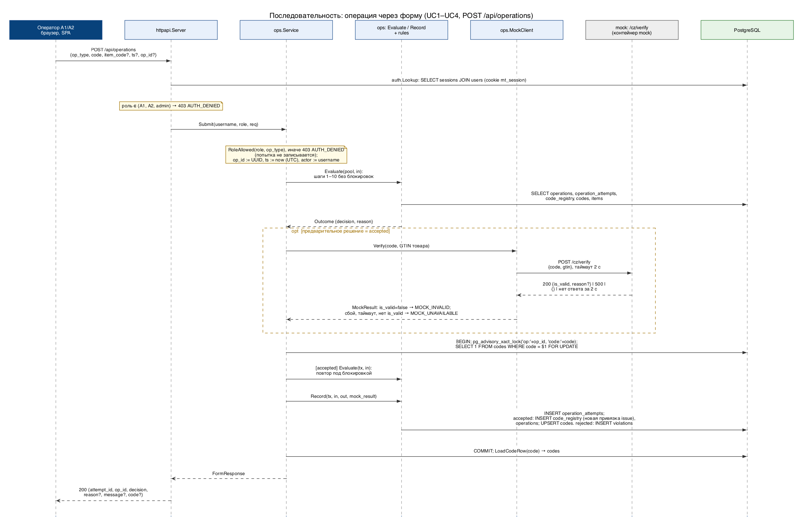
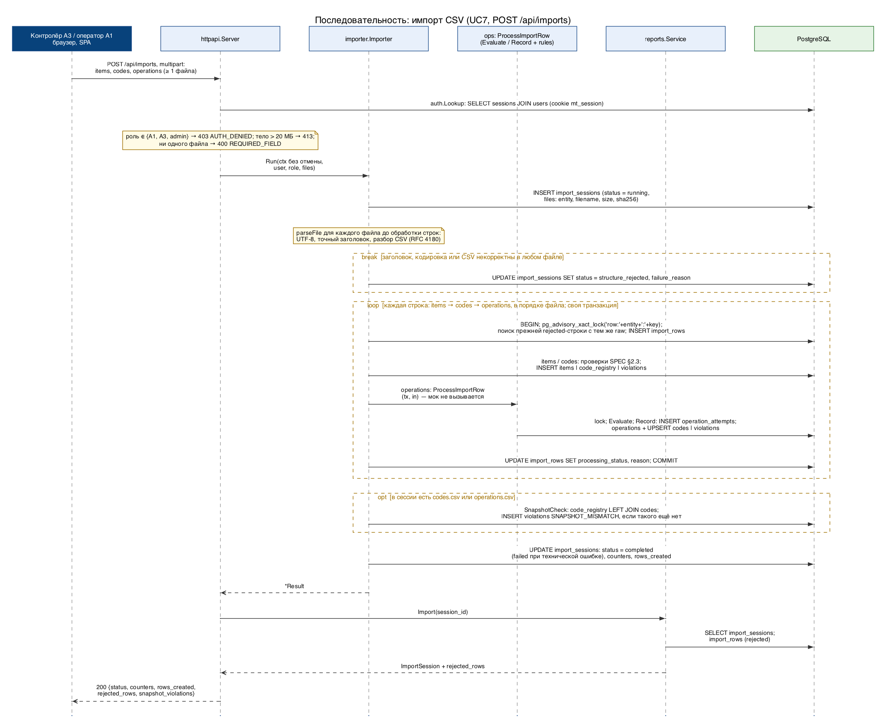

# 27. Архитектура модулей MarkTrace

**MarkTrace · версия 1.0 · 16.11.2026**

## 1. Назначение и основание

Документ фиксирует архитектуру реализованного MVP: контейнеры, пакеты backend, их ответственность и зависимости, основные типы (UML Class), последовательность двух ключевых сценариев, связь данных с процессами BPMN и развёртывание. Это артефакт контрольных точек 3–4 (практики 12–13 «агрегаты, контексты, слои» и 25–26 «модули и их зависимости, схема взаимодействия компонентов»).

Всё описанное сверено с кодом `backend/internal/*`, `mock/`, `web/nginx.conf`, `docker-compose.yml` и схемой `backend/internal/store/migrations/001_init.sql`. Контракт реализации — [SPEC.md](../SPEC.md). Внешний контекст — [C4 Context](10-c4-context.md), процессы — [BPMN](11-bpmn-process.md), логическая модель — [ERD](12-erd.md) и [словарь данных](13-data-dictionary.md), интерфейсы — [спецификация API](28-api.md) и [openapi.yaml](openapi.yaml). Где аналитические документы описывают больше, чем делает MVP, расхождение указано в разделе 10.

Нумерация сценариев — по [09-use-cases.md](09-use-cases.md): UC1–UC4 — операции через форму, UC5 — разбор расхождений, UC6 — отчёт «Статусы» и CSV, UC7 — импорт.

## 2. Контейнеры

| Контейнер | Технология | Порт (хост → контейнер) | Ответственность | Зависит от |
|---|---|---|---|---|
| `web` | React 18 + TypeScript + Vite, nginx 1.27 | 8080 → 80 | Раздаёт SPA; проксирует `/api/` на `backend:8080` (резолвер Docker DNS, `client_max_body_size 50m`, таймаут 300 с) | `backend` |
| `backend` | Go, `net/http` (маршруты Go 1.22), pgx v5, bcrypt | 8081 → 8080 | REST API, правила, импорт, отчёты, KPI; единственный, кто пишет в БД | `db` (healthcheck), `mock` |
| `mock` | Go stdlib | 8082 → 8080 | Имитация ЦРПТ: `POST /cz/verify`, переключение режима `/admin/mode` | файл `data/C16/mock_registry.csv` (ro) |
| `db` | PostgreSQL 16-alpine | наружу не публикуется | Хранение; том `pgdata` | — |

Браузер обращается только к `web`; `backend` и `mock` опубликованы на хосте для проверки API и демонстрации сбоев мока. Каталог `golden/` монтируется в `backend` только на чтение (`GOLDEN_DIR=/golden`) для сверки K5.

## 3. Слои (стратификация)

| Слой | Элементы MarkTrace |
|---|---|
| UX | SPA: «Операция», «Коды», «Код», «Расхождения», «Импорт», «Сводка KPI», «Проверка кода» (`web/src/pages`); роль определяет состав меню и кнопок |
| Application | `httpapi` (маршруты, роли, формат ошибок), `ops.Service.Submit` (сценарий формы), `importer.Importer.Run` (сценарий импорта), `reports.Service` (чтение и разбор расхождений) |
| Domain | `rules` (GTIN, маска кода, время, таблица переходов, коды причин, `rules_version`); движок `ops.Evaluate` / `ops.Record` (порядок проверок 1–10, решение `accepted / rejected / duplicate`) |
| Infrastructure | `store` (пул pgx, встроенные миграции, демо-пользователи), PostgreSQL, `ops.MockClient` (HTTP-клиент мока, таймаут 2 с), контейнер `mock`, файлы `golden/*.csv` |

Ограниченные контексты и карта связей между ними показаны на [contexts.png](diagrams/contexts.png). Соответствие контекстов пакетам: «Учёт операций» — `ops` + `rules`; «Импорт» — `importer`; «Отчётность и контроль» — `reports`; «Доступ» — `auth`; «Внешняя проверка» — `ops.MockClient` + контейнер `mock`. Общее ядро (Shared Kernel) — пакет `rules`: им пользуются и форма, и импорт, и отчёты.

## 4. Пакеты backend

| Пакет | Ответственность | Основные типы и функции | Зависит от | Таблицы: чтение / запись |
|---|---|---|---|---|
| `cmd/server` | Чтение env (`DATABASE_URL`, `MOCK_URL`, `GOLDEN_DIR`, `LISTEN_ADDR`), подключение к БД с ожиданием до 2 мин, миграции, запуск HTTP, корректная остановка по SIGTERM | `main` | `store`, `httpapi` | — |
| `httpapi` | Маршрутизация `/api/*`, проверка входа и роли (`with`), разбор JSON/multipart, коды ответа, единый формат ошибки, recover и журнал запросов | `Server`, `New`, `Handler`, `apiError`; наборы ролей `allRoles`, `opRoles`, `importRoles`, `resolveRoles` | `auth`, `ops`, `importer`, `reports`, `rules` | через сервисы |
| `auth` | Вход по паролю (bcrypt), сеанс-токен 32 байта, cookie `mt_session` (HttpOnly, SameSite=Lax, 12 ч), поиск пользователя по токену | `Service.Login/Logout/Lookup`, `User`, `SetCookie`, `ClearCookie` | pgx | `users` / `sessions` |
| `rules` | Чистые правила без ввода-вывода: GTIN-13/14 и контрольная цифра, нормализация GTIN, маска кода, формат времени, переходы статусов, 17 кодов причин и русские сообщения | `Version`, `CodeMask`, `Transitions`, `CheckGTIN`, `NormalizeGTIN`, `ParseCode`, `ParseTime`, `FormatTime`, `NextStatus`, `Message` | — | — |
| `ops` | Движок операции для обоих каналов: проверки 1–10 по SPEC §2.3, запись попытки и последствий; сценарий формы с вызовом мока и повторной проверкой под блокировкой; HTTP-клиент мока | `Evaluate`, `Record`, `ProcessImportRow`, `Service.Submit`, `RoleAllowed`, `MockClient.Verify`, `Input`, `Outcome`, `FormRequest`, `FormResponse`, `CodeRow` | `rules`, `store` (интерфейс `DB`) | `items`, `code_registry`, `codes`, `operations`, `operation_attempts` / `operation_attempts`, `operations`, `codes`, `code_registry`, `violations` |
| `importer` | Сессия импорта: метаданные файлов (sha256), структурная проверка всех файлов, построчная обработка items → codes → operations в порядке файла (одна транзакция на строку), проверка снимка | `Importer.Run`, `SnapshotCheck`, `File`, `Result`, `Counters`, `Headers` | `ops`, `rules` | все предметные / `import_sessions`, `import_rows`, `items`, `code_registry`, `violations` (+ через `ops`) |
| `reports` | Модели чтения: справочник, отчёт по кодам и CSV, история кода, сводка статусов, расхождения и их разбор, KPI K1–K5, сверка с golden, сессии импорта | `Service` (`Codes`, `CodesCSV`, `CodeDetail`, `StatusSummary`, `Violations`, `ViolationExportRows`, `Resolve`, `KPI`, `GoldenCompare`, `Imports`, `Import`), `CodeFilter`, `ViolationFilter` | `ops` (тип `CodeRow`, `LoadCodeRow`), `rules` | все таблицы / `violation_resolutions` |
| `store` | Подключение с повторами, встроенные (`embed`) миграции под advisory-lock, учёт `schema_migrations`, демо-пользователи | `Connect`, `Migrate`, `SeedUsers`, `Init`, интерфейс `DB` | pgx, bcrypt | `schema_migrations`, `users` |
| `testdb` | Только для тестов: временная БД на PostgreSQL из `TEST_DATABASE_URL` | — | `store` | — |

Направление зависимостей одностороннее: `httpapi` → сервисы → `rules`; циклов нет. `rules` не зависит ни от чего, поэтому форма и импорт не могут разойтись в правилах. `reports` только читает предметные таблицы и пишет одну таблицу — `violation_resolutions`.

## 5. UML Component

[Векторная схема SVG](diagrams/uml-component.svg) · [Исходник Graphviz](diagrams/uml-component.dot)

| Интерфейс | Поставщик | Потребитель | Формат |
|---|---|---|---|
| HTTP :8080 | `web` (nginx) | браузер | HTML/JS, `/api/*` проксируется |
| REST `/api` | `backend/httpapi` | SPA через nginx; скрипты `scripts/*.sh` напрямую на :8081 | JSON UTF-8, CSV; cookie `mt_session` |
| `POST /cz/verify` | `mock` | `ops.MockClient` (форма UC1–UC4 и `POST /api/verify`) | JSON `{code, gtin?}` → `{is_valid, reason?}` |
| SQL :5432 | `db` | `store` создаёт один `pgxpool.Pool`, его получают `auth`, `ops`, `importer`, `reports` | PostgreSQL wire protocol |

## 6. UML Class

[Векторная схема SVG](diagrams/uml-class.svg) · [Исходник Graphviz](diagrams/uml-class.dot)

Имена на диаграмме — реальные идентификаторы Go. Go не имеет классов: структура с методами изображена классом, набор функций пакета — классом со стереотипом «utility». Обозначения: закрашенный ромб — композиция (владелец создаёт и хранит часть), пустой ромб — агрегация (один экземпляр `MockClient` разделяют `httpapi.Server` и `ops.Service`), сплошная стрелка — ассоциация, пунктир — зависимость «use» или «create», пунктир с пустым треугольником — реализация интерфейса.

| Связь | Смысл |
|---|---|
| `httpapi.Server` ◆→ `auth.Service`, `ops.Service`, `importer.Importer`, `reports.Service` | Сервер собирает сервисы в `New(pool, mockURL, goldenDir)`; все получают один пул |
| `ops.Service` ◇→ `MockClient` | Тот же клиент используется в `POST /api/verify` |
| `ops.Evaluate` → `store.DB` | Проверки работают и на пуле (предпроверка формы), и в транзакции `pgx.Tx` (запись). Оба типа реализуют `store.DB` |
| `importer.Importer` → `ops.ProcessImportRow` | Строки `operations.csv` проходят тот же движок, что и форма, но без мока |
| `reports.CodesResult`, `CodeDetail`, `ops.FormResponse` → `ops.CodeRow` | Одна проекция кода в ответах формы и отчётов |
| `reports.Violation` ◆→ `Resolution` | Комментарии и закрытие возвращаются вместе с расхождением; `State` вычисляется по наличию `close` |
| `rules` ◆→ `Transition` ×5 | Таблица переходов SPEC §1.4 — данные, а не ветвления в коде; отдаётся в `GET /api/rules` |

## 7. Последовательности

### 7.1. Операция через форму (UC1–UC4)

[SVG](diagrams/seq-operation.svg) · [Исходник](diagrams/seq-operation.dot)

| Шаг | Что происходит | Где в коде |
|---|---|---|
| 1 | SPA отправляет `POST /api/operations`; `with(opRoles)` находит пользователя по cookie, иначе 401; A3/A4 → 403 | `httpapi.Server.with` |
| 2 | Проверка роли по типу операции: issue/introduce — A1, sell/return/dispose — A2, admin — все. Отказ → 403 `AUTH_DENIED`, попытка не записывается | `ops.RoleAllowed` |
| 3 | Значения по умолчанию: `op_id` = новый UUID, `ts` = текущее время UTC с точностью до секунды, `actor` = логин | `ops.Service.Submit` |
| 4 | Предпроверка без блокировок: шаги 1–10 SPEC §2.3, для `issue` — привязка к товару и сравнение GTIN | `ops.Evaluate` |
| 5 | Только если предварительное решение `accepted`: вызов мока с GTIN товара, таймаут 2 с. `is_valid=false` → `MOCK_INVALID`; таймаут, сеть, не 200, нет `is_valid` → `MOCK_UNAVAILABLE` | `ops.MockClient.Verify` |
| 6 | Транзакция: advisory-lock по `op_id` и по `code`, `SELECT … FOR UPDATE` строки `codes`; если решение ещё `accepted` — повторная `Evaluate` в транзакции | `ops.lock`, `ops.Evaluate` |
| 7 | Запись: всегда `operation_attempts` (с `mock_result`); при `accepted` — новая привязка в `code_registry` (только `issue` с формы), `operations`, upsert `codes`; при `rejected` — `violations` | `ops.Record` |
| 8 | Ответ 200 `{attempt_id, op_id, decision, reason?, message?, code?}`. Бизнес-отказ — тоже 200, причина в теле | `httpapi.operation` |

### 7.2. Импорт CSV (UC7)

[SVG](diagrams/seq-import.svg) · [Исходник](diagrams/seq-import.dot)

| Шаг | Что происходит | Где в коде |
|---|---|---|
| 1 | `POST /api/imports` (multipart `items`, `codes`, `operations`, хотя бы одно поле); роли A1, A3, admin; лимит 20 МБ | `httpapi.importFiles` |
| 2 | Создаётся сессия `running` с метаданными файлов (имя, размер, sha256). Обработка не прерывается при обрыве соединения клиента | `importer.Importer.Run` |
| 3 | Все файлы разбираются до обработки строк: UTF-8, BOM снимается, заголовок совпадает точно. Ошибка → `structure_rejected` с `failure_reason`, строки не обрабатываются | `importer.parseFile` |
| 4 | Строки обрабатываются по порядку items → codes → operations, внутри файла — в порядке строк. Одна строка — одна транзакция с advisory-lock по ключу | `importer.processRow` |
| 5 | Строка `items`/`codes` проверяется в `importer`; строка `operations` — общим движком `ops.ProcessImportRow` без вызова мока | `processItem`, `processCode`, `processOperation` |
| 6 | Каждой строке — один итог `accepted / duplicate / rejected`, у отклонённой — одна причина и одна запись `violations` | `import_rows.processing_status` |
| 7 | Если в сессии есть `codes.csv` или `operations.csv` — проверка снимка: `SNAPSHOT_MISMATCH` для каждого кода, где фактический `status/ts` не равен ожидаемому, без повторов | `importer.SnapshotCheck` |
| 8 | Сессия закрывается `completed` (или `failed` при технической ошибке) со счётчиками и `rows_created`; ответ — детализация сессии с отклонёнными строками | `importer.finish`, `reports.Import` |

## 8. Связь данных с процессами

Схемы процессов: [bpmn-operation.png](diagrams/bpmn-operation.png), [bpmn-import.png](diagrams/bpmn-import.png); потоки данных — [dfd-1.png](diagrams/dfd-1.png). Обозначения: C — вставка, R — чтение, U — изменение.

### 8.1. Операция (bpmn-operation)

| Узел BPMN | Реализация | Таблицы |
|---|---|---|
| `Op_Input` | Форма «Операция»; справочник товаров для `issue` | R `items` (через `GET /api/items`) |
| `Op_Preflight` | `with` + `RoleAllowed` + `Evaluate` (без блокировок) | R `sessions`, `users`, `operations`, `operation_attempts`, `code_registry`, `codes`, `items` |
| `Op_Local` → `Op_Return` | Решение `duplicate`: мок не вызывается, новой операции нет | C `operation_attempts` (`decision=duplicate`) |
| `Op_Verify`, `Op_MockResult` | `MockClient.Verify` | таблиц нет; ответ мока сохраняется в `operation_attempts.mock_result` |
| `Op_Timeout`, `Op_Unavailable` → `Op_Reject` | Попытка отклоняется с `MOCK_UNAVAILABLE` (статуса `pending` нет) | C `operation_attempts` (`rejected`), C `violations` |
| `Op_Commit`, `Op_Applied` | Транзакция с блокировками, повторная `Evaluate`, `Record` | C `operation_attempts`, C `code_registry` (новая привязка `issue`), C `operations`, C/U `codes` |
| `Op_Show` | `LoadCodeRow` → поле `code` ответа | R `codes` |
| `Op_Reject` | `Record` с решением `rejected` | C `operation_attempts`, C `violations` |
| `Op_WriteError` → `Op_TechFailure` | Транзакция откатывается, ответ 500; повтор с тем же `op_id` безопасен (раздел 6 [API](28-api.md)) | ничего не записывается |

### 8.2. Импорт (bpmn-import)

| Узел BPMN | Реализация | Таблицы |
|---|---|---|
| `Imp_Select` | Страница «Импорт», три поля файлов, заполнить можно любое непустое подмножество | — |
| `Imp_Structure`, `Imp_Valid` | `parseFile` для всех файлов | C `import_sessions` (`running`) |
| `Imp_RejectAll` | `finish(structure_rejected)` | U `import_sessions` (`status`, `failure_reason`) |
| `Imp_Open`, `Imp_Queue` | Сессия создана; очередь — строки в порядке items → codes → operations | C `import_sessions.files` |
| `Imp_Row`, `Imp_Result` | `processRow` → `processItem` / `processCode` / `ops.ProcessImportRow` | R `items`, `code_registry`, `codes`, `operations`, `operation_attempts`, `import_rows`; C `import_rows` |
| `Imp_Accept` | Принятая строка | C `items` или C `code_registry` или C `operations` + C/U `codes` + C `operation_attempts`; U `import_rows` |
| `Imp_Duplicate` | Повтор | U `import_rows`; для operations — C `operation_attempts` (`duplicate`) |
| `Imp_RejectRow` | Отклонение с одной причиной | C `violations`; U `import_rows` (`reason`); для operations — C `operation_attempts` (`rejected`) |
| `Imp_Summary` | `SnapshotCheck` и `finish(completed)` | R `code_registry`, `codes`; C `violations` (`SNAPSHOT_MISMATCH`); U `import_sessions` (`counters`, `rows_created`) |
| `Imp_Fault` → `Imp_Failed` | `finish(failed)`; уже зафиксированные строки остаются | U `import_sessions` (`failed`, `failure_reason`) |

### 8.3. Процессы вне двух BPMN-схем

| Процесс | Эндпойнт | Таблицы |
|---|---|---|
| Вход и выход | `POST /api/auth/login`, `/logout` | R `users`; C/D `sessions` |
| UC5: разбор расхождений | `GET /api/violations`, `POST /api/violations/{id}/resolutions` | R `violations`, `violation_resolutions`; C `violation_resolutions` |
| UC6: статусы и выгрузка | `GET /api/codes`, `/codes/export.csv`, `/status-summary.csv`, `/codes/{code}` | R `codes`, `code_registry`, `items`, `operations`, `operation_attempts`, `violations` |
| KPI и сверка | `GET /api/kpi`, `/golden/compare` | R `operation_attempts`, `operations`, `codes`, `import_sessions`, `violations`; файлы `golden/*.csv` |

### 8.4. Матрица CRUD: таблица × модуль

| Таблица | `auth` | `ops` | `importer` | `reports` | `store` |
|---|---|---|---|---|---|
| `users` | R | — | — | — | C (seed) |
| `sessions` | C R D | — | — | — | — |
| `items` | — | R | C R | R | — |
| `code_registry` | — | C R | C R | R | — |
| `codes` | — | C R U | R | R | — |
| `operations` | — | C R | — | R | — |
| `operation_attempts` | — | C R | — | R | — |
| `import_sessions` | — | — | C U | R | — |
| `import_rows` | — | — | C R U | R | — |
| `violations` | — | C | C R | R | — |
| `violation_resolutions` | — | — | — | C R | — |

Удалений предметных данных нет: история операций, попытки и расхождения только добавляются. Единственное `UPDATE` предметной таблицы — проекция `codes`.

## 9. Развёртывание

Стенд поднимается одной командой `make up` (`docker compose up -d --build`); `make verify` пересоздаёт его с чистым томом и прогоняет приёмочный сценарий.

| Узел | Образ / сборка | Конфигурация | Тома | Проверка готовности |
|---|---|---|---|---|
| `db` | `postgres:16-alpine` | `POSTGRES_USER/PASSWORD/DB = marktrace` | `pgdata` | `pg_isready`, каждые 3 с, 20 попыток |
| `mock` | `./mock` | `ADDR=:8080`, `REGISTRY_FILE=/data/mock_registry.csv`, `MOCK_MODE=normal`, `MOCK_SLOW_MS=5000` | `data/C16/mock_registry.csv` (ro) | `GET /healthz` |
| `backend` | `./backend`: сборка `golang:1.26-alpine`, запуск `alpine:3.22` от пользователя `app` (uid 10001) | `DATABASE_URL`, `MOCK_URL=http://mock:8080`, `GOLDEN_DIR=/golden`, `LISTEN_ADDR=:8080` | `golden/` (ro) | `HEALTHCHECK wget /healthz`; старт после `db: service_healthy` |
| `web` | `./web`: сборка `node:22-alpine`, запуск `nginx:1.27-alpine` | `nginx.conf`: SPA с fallback на `index.html`, `/assets/` кэш 7 дней, `/api/` → backend | — | — |

Миграции встроены в бинарь (`embed`) и применяются при каждом старте под `pg_advisory_xact_lock`; демо-пользователи создаются, если их нет. Все сервисы — `restart: unless-stopped`. Наружу торчат только HTTP-порты 8080–8082; TLS на учебном стенде не используется.

## 10. Отклонения от аналитических документов

| Документ | Что описано | Что в MVP | Почему |
|---|---|---|---|
| [12-erd.md](12-erd.md), [13-data-dictionary.md](13-data-dictionary.md) | `operation_requests` с `request_id` и `decision_status` из 6 значений | `operation_attempts` с `attempt_id`; решения только `accepted / rejected / duplicate` | Упрощение SPEC §4 |
| 12, 13 | `verification_checks` — отдельная запись на каждый вызов мока | Ответ мока хранится в `operation_attempts.mock_result` (jsonb); один вызов на попытку | Повторов вызова в MVP нет |
| BPMN v1.0 ([11](11-bpmn-process.md) §9) `Op_Pending`, 13 | Недоступность мока → `pending`, позднее возобновление | Отказ `MOCK_UNAVAILABLE`; такая попытка не считается окончательной: повтор с тем же `op_id` проверяется заново | Нет фоновой обработки |
| 12 | `codes.item_code → items` хранит привязку; FK `operations.code → codes` | Привязка вынесена в `code_registry`, `codes` — только проекция; FK `operations.code → code_registry` | Нужно хранить ожидаемый снимок из `codes.csv` и привязку до первой операции |
| 12, правило R7/R8 | В `violations` ровно одна ссылка: `request_id` XOR `import_row_id` | У нарушения строки `operations.csv` заполнены обе (`attempt_id` и `import_row_id`); у `SNAPSHOT_MISMATCH` — ни одной; ссылки без FK-ограничений | Упрощение SPEC §4 |
| BPMN v1.0, §4.3 | Операции импорта упорядочиваются по времени внутри кода, очередь учитывает зависимости | Строки обрабатываются строго в порядке файла (SPEC §2.2); строка «из прошлого» получает `TIME_REVERSED` | Детерминизм и совпадение с golden |
| BPMN v1.0, §4.1 | Отсутствие обязательного файла или неверное число полей → `structure_rejected` | Можно загрузить любое непустое подмножество файлов; неверное число полей — отказ строки `VALUE_FORMAT` | SPEC §2.1–2.2 |
| BPMN v1.0, 12 | Нумерация UC1 «операция», UC2 «импорт», UC5 «проверка через мок» | Используется нумерация [09](09-use-cases.md): UC1–UC4, UC7, проверка — `POST /api/verify` | 09 — актуальная версия |

Схемы BPMN версии 1.1 ([11](11-bpmn-process.md)) уже приведены к MVP; строки «BPMN v1.0» описывают первую модель, показанную на защите 2.

## 11. Статус реализации и проверка модулей

| Модуль | Статус | Автотесты | Ответственный (роль) |
|---|---|---|---|
| `rules` | Реализован | `rules_test.go`: GTIN, маска, время, переходы, перечисления, сообщения | Брусникин Максим (backend) |
| `ops` | Реализован | `form_test.go`: жизненный цикл, привязка `issue`, роли, сбои мока | Брусникин Максим (backend) |
| `importer` | Реализован | `importer_test.go`: причины, снимок, повторный импорт, `structure_rejected`, сессии в неверном порядке, кавычки | Брусникин Максим (backend) |
| `reports` | Реализован | `reports_test.go`: сортировка экспорта, сверка мультимножеств, разбор дат фильтра | Брусникин Максим (backend) |
| `httpapi` | Реализован | `api_test.go` (сквозной сценарий API), `golden_test.go` (K5 = 100 % на T1) | Брусникин Максим (backend) |
| `mock` | Реализован | `mock/server_test.go`: сценарии проверки, режимы `error/garbage/slow`, `/admin/mode`, журнал | Брусникин Максим (backend) |
| `tools/gen` | Реализован | `gen_test.go`: детерминизм, актуальность файлов в репозитории, контрольная цифра GS1 | Брусникин Максим (backend) |
| `web` | Реализован, идёт обновление оформления | сборка `npm run build` в `make test` | Жраков Артём (frontend) |
| Сквозная проверка | `make verify`: чистый стек, импорт T1, golden, повторный импорт, роли | `scripts/verify.sh`, `scripts/demo.sh` | Шиншин Алексей (тимлид), Завгороднев Ярослав (аналитик) |

Фактические значения KPI на стенде после импорта T1 и повторного импорта: K1 = 99,19 % (862 принятых, 7 отклонённых), K2 = 100 % (512 из 512), K3 = 0 новых строк при повторном импорте, K4 ≈ 1 мс, K5 = 100 % (5 из 5 строк сводки и 18 из 18 расхождений).
