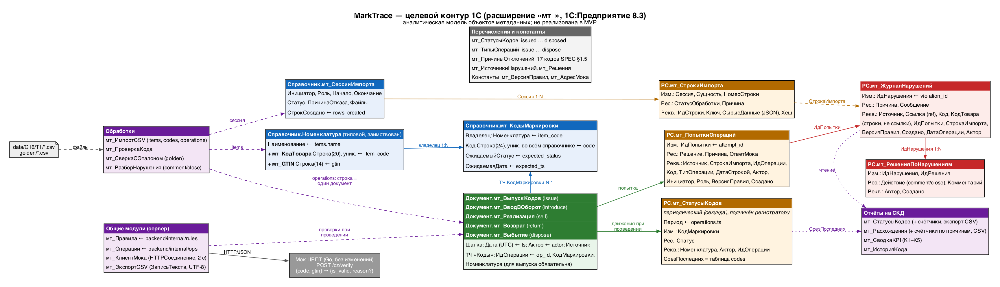
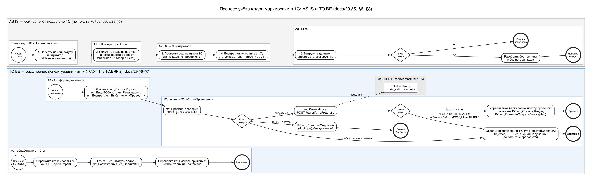

# 29. Целевой контур 1С: ТЗ на доработку конфигурации

**MarkTrace · версия 1.0 · 16.11.2026**

Артефакт этапа «Анализ бизнес-процесса и подготовка ТЗ на доработку 1С» (ПР 27–32). Документ **аналитический**: он описывает, как правила, данные и сценарии MarkTrace ложатся на объекты 1С:Предприятие 8.3. В MVP ни один объект 1С не реализован. Работающий продукт — Go + PostgreSQL + React ([SPEC.md](../SPEC.md)). Все имена объектов 1С ниже — проектные.

Связанные артефакты: [карточка](01-project-card.md), [Use Case](09-use-cases.md), [BPMN](11-bpmn-process.md), [ERD](12-erd.md), [словарь данных](13-data-dictionary.md), схема БД `backend/internal/store/migrations/001_init.sql`.

## 0. Почему MVP сделан не на 1С

| Факт | Источник | Следствие |
|---|---|---|
| Кейс перечисляет компоненты 1С «при наличии у заказчика» и называет 1С:ERP целевым контуром, где процессы маркировки живут «в бою» | кейс 16, §6 | 1С — это контур заказчика, а не обязательная платформа макета |
| Демо-базы 1С разрешены, «если кафедра предоставляет». При их отсутствии нужно зафиксировать это и проверять решение на CSV | кейс 16, §7 | MVP работает на CSV-наборе T1 |
| Демо-база с объектами маркировки и лицензии для командной разработки команде не выданы [подтвердить у куратора] | риск R01 в [01](01-project-card.md) и [16](16-risk-matrix.md) «Нет эталонных данных и демо-системы» | Без базы нельзя ни проверить сценарий D16, ни сдать конфигурацию |
| Стек команды и ресурс — ≈ 192 чел.-ч (4 человека × 6 ч × 8 нед): Go, PostgreSQL, React | [01](01-project-card.md), [02](02-project-charter.md) §8 и §11 | Разработка на 1С с нуля не укладывалась в срок v1.0 |
| Правила кейса не зависят от платформы: маска кода, GTIN, граф переходов, идемпотентность | SPEC §1–§2 | Правила, данные и эталоны переносятся в 1С без изменения смысла (раздел 14) |

Решение: MVP реализован на собственном стеке. Для 1С в этом документе подготовлено ТЗ на доработку, модель объектов метаданных, таблица маппинга и план переноса. Так закрываются ПР 27–32 и пункты «Артефакты решения на платформе 1С» и «Финальное ТЗ с описанием артефактов 1С» финальной защиты.

---

## 1. Название задачи

Учебный контур учёта жизненного цикла кодов маркировки в 1С:Управление торговлей 11 (расширение конфигурации «мт_»).

## 2. Постановщик задачи

Аналитик — Завгороднев Ярослав. Согласует тимлид — Шиншин Алексей. Заказчик (роль): куратор кейса [ФИО куратора].

## 3. Дата

16.11.2026, версия 1.0.

## 4. Цель доработки

Дать оператору и контролёру в 1С единый регистр текущих статусов кодов маркировки. Операции жизненного цикла должны проверяться автоматически по правилам версии `2026.11-1`, расхождения — попадать в журнал с машинно-читаемой причиной. Цель KPI та же, что у MVP: доля корректно оформленных операций на T1 ≥ 99% (K1).

**Проблема → обоснование → цель доработки (ПР 28)**

| № | Проблема в текущем процессе | Обоснование | Цель доработки | Тип |
|---|---|---|---|---|
| П1 | Статус кода не хранится в учётной базе. Его смотрят в ЛК оператора или в Excel | [01](01-project-card.md) «Проблема»; кейс §2 «статусная целостность» | РС «мт_СтатусыКодов»: статус = последняя проведённая операция | Ф |
| П2 | Операции проводят в неверном порядке: продажа без ввода, повторный вывод | кейс §2.2–2.3 | Проверка перехода при проведении документа, отказ с причиной `TRANSITION_NOT_ALLOWED` | Ф |
| П3 | Ошибки формата кода и GTIN находят только при обмене с оператором | кейс §2.4 | Проверка маски кода, длины и контрольной цифры GTIN при вводе и импорте | Ф |
| П4 | Повторная загрузка выгрузки создаёт дубли | кейс §3 «Надёжность» | Идемпотентный импорт по `op_id`, `(code, ts)` и хешу сырой строки | Ф/НФ |
| П5 | Расхождения разбирают вручную, без истории решений | кейс §4; UC5 | РС «мт_ЖурналНарушений», комментарий и закрытие нарушения | Ф |
| П6 | Нет отчёта «статусы + ошибки» с фильтрами и выгрузкой | кейс §4 | Отчёты на СКД, экспорт CSV в формате golden | Ф |
| П7 | Аудитор имеет те же права, что и оператор | кейс §3 «Доступы» | Роли 1С, у аудитора только чтение | НФ |

Ф — функциональная, НФ — нефункциональная.

## 5. Описание текущего процесса (AS IS)

**Допущение.** Процесс AS IS описан по тексту кейса и по [08](08-actors-registry.md) (E1 «Учётная система заказчика»). Демо-конфигурацию 1С:УТ на 1cfresh.com, указанную в ПР 27, команда не изучала [подтвердить доступ / приложить скриншоты, если он будет].

| Шаг | Кто | Где сейчас | Ограничение |
|---|---|---|---|
| 1. Завести номенклатуру со штрихкодом | Товаровед | 1С: справочник «Номенклатура», штрихкоды | Контрольная цифра GTIN не проверяется при записи |
| 2. Получить коды на партию, нанести, ввести в оборот | Оператор производства (A1) | ЛК оператора / внешний сервис, список кодов в Excel | Связь «код → товар» живёт вне 1С |
| 3. Отгрузить или продать товар | Оператор розницы/склада (A2) | 1С: документ реализации; код сканируется на кассе или складе | Учёт не знает, введён ли код в оборот |
| 4. Принять возврат, списать товар | A2 | 1С: возврат и списание; статус кода меняют вручную во внешнем сервисе | Повторный вывод и продажу после вывода никто не замечает |
| 5. Свести статусы и найти ошибки | Контролёр качества (A3) | Выгрузки в Excel, ручная сверка | Поздно, без причины ошибки и без истории разбора |

## 6. Предлагаемые изменения (TO BE)

Доработка оформляется **расширением конфигурации** с префиксом «мт_». Типовая конфигурация не меняется, расширение подключается к 1С:УТ 11 или 1С:ERP 2: обе используют общий справочник «Номенклатура». Типовую подсистему интеграции с ИС МП (боевая ГИС МТ, УКЭП) расширение не использует и не трогает — это W1 в [MoSCoW](03-moscow.md).

**Точки автоматизации (ПР 27, ПР 29)**

| ID | Шаг AS IS | Что автоматизируем | Объект 1С | Правило SPEC |
|---|---|---|---|---|
| ТА1 | 1 | Проверка GTIN при записи номенклатуры | Справочник «Номенклатура», ПередЗаписью → мт_Правила | §1.1 |
| ТА2 | 2 | Выпуск и ввод кода с привязкой к товару | Документы «мт_ВыпускКодов», «мт_ВводВОборот» | §1.2, §1.4, §3 |
| ТА3 | 3–4 | Продажа, возврат, вывод с проверкой перехода и времени | Документы «мт_Реализация», «мт_Возврат», «мт_Выбытие» | §1.4 |
| ТА4 | 2–4 | Проверка кода во внешнем сервисе | Общий модуль «мт_КлиентМока» → `POST /cz/verify` | §3, §8 |
| ТА5 | 2–4, выгрузки | Идемпотентная загрузка items, codes, operations | Обработка «мт_ИмпортCSV» | §2 |
| ТА6 | 5 | Отчёты, KPI, разбор расхождений | Отчёты на СКД, РС «мт_ЖурналНарушений» | §5, §6 |

**Новые объекты** — полный состав в разделе 7. Кратко: 2 справочника (плюс 2 реквизита типовой «Номенклатуры»), 6 перечислений, 3 константы, 5 документов, 5 регистров сведений, 4 отчёта на СКД, 4 обработки, 4 общих модуля, 5 ролей, подсистема «Маркировка (учебный макет)».

**Требования к форме, регистру и отчёту (ПР 28)**

| Объект | Требование | Критерий приёмки |
|---|---|---|
| Форма документа операции | Поля: Дата, Актор (по умолчанию текущий пользователь), ТЧ «Коды». Для выпуска колонка «Номенклатура» обязательна. Кнопка «Проверить код». При отказе в проведении — сообщение с кодом причины и текстом на русском | Сценарии UC1–UC4 из [09](09-use-cases.md). Отказ показывает причину из `мт_ПричиныОтклонений` |
| РС «мт_СтатусыКодов» | Пишется только движениями документов, ручной ввод запрещён. Срез последних даёт `code, item_code, status, last_ts, last_actor` | K2 = 100%. Срез совпадает с `codes` MVP на T1 |
| Отчёт «мт_СтатусыКодов» | Колонки `code, item_code, status, last_ts` + счётчики по 5 статусам. Отборы: период, товар, статус, актор, подстрока кода. Команда «Экспорт CSV» | Свод совпадает с `golden/status_summary.csv`, время ≤ 2 с на T1 |
| Отчёт «мт_Расхождения» | Причина, источник, ссылка, код, товар, актор, состояние (открыто/закрыто). Отборы, счётчики по причинам, экспорт CSV `code,reason,source,ref` | Совпадение с `golden/violations.csv` (18 строк) |

## 7. Модель данных (ПР 30)



[SVG](diagrams/1c-model.svg) · [исходник Graphviz](diagrams/1c-model.dot)

### 7.1. Справочники

| Объект | Реквизит | Тип 1С | Источник MarkTrace | Примечание |
|---|---|---|---|---|
| Справочник.Номенклатура (типовой, заимствован в расширение) | Наименование | Строка | `items.name` | типовой реквизит |
| | **мт_КодТовара** | Строка(20) | `items.item_code` | уникальность проверяется в ПередЗаписью |
| | **мт_GTIN** | Строка(14) | `items.gtin` | строка, ведущие нули сохраняются. GTIN-13 и GTIN-14, контрольная цифра — ТА1 |
| Справочник.мт_КодыМаркировки | Владелец | СправочникСсылка.Номенклатура | `code_registry.item_code` | подчинённый справочник |
| | Код | Строка(24) | `code_registry.code` | контроль уникальности по всему справочнику, без обрезки пробелов и смены регистра |
| | ОжидаемыйСтатус | ПеречислениеСсылка.мт_СтатусыКодов | `expected_status` | пусто для кодов, созданных из формы |
| | ОжидаемаяДата | Дата (дата и время, UTC) | `expected_ts` | пусто для кодов, созданных из формы |
| Справочник.мт_СессииИмпорта | Инициатор, Роль, Начало, Окончание, Статус, ПричинаОтказа, Файлы (Строка неогр., JSON), Счётчики (JSON), СтрокСоздано (Число) | | `import_sessions` | Статус: running / completed / structure_rejected / failed |

### 7.2. Перечисления и константы

| Объект | Значения | Источник |
|---|---|---|
| Перечисление.мт_СтатусыКодов | issued, introduced, sold, returned, disposed (синонимы «Выпущен», «Введён в оборот», «Продан», «Возвращён», «Выведен из оборота») | SPEC §1.4 |
| Перечисление.мт_ТипыОпераций | issue, introduce, sell, return, dispose | SPEC §1.4 |
| Перечисление.мт_ПричиныОтклонений | 17 кодов SPEC §1.5: `AUTH_DENIED` … `MOCK_UNAVAILABLE` | `backend/internal/rules/reasons.go` |
| Перечисление.мт_ИсточникиНарушений | items, codes, operations | `violations.source` |
| Перечисление.мт_РешенияПопытки | accepted, rejected, duplicate | `operation_attempts.decision` |
| Перечисление.мт_ДействияРазбора | comment, close | `violation_resolutions.action` |
| Константа.мт_ВерсияПравил | `2026.11-1` | `rules.Version` |
| Константа.мт_АдресМока | `http://mock:8080` [адрес стенда] | env `MOCK_URL` |
| Константа.мт_КаталогЭталонов | путь к `golden/` | env `GOLDEN_DIR` |

Имена значений перечислений заданы латиницей, как в SPEC. Так экспорт CSV даёт байт-в-байт те же строки, что и golden.

### 7.3. Документы (журнал операций)

Пять документов с одинаковой структурой. Один вид документа соответствует одному `op_type`.

| Документ | op_type | Роль | Разрешённый предыдущий статус |
|---|---|---|---|
| мт_ВыпускКодов | issue | A1 | у кода нет принятой истории |
| мт_ВводВОборот | introduce | A1 | issued |
| мт_Реализация | sell | A2 | introduced, returned |
| мт_Возврат | return | A2 | sold |
| мт_Выбытие | dispose | A2 | introduced, sold, returned |

| Реквизит | Тип | Источник | Правило |
|---|---|---|---|
| Дата (стандартный) | Дата и время | `operations.ts` | хранится в UTC: в 1С тип «Дата» без часового пояса, смещение из RFC 3339 переводится в UTC при вводе и импорте |
| Актор (шапка) | Строка(50) | `operations.actor` | по умолчанию — имя текущего пользователя |
| Источник (шапка) | form / import | `operation_attempts.source` | |
| ТЧ «Коды».ИдОперации | Строка(36) | `operations.op_id` | уникален во всей ИБ: проверка запросом по ТЧ всех пяти документов |
| ТЧ «Коды».КодМаркировки | СправочникСсылка.мт_КодыМаркировки | `operations.code` | |
| ТЧ «Коды».Номенклатура | СправочникСсылка.Номенклатура | `code_registry.item_code` | обязательна для выпуска, иначе заполняется из владельца кода |

**Проведение** (`ОбработкаПроведения`, сервер). Для каждой строки ТЧ выполняются проверки SPEC §2.3, шаги 1–10, затем вызов мока (§3). Используется управляемая блокировка РС «мт_СтатусыКодов» по измерению КодМаркировки — аналог `SELECT … FOR UPDATE` в MVP. При успехе пишутся движения в РС «мт_СтатусыКодов». Запись в РС «мт_ПопыткиОпераций» (на каждую строку ТЧ, любое решение) и при отказе запись в РС «мт_ЖурналНарушений» делаются в отдельной транзакции, вне транзакции проведения, иначе откат проведения стёр бы след отказа. При отказе документ не проводится.

### 7.4. Регистры сведений

| Регистр | Режим | Измерения | Ресурсы | Реквизиты | Таблица MVP |
|---|---|---|---|---|---|
| мт_СтатусыКодов | периодический (секунда), подчинён регистратору (5 документов) | КодМаркировки | Статус | Номенклатура, Актор, ИдОперации | `codes` (срез последних) + след `operations` |
| мт_ПопыткиОпераций | независимый | ИдПопытки (УникальныйИдентификатор) | Решение, Причина, ОтветМока (JSON) | Источник, СтрокаИмпорта, ИдОперации, Код (Строка), ТипОперации (Строка), ДатаСтрокой, Актор, Инициатор, Роль, ВерсияПравил, Создано | `operation_attempts` |
| мт_ЖурналНарушений | независимый | ИдНарушения | Причина, Сообщение | Источник, Ссылка (ref), Код, КодТовара, ИдПопытки, СтрокаИмпорта, ВерсияПравил, Создано, ДатаОперации, Актор | `violations` |
| мт_РешенияПоНарушениям | независимый | ИдНарушения, ИдРешения | Действие, Комментарий (не пустой) | Автор, Создано | `violation_resolutions` |
| мт_СтрокиИмпорта | независимый | Сессия (СправочникСсылка.мт_СессииИмпорта), Сущность, НомерСтроки | СтатусОбработки, Причина | ИдСтроки, Ключ, СырыеДанные (JSON), Хеш (SHA-256 сырых данных) | `import_rows` |

Почему так:

- **Статус = срез последних.** Таблица `codes` в MVP — проекция последней принятой операции. В 1С это `РегистрСведений.мт_СтатусыКодов.СрезПоследних()`: статус по построению совпадает с журналом, K2 = 100% без отдельного пересчёта.
- **Уникальность `(code, ts)`.** У регистра, подчинённого регистратору, ключ записи — регистратор и номер строки. Платформа не запрещает две записи с одинаковыми периодом и кодом от разных документов. Поэтому проверка `IDEMPOTENCY_CONFLICT` / `duplicate` по `(code, ts)` (SPEC §2.3, шаг 6) выполняется запросом при проведении.
- **Код и товар в нарушениях — строки, а не ссылки.** Отклонённая строка может содержать код, которого нет в справочнике (`CODE_FORMAT`, `CODE_NOT_FOUND`). Golden сравнивает сырые значения из файла.
- **Нет удаления.** Документы не удаляются, нарушения не правятся: разбор только добавляет записи в «мт_РешенияПоНарушениям» (второе `close` → отказ, как 409 в MVP).

### 7.5. Отчёты, обработки, общие модули

| Объект | Назначение | Аналог в MarkTrace |
|---|---|---|
| Отчёт.мт_СтатусыКодов (СКД) | срез последних + счётчики по статусам, отборы, команда «Экспорт CSV», команда «Свод статусов CSV» | `GET /api/codes`, `/codes/export.csv`, `/status-summary.csv` |
| Отчёт.мт_Расхождения (СКД) | журнал нарушений + решения, счётчики по причинам, экспорт `code,reason,source,ref` | `GET /api/violations`, `/violations/export.csv` |
| Отчёт.мт_СводкаKPI (СКД) | K1–K5 по формулам SPEC §5 | `GET /api/kpi` |
| Отчёт.мт_ИсторияКода (СКД) | привязка, операции по времени, попытки, нарушения одного кода | `GET /api/codes/{code}` |
| Обработка.мт_ИмпортCSV | загрузка трёх файлов, порядок items → codes → operations → проверка снимка | `POST /api/imports` |
| Обработка.мт_ПроверкаКода | ручная проверка кода в моке | `POST /api/verify` |
| Обработка.мт_СверкаСЭталоном | сравнение экспортов с `golden/*.csv`, вывод missing/extra | `GET /api/golden/compare` |
| Обработка.мт_РазборНарушения | комментарий или закрытие нарушения | `POST /api/violations/{id}/resolutions` |
| ОбщийМодуль.мт_Правила (сервер) | GTIN (§1.1), маска кода (§1.2), разбор времени (§1.3), граф переходов (§1.4) | `backend/internal/rules` |
| ОбщийМодуль.мт_Операции (сервер) | порядок проверок §2.3, запись попыток и нарушений | `backend/internal/ops`, `importer` |
| ОбщийМодуль.мт_КлиентМока (сервер) | `HTTPСоединение`, таймаут 2 с, разбор JSON | `ops/mock.go` |
| ОбщийМодуль.мт_ЭкспортCSV (сервер) | запись CSV через `ЗаписьТекста` (UTF-8, `,`, кавычки по RFC 4180) | `reports/*.go` |

Экспорт CSV делается общим модулем, а не сохранением табличного документа: среди форматов сохранения табличного документа нет CSV, и формат golden должен совпасть побайтно. Маска кода проверяется посимвольно (длина 24, префикс `01`, 14 цифр, `21`, 6 символов `[A-Za-z0-9]`), чтобы не зависеть от поддержки регулярных выражений в версии платформы.

## 8. Бизнес-процесс (ПР 29)

Схема AS IS / TO BE в нотации BPMN (пулы, дорожки, события, шлюзы): верхний пул — текущий процесс из раздела 5, нижний — процесс в расширении «мт_» с объектами раздела 7 и ветвью отказа `MOCK_UNAVAILABLE`.



[SVG](diagrams/1c-process.svg) · [исходник Graphviz](diagrams/1c-process.dot)

Подробный TO BE по шагам совпадает с BPMN MarkTrace версии 1.1 ([11](11-bpmn-process.md), `diagrams/bpmn-operation.*`, `diagrams/bpmn-import.*`): недоступность мока — сразу отказ `MOCK_UNAVAILABLE`, отложенной проверки нет. Меняется только реализация задач:

| Задача BPMN (TO BE) | AS IS | TO BE в 1С |
|---|---|---|
| Ввод операции | Excel / ЛК оператора | Форма документа «мт_…», кнопка «Провести» |
| Проверка формата, GTIN, перехода, времени | вручную или не проверяется | ОбработкаПроведения → мт_Правила |
| Проверка кода у оператора | ЛК оператора | мт_КлиентМока → мок `/cz/verify` |
| Обновление статуса | ручная правка во внешнем сервисе | движение РС «мт_СтатусыКодов» |
| Фиксация отказа | нет | запись РС «мт_ЖурналНарушений» с причиной |
| Загрузка выгрузки | копирование в Excel | Обработка «мт_ИмпортCSV» с журналом сессий |
| Отчёт и разбор | ручная сверка | Отчёты СКД, Обработка «мт_РазборНарушения» |
| Недоступность мока | — | Отказ проведения с `MOCK_UNAVAILABLE`, запись попытки и нарушения; повтор документом с тем же ИдОперации |

## 9. Интеграция (ПР 31)

### 9.1. Сценарии обмена

| № | Источник → приёмник | Механизм 1С | Формат | Триггер / частота | Идемпотентность |
|---|---|---|---|---|---|
| И1 | 1С → мок ЦРПТ | `HTTPСоединение`, `POST /cz/verify` | JSON по HTTP | при проведении каждой строки документа; по кнопке «Проверить код» | мок без состояния, повтор безопасен |
| И2 | Файлы E1 → 1С | Обработка «мт_ИмпортCSV» (файловый обмен) | CSV UTF-8, заголовок обязателен | по запуску контролёром (A3) или оператором (A1) | `op_id`, `(code, ts)`, хеш сырой строки: повтор T1 даёт 0 новых записей (K3) |
| И3 | 1С → E1 / проверяющий | команды «Экспорт CSV» в отчётах | CSV `code,item_code,status,last_ts`; `status,count`; `code,reason,source,ref` | по запросу пользователя | экспорт без записи в базу |
| И4 | Внешняя система → 1С (опционально, Could) | HTTP-сервис «мт_API», корень `/hs/marktrace/v1/` | JSON | по событию во внешней системе | та же логика, что И2 (ключ `op_id`) |

ГИС МТ «Честный знак» (E3) не подключается ни в каком сценарии.

### 9.2. Структура сообщения И1

Запрос `POST {мт_АдресМока}/cz/verify`, `Content-Type: application/json`:

| Поле | Тип | Обяз. | Источник в 1С |
|---|---|---|---|
| `code` | string(24) | да | ТЧ.КодМаркировки.Код |
| `gtin` | string(13/14) | нет | ТЧ.Номенклатура.мт_GTIN |

Ответ `200`:

| Поле | Тип | Значения |
|---|---|---|
| `is_valid` | bool | true / false |
| `reason` | string | `INVALID_FORMAT`, `UNKNOWN_CODE`, `GTIN_MISMATCH` (только при `is_valid=false`) |

```json
{"code": "010460419899417021yOm9sp", "gtin": "04604198994170"}
{"is_valid": true}
```

Обработка ошибок, как SPEC §3: `is_valid=false` → `MOCK_INVALID` (с текстом `reason`). Таймаут 2 с, сетевая ошибка, код ≠ 200 или нет `is_valid` → `MOCK_UNAVAILABLE`. Документ не проводится, попытка и нарушение записываются. Режимы мока `slow`, `error`, `garbage` (`POST /admin/mode`) используются как контрольные примеры отказов.

### 9.3. Структура файлов И2/И3

Формат — SPEC §2.1 без изменений: `items.csv` (`item_code,name,gtin`), `codes.csv` (`code,item_code,status,ts`), `operations.csv` (`op_id,code,op_type,ts,actor`). Заголовок не совпал → сессия `structure_rejected`, строки не обрабатываются. Строки обрабатываются в порядке файла, каждая в своей транзакции.

## 10. Требования к интерфейсу

| Форма / отчёт | Поля и элементы | Роли |
|---|---|---|
| Форма документа операции (5 видов) | Дата, Актор, ТЧ «Коды» (ИдОперации, КодМаркировки, Номенклатура), «Проверить код», «Провести» | A1: выпуск, ввод; A2: реализация, возврат, выбытие |
| Форма элемента «мт_КодыМаркировки» | Код, Владелец, текущий статус (срез), отчёт «мт_ИсторияКода» во вкладке | все, на чтение |
| Отчёт «мт_СтатусыКодов» | счётчики по 5 статусам, таблица, отборы, «Экспорт CSV» | все |
| Отчёт «мт_Расхождения» | счётчики по причинам, таблица, отборы, «Экспорт CSV», «Комментарий/Закрыть» | все; разбор — A3 |
| Обработка «мт_ИмпортCSV» | 3 поля выбора файла, итог по сущностям (accepted / duplicate / rejected), «Строк создано», отклонённые строки с причиной | A1, A3 |
| Отчёт «мт_СводкаKPI» | плитки K1–K5, цель K1 = 99 | все |
| Обработка «мт_СверкаСЭталоном» | % совпадения, списки missing / extra | все |

Подсистема «Маркировка (учебный макет)» собирает команды в одном разделе. Для аудитора (A4) команды записи недоступны.

## 11. Нефункциональные требования

| Требование | Значение | Как проверить |
|---|---|---|
| Время отчёта «Статусы» на T1 | ≤ 2 с (K4) | замер на T1 (512 кодов в своде) |
| Идемпотентность импорта | 0 новых записей при повторе T1 (K3) | повторный запуск «мт_ИмпортCSV» |
| Доступность мока | отказ мока не теряет данные: попытка записана, документ не проведён | режимы `slow`, `error` |
| Конкурентный доступ | две операции над одним кодом не проходят обе | управляемая блокировка по КодМаркировки |
| Трассируемость | каждая попытка и нарушение хранят `ВерсияПравил` | поле в регистрах |
| Совместимость | расширение без изменения типовой конфигурации, платформа 8.3 | установка на чистую демо-базу УТ |
| Данные | только синтетика T1, без ПДн | |

## 12. Примечания: вопросы, риски, отклонения

**Отличия 1С-контура от MVP (осознанные)**

| № | MarkTrace MVP | Целевой 1С | Последствие |
|---|---|---|---|
| О1 | Одна операция = один запрос, решение по каждой отдельно | Документ формы может содержать несколько кодов в ТЧ; проведение атомарно: одна ошибка отменяет весь документ | Нарушения всё равно пишутся по каждой строке. Импорт создаёт документ на каждую строку `operations.csv`, поэтому golden не меняется |
| О2 | `timestamptz`, вывод в UTC | Тип «Дата» без часового пояса, хранится UTC | Конвертация смещения при вводе; в формах показ местного времени |
| О3 | Журнал `operations` — отдельная таблица | Журнал = проведённые документы + движения регистра | Таблица `operations` не нужна; ключ `op_id` — в ТЧ |
| О4 | Свои пользователи, cookie-сессии (`users`, `sessions`) | Пользователи ИБ и роли платформы | Таблицы `users`, `sessions` не переносятся |
| О5 | Веб-интерфейс React | Управляемые формы 1С (тонкий/веб-клиент) | `web/` не переиспользуется |

**Вопросы заказчику**

- Целевая конфигурация — УТ 11 или ERP 2 [уточнить], и какая версия платформы.
- Выдаётся ли демо-база или учебная платформа для проверки на стенде [уточнить].
- Нужен ли HTTP-сервис И4 или достаточно файлового обмена.

**Риски**

| Риск | Мера |
|---|---|
| Ограничения учебной версии платформы на объём данных | Проверить загрузку T1 (≈1,5 тыс. строк в трёх файлах); при нехватке — сокращённый набор и сверка по нему |
| Расхождение правил двух реализаций | Один источник правил — SPEC §1–§2; контрольные примеры из `rules_test.go` и golden прогоняются на обеих |
| Конфликт расширения с обновлением типовой конфигурации | Заимствуется только «Номенклатура», добавлены два реквизита с префиксом «мт_» |

---

## 13. Маппинг MarkTrace → 1С

### 13.1. Таблицы БД

| Таблица MarkTrace (`001_init.sql`) | Объект 1С | Поле → реквизит |
|---|---|---|
| `items` | Справочник.Номенклатура (+ расширение) | `item_code` → мт_КодТовара; `name` → Наименование; `gtin` → мт_GTIN |
| `code_registry` | Справочник.мт_КодыМаркировки | `code` → Код; `item_code` → Владелец; `expected_status` → ОжидаемыйСтатус; `expected_ts` → ОжидаемаяДата |
| `codes` | РС.мт_СтатусыКодов, срез последних | `code` → КодМаркировки; `status` → Статус; `ts` → Период; `last_actor` → Актор; `item_code` → Номенклатура |
| `operations` | Документы мт_ВыпускКодов … мт_Выбытие | `op_id` → ТЧ.ИдОперации; `code` → ТЧ.КодМаркировки; `op_type` → вид документа; `ts` → Дата; `actor` → Актор; `attempt_id` → связь через РС попыток |
| `operation_attempts` | РС.мт_ПопыткиОпераций | 1:1 по полям; `mock_result` → ОтветМока (JSON) |
| `violations` | РС.мт_ЖурналНарушений | 1:1 по полям; `reason` → мт_ПричиныОтклонений |
| `violation_resolutions` | РС.мт_РешенияПоНарушениям | `action` → Действие; `comment` → Комментарий; `author` → Автор |
| `import_sessions` | Справочник.мт_СессииИмпорта | 1:1 по полям |
| `import_rows` | РС.мт_СтрокиИмпорта | `raw` → СырыеДанные; + Хеш для поиска «ранее отклонённой идентичной строки» |
| `users` | Пользователи ИБ + роли | `role` → набор ролей (13.3) |
| `sessions` | — | аутентификация платформы |

### 13.2. REST API → объекты 1С

| Эндпойнт MarkTrace (SPEC §6) | Объект 1С |
|---|---|
| `POST /auth/login`, `/auth/logout`, `GET /auth/me` | аутентификация платформы, `ПользователиИнформационнойБазы` |
| `GET /rules` | Константа мт_ВерсияПравил + мт_Правила |
| `GET /items` | форма списка «Номенклатура» |
| `POST /operations` | форма документа «мт_…», проведение |
| `GET /codes`, `/codes/export.csv`, `/status-summary.csv` | Отчёт мт_СтатусыКодов + мт_ЭкспортCSV |
| `GET /codes/{code}` | форма элемента мт_КодыМаркировки + Отчёт мт_ИсторияКода |
| `GET /violations`, `/violations/export.csv` | Отчёт мт_Расхождения + мт_ЭкспортCSV |
| `POST /violations/{id}/resolutions` | Обработка мт_РазборНарушения |
| `GET /kpi` | Отчёт мт_СводкаKPI |
| `POST /imports`, `GET /imports`, `GET /imports/{id}` | Обработка мт_ИмпортCSV, список мт_СессииИмпорта |
| `GET /golden/compare` | Обработка мт_СверкаСЭталоном |
| `POST /verify` | Обработка мт_ПроверкаКода → мт_КлиентМока |
| мок `POST /cz/verify` | остаётся внешним сервисом Go (`mock/`), вызывается из 1С |

### 13.3. Роли 1С

| Роль 1С | Актор | Права |
|---|---|---|
| мт_ОператорПроизводства | A1 | Добавление и проведение мт_ВыпускКодов, мт_ВводВОборот; запуск мт_ИмпортCSV; чтение справочников и отчётов |
| мт_ОператорРозницы | A2 | Добавление и проведение мт_Реализация, мт_Возврат, мт_Выбытие; чтение |
| мт_КонтролерКачества | A3 | Запуск мт_ИмпортCSV; запись РС мт_РешенияПоНарушениям; чтение всего; документы операций — нет |
| мт_Аудитор | A4 | Только чтение объектов подсистемы и отчётов |
| ПолныеПрава | admin | Всё |

Все роли могут запускать мт_ПроверкаКода. Регистры мт_СтатусыКодов, мт_ПопыткиОпераций, мт_ЖурналНарушений интерактивно не редактирует никто: запись идёт только из модулей в привилегированном режиме. Это аналог «пишет только backend» в SPEC §4.

## 14. Что переиспользуется и план переноса

| Актив MarkTrace | Как используется в 1С |
|---|---|
| Правила SPEC §1 (версия `2026.11-1`) и порядок проверок §2.3 | спецификация для мт_Правила и мт_Операции, без изменений |
| Причины отказа (17 кодов) | значения мт_ПричиныОтклонений |
| Тесты `backend/internal/rules/rules_test.go`, `importer_test.go` | контрольные примеры для ручной и автотестовой проверки 1С |
| Данные `data/C16/T1/*.csv` | вход мт_ИмпортCSV как есть |
| Эталоны `golden/status_summary.csv`, `golden/violations.csv` | критерий приёмки 1С-контура: совпадение 100% (K5) |
| Мок `mock/` + `data/C16/mock_registry.csv`, `demo_codes.csv` | внешний сервис для И1; демо-коды для живого показа |
| BPMN, ERD, словарь, Use Case, роли A1–A4 | без изменений |
| `backend/`, `web/` | не переносятся (код Go и React) |

**План переноса** (оценка ~70 чел.-ч, при наличии демо-базы УТ и платформы):

| Этап | Результат | Исполнитель | Оценка |
|---|---|---|---|
| 1. Метаданные | расширение «мт_»: справочники, перечисления, константы, документы, регистры, роли | Брусникин Максим | 12 ч |
| 2. Правила и проведение | мт_Правила, мт_Операции, мт_КлиентМока; прогон контрольных примеров | Брусникин Максим | 20 ч |
| 3. Импорт и экспорт | мт_ИмпортCSV, мт_ЭкспортCSV; повтор T1 → 0 новых записей | Брусникин Максим | 14 ч |
| 4. Формы и отчёты | формы документов, 4 отчёта СКД, мт_РазборНарушения, подсистема | Жраков Артём | 16 ч |
| 5. Приёмка | сверка с golden (мт_СверкаСЭталоном), сценарий D16, замер K4 | Завгороднев Ярослав, Шиншин Алексей | 8 ч |

Критерий готовности: на чистой базе после одной загрузки T1 выгрузки 1С совпадают с `golden/*.csv`. Это та же проверка, что `make verify` для MVP.

## 15. Что показать на защите по 1С

**Слайд 1. Почему не 1С и что сделано вместо этого.** Две строки из раздела 0: кейс допускает 1С «при наличии у заказчика», демо-база не выдана, MVP проверен на CSV по §7 кейса. Ниже — диаграмма `diagrams/1c-model.png`: целевой контур как расширение «мт_» к 1С:УТ/ERP.

**Слайд 2. Как MarkTrace ложится на 1С.** Сокращённая таблица 13.1 (`items` → Номенклатура, `code_registry` → справочник «мт_КодыМаркировки», `codes` → срез РС «мт_СтатусыКодов», `operations` → 5 документов, `violations` → РС «мт_ЖурналНарушений») и таблица ролей 13.3. Тезис: статус = срез последних регистра, поэтому K2 = 100% по построению.

**Слайд 3. Что переносится без изменений и как проверить.** Правила, T1, golden, мок — из раздела 14. Критерий: выгрузки 1С побайтно совпадают с golden. План из 5 этапов, ~70 чел.-ч.

Вопросы, к которым стоит подготовиться: «почему регистр сведений, а не накопления» (у кода нет количества, только статус); «где проверяется уникальность `(code, ts)`» (запросом при проведении, см. 7.4); «что будет при недоступности мока» (`MOCK_UNAVAILABLE`, документ не проведён, попытка записана).
