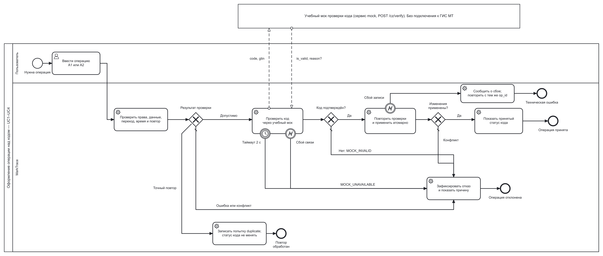
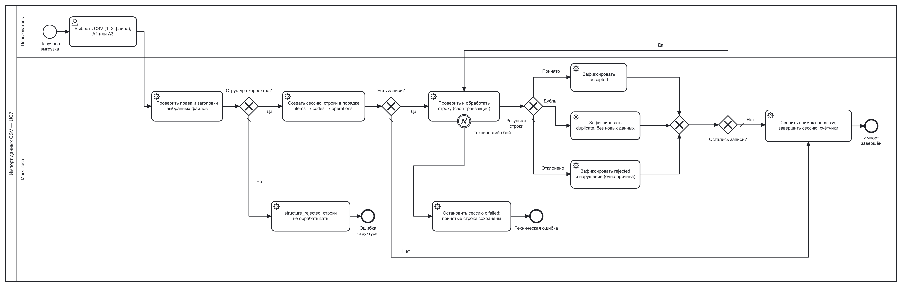
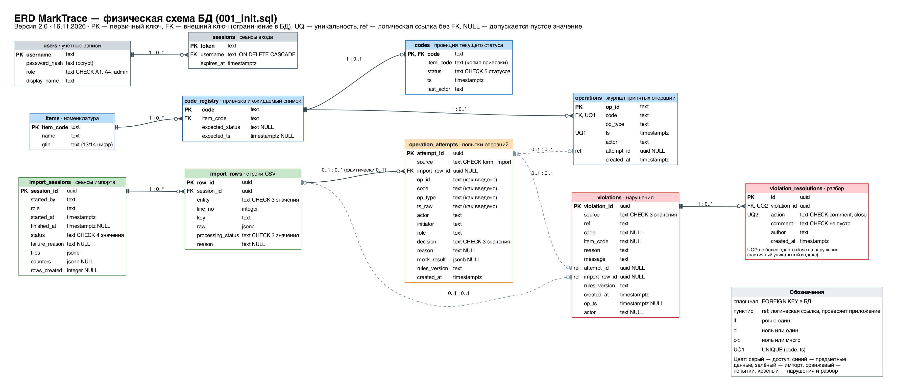
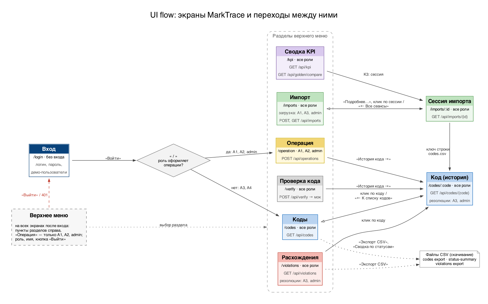

# 30. Техническое задание на разработку MVP

**MarkTrace · версия 1.0 · 16.11.2026**

Финальное техническое задание к защите 4 (практики 17, 21, 28 и 32). Структура и нумерация разделов — по шаблону ТЗ курса. Содержание сверено с реализацией в репозитории: `SPEC.md` (контракт реализации), `backend/internal/store/migrations/001_init.sql` (схема БД), `backend/internal/httpapi` (API и роли), `web/src` (экраны), `scripts/verify.sh` и `scripts/demo.sh` (приёмка). Где аналитические документы описывают больше, чем делает MVP, это указано как отклонение или допущение.

| Поле | Значение |
|---|---|
| Документ | Техническое задание на разработку MVP проекта «MarkTrace — учебный макет учёта жизненного цикла кодов маркировки» |
| Команда | [номер команды], группа ЭФБО-02-25 |
| Дисциплина | Основы проектной деятельности (МИРЭА, ИТУ, Центр технологий 1С) |
| Кейс | 16 — Маркировка «Честный знак» (макет) |
| Версия документа | 1.0 |
| Дата | 16.11.2026 |

## 1. Общие сведения

### 1.1. Полное наименование проекта

Учебный макет учёта жизненного цикла кодов маркировки «Честный знак» (кейс 16).

### 1.2. Краткое наименование проекта

**MarkTrace**.

### 1.3. Основание для разработки

Настоящее техническое задание разработано в рамках выполнения командного проекта по дисциплине «Основы проектной деятельности», кейс 16 «Маркировка "Честный знак" (макет)». Исходные документы: [карточка проекта](01-project-card.md), [устав](02-project-charter.md), [MoSCoW v0.2](03-moscow.md) (заморожен в конце недели 2).

### 1.4. Назначение документа

Настоящее техническое задание определяет назначение, границы MVP, состав пользователей, основные функции, требования к данным, интерфейсу и критерии приёмки проекта MarkTrace. Документ служит основой для приёмки MVP v1.0 (задача Ф13 в [плане](23-mvp-plan.md)) и для переноса решения на платформу 1С ([приложение Л](29-1c-target.md)).

### 1.5. Состав команды

| № | ФИО участника | Роль в команде | Зона ответственности |
|---|---|---|---|
| 1 | Шиншин Алексей | Тимлид (Project Lead); роль кейса P4 | Сроки, риски, KPI, приёмка, демо-сценарий, презентация |
| 2 | Завгороднев Ярослав | Аналитик (BA/SA); роль кейса P3 | MoSCoW, Use Case, BPMN, ERD, словарь данных, DFD, маппинг, модель 1С, ТЗ |
| 3 | Брусникин Максим | Backend-разработчик; роли кейса P1, P2, P5 | Правила проверок, операции, импорт и экспорт CSV, отчёты и KPI, мок `/cz/verify`, генератор T1 и эталонов, автотесты |
| 4 | Жраков Артём | Frontend-разработчик; роли кейса P1, P2 | Веб-интерфейс: вход, форма операции, отчёты и фильтры, история кода, импорт, сводка KPI |

### 1.6. История версий документа

| Версия | Дата | Автор | Изменения |
|---|---|---|---|
| 0.1 | [дата защиты 3] | Завгороднев Ярослав | Черновик ТЗ (ЧТЗ) к защите 3: назначение, границы MVP, роли, процесс, требования по MoSCoW, модель данных по ERD v1.0 |
| 1.0 | 16.11.2026 | Завгороднев Ярослав; проверка — Шиншин Алексей | Финальная версия к защите 4: требования сверены с реализацией MVP; модель данных приведена к схеме `001_init.sql` (ERD v2.0); добавлены трассировка FR → MoSCoW / UC / US / экран / API, таблица проверки FR, отклонения от BPMN, обоснование стека и ссылка на целевой контур 1С; схемы BPMN заменены версией 1.1 (без `pending`), связи пронумерованы R1–R10 как в ERD, критерий 10.1 п. 8 (M13) |

## 2. Назначение и цели создания системы

### 2.1. Проблема, решаемая проектом

Компания, которая выпускает или продаёт маркируемый товар, должна вести каждый код маркировки по цепочке выпуск → ввод в оборот → продажа → возврат → вывод из оборота. Учёт ведётся в разрозненных таблицах и личных кабинетах внешних сервисов. В результате:

- операции оформляются в неверном порядке: продажа без ввода в оборот, повторный вывод, продажа после вывода;
- коды и GTIN содержат ошибки формата и контрольной цифры, статус кода расходится с журналом операций;
- расхождения находят поздно и разбирают вручную, потому что нет отчёта «статусы + ошибки» с причиной и историей.

Подключаться для отработки процесса к боевой ГИС МТ нельзя. Нужен безопасный макет, на котором проверяются процесс и правила данных.

### 2.2. Целевая аудитория

| Группа | Кто | Чем пользуется |
|---|---|---|
| Основные пользователи | Контролёр качества (A3, персона «Ирина», [06](06-user-persona.md)) | Импорт, отчёты «Статусы» и «Расхождения», разбор, KPI |
| Основные пользователи | Оператор розницы/склада (A2, персона «Андрей») | Форма операций sell, return, dispose |
| Основные пользователи | Оператор производства (A1) | Форма операций issue, introduce; импорт |
| Дополнительные | Аудитор (A4) | Все отчёты и история только для чтения |
| Дополнительные | Заказчик (куратор кейса), преподаватель | Демонстрация, сверка с эталоном, приёмка |

### 2.3. Назначение системы

Система MarkTrace предназначена для регистрации операций жизненного цикла кодов маркировки на макетных данных, проверки каждой операции по единым версионируемым правилам (формат кода, GTIN, уникальность, допустимый переход, время, ответ имитации ЦРПТ), хранения полного протокола попыток и причин отказа, а также для построения отчётов по статусам кодов и расхождениям с выгрузкой в CSV.

### 2.4. Цель создания системы

Целью создания системы является выпуск к неделе 8 MVP-макета, который на синтетическом наборе T1 (≥ 500 кодов, 600–900 операций) оформляет операции жизненного цикла, находит нарушения формата, уникальности и последовательности и выдаёт отчёты по статусам и расхождениям. Доля корректно оформленных операций на макете (K1) — не менее 99%, результат совпадает с эталонами `golden/` на 100% (K5).

### 2.5. Задачи проекта

Для достижения поставленной цели необходимо решить следующие задачи:

1. Формализовать жизненный цикл кода, правила проверок и их порядок; зафиксировать маску кода и версию правил (`SPEC.md` §1).
2. Смоделировать процесс (Use Case, BPMN) и данные (ERD, словарь данных, DFD, маппинг).
3. Подготовить детерминированный синтетический набор T1 с внедрёнными ошибками и эталоны `golden/`, независимые от кода проверок.
4. Реализовать форму операций, CSV-импорт с журналом сессий, мок `POST /cz/verify` и общий модуль правил для формы и импорта.
5. Реализовать отчёты «Статусы кодов» и «Расхождения» с фильтрами и экспортом CSV, историю кода, сводку KPI и сверку с эталоном.
6. Обеспечить разграничение прав по ролям, автоматическую проверку (`make test`, `make verify`) и воспроизводимый демо-сценарий D16 (`make demo`).
7. Описать целевой контур на платформе 1С для переноса решения.

### 2.6. Границы MVP

В состав MVP входят следующие возможности (пять пользовательских операций — форма, отчёт «Статусы», отчёт «Расхождения», импорт, экспорт CSV — в пределах ограничения кейса):

1. Форма операции над одним кодом: issue, introduce, sell, return, dispose с ответом «принято / отклонено / повтор» и причиной.
2. Проверки: формат кода, GTIN (длина 13/14, контрольная цифра), привязка кода к товару, уникальность кода, допустимый переход статуса, временная целостность, идемпотентность по `op_id` и `(code, ts)`.
3. Импорт CSV `items`, `codes`, `operations` с журналом сессий, протоколом отклонённых строк и сверкой ожидаемого снимка из `codes.csv`.
4. Отчёт «Статусы кодов» (code, item_code, status, last_ts + счётчики) с фильтрами и экспортом CSV; свод по статусам.
5. Отчёт «Расхождения» с причиной, фильтрами, разбором (комментарий, закрытие) и экспортом CSV.
6. История кода, сводка KPI K1–K5, сверка с эталоном.
7. REST-мок ЦРПТ `POST /cz/verify` с управляемыми сценариями ошибок; экран ручной проверки кода.
8. Роли A1–A4 и техническая учётная запись `admin`; аудитор только читает.

### 2.7. Что не входит в MVP

В текущую версию проекта не входят:

1. Боевая интеграция с ЦРПТ / ГИС МТ, УКЭП и подписание (W1); прод-развёртывание, реальные и персональные данные (W2).
2. Агрегация в короба и паллеты (W3), печать и генерация DataMatrix (W4), ЭДО и УПД (W5).
3. Реализация на платформе 1С: в MVP не делается, целевой контур описан в [29-1c-target.md](29-1c-target.md) (риск R02).
4. Could C1–C3: экспорт отчёта в JSON, набор T2, диаграмма состояний кода в UI; импорт JSON.
5. Истории бэклога: пакет кодов в форме (US-23), карточка кода до подтверждения (US-11), отдельная команда «перезапустить проверку» (US-22).
6. Отложенная перепроверка кода (состояние `pending`) и вызов мока при импорте.

## 3. Характеристика объекта автоматизации

### 3.1. Краткая характеристика предметной области

Обязательная маркировка товаров средствами идентификации. Каждая единица товара получает уникальный код маркировки, связанный с товаром через GTIN. Код проходит жизненный цикл, который ведёт оператор (ЦРПТ, ГИС МТ «Честный знак»):

| Операция | Допустима из статуса | Новый статус |
|---|---|---|
| `issue` — эмиссия | кода ещё нет в истории | `issued` |
| `introduce` — ввод в оборот | `issued` | `introduced` |
| `sell` — продажа | `introduced`, `returned` | `sold` |
| `return` — возврат | `sold` | `returned` |
| `dispose` — вывод из оборота | `introduced`, `sold`, `returned` | `disposed` (финальный) |

Объекты учёта (по кейсу): номенклатура `items(item_code, name, gtin)`, реестр кодов `codes(code, item_code, status, ts)`, журнал операций `operations(op_id, code, op_type, ts, actor)`. Термины — в [глоссарии](21-glossary.md).

### 3.2. Текущий способ решения задачи

| Шаг | Кто | Как сейчас | Проблема |
|---|---|---|---|
| Завести товар и GTIN | Товаровед | Учётная система (ERP/WMS, в целевом контуре — 1С:УТ / ERP) | Контрольная цифра GTIN не проверяется |
| Получить коды, нанести, ввести в оборот | A1 | Личный кабинет оператора, список кодов в Excel | Связь «код → товар» живёт вне учётной системы |
| Продать, вернуть, списать | A2 | Документы учётной системы; статус кода меняется вручную во внешнем сервисе | Учёт не знает, введён ли код в оборот; повторный вывод и продажа после вывода не замечаются |
| Свести статусы и найти ошибки | A3 | Выгрузки в Excel, ручная сверка | Поздно, без причины ошибки и без истории разбора |

Подробно AS IS / TO BE — в [29-1c-target.md](29-1c-target.md) §5–6.

### 3.3. Ограничения предметной области

| Вид | Ограничение |
|---|---|
| Организационные | Команда из 4 человек, ~6 ч в неделю каждый, ресурс ≈ 192 чел.-ч; ответ заказчика — до 2 рабочих дней |
| Технические | Реальной интеграции с «Честным знаком» нет и не будет — только REST-мок; демо-база 1С с объектами маркировки команде не выдана [подтвердить у куратора] |
| Данные | Только синтетические данные (набор T1 из генератора), без персональных данных |
| Пользовательские | Маска кода учебная и не совпадает с боевой структурой кода ЦРПТ; правила фиксируются версией `2026.11-1` |
| Временные | 8 недель; тег v0.1 — неделя 5, v1.0 — неделя 8; защиты 3 и 4 — [дата защиты 3], [дата защиты 4] |
| Объём | Не более 5 пользовательских операций (форма ввода + отчёты) |

## 4. Роли пользователей системы

### 4.1. Перечень ролей

| № | Роль пользователя | Демо-учётная запись | Назначение роли |
|---|---|---|---|
| 1 | A1 — оператор производства | `prod` | Регистрирует эмиссию и ввод в оборот; загружает данные из учётной системы |
| 2 | A2 — оператор розницы/склада | `retail` | Оформляет продажу, возврат, вывод из оборота |
| 3 | A3 — контролёр качества | `qc` | Загружает данные, разбирает расхождения, контролирует KPI |
| 4 | A4 — аудитор | `auditor` | Проверяет протокол и отчёты без права изменения |
| 5 | admin — администратор (техническая) | `admin` | Демонстрация и сверка; допускается ко всем действиям. Бизнес-ролью не является |

Внешние системы (вторичные акторы, [08](08-actors-registry.md)): E1 — учётная система заказчика (источник CSV, приёмник выгрузок), E2 — мок-сервис проверки кода (имитация ЦРПТ). E3 — боевая ГИС МТ, не подключается.

### 4.2. Права и действия пользователей

Права проверяет backend (`backend/internal/httpapi/server.go`); интерфейс только скрывает недоступные элементы.

| Роль | Основные действия в системе | Ограничения |
|---|---|---|
| A1 | `issue` (с выбором товара), `introduce` через форму; импорт CSV; просмотр всех отчётов, истории кода, KPI; экспорт CSV; ручная проверка кода | sell/return/dispose → 403 `AUTH_DENIED`; разбор расхождений недоступен |
| A2 | `sell`, `return`, `dispose` через форму; просмотр отчётов, журнала импорта, KPI; экспорт CSV; ручная проверка кода | issue/introduce → 403; импорт и разбор расхождений недоступны |
| A3 | Импорт CSV; комментарий и закрытие расхождений; все отчёты, история кода, KPI, сверка с эталоном; экспорт CSV | Операции через форму недоступны: экран «Операция» скрыт, прямой переход ведёт на «Коды» |
| A4 | Просмотр всех отчётов, истории кода, журнала импорта, KPI; экспорт CSV; ручная проверка кода (данных не меняет) | Любой запрос на запись → 403 `AUTH_DENIED`; кнопок записи в интерфейсе нет |
| admin | Все действия A1–A3 | Используется только для демонстрации и проверки |

## 5. Описание основного бизнес-процесса

### 5.1. Наименование основного процесса

Оформление операций жизненного цикла кода маркировки с проверкой правил и разбором расхождений (через форму и импорт CSV).

### 5.2. Краткое описание процесса

**Начало:** поступает выгрузка учётной системы (файлы `items.csv`, `codes.csv`, `operations.csv`) или событие с товаром — партия выпущена, товар продан, возвращён или списан.

**Основные этапы:** загрузка данных и построчная проверка; оформление операции через форму с локальными проверками и проверкой кода в имитации ЦРПТ; фиксация принятой операции и обновление статуса кода либо отказ с одной машинной причиной и записью нарушения; разбор расхождений контролёром; отчёты, экспорт и KPI.

**Завершение:** каждая попытка имеет итог `accepted`, `duplicate` или `rejected`; статус кода в `codes` совпадает с пересчётом по журналу (K2 = 100%); каждое нарушение видно в отчёте «Расхождения» и может быть закрыто с комментарием.

Процесс описан двумя схемами BPMN 2.0 ([11-bpmn-process.md](11-bpmn-process.md), приложение В): «Операция над кодом» и «Импорт CSV».

### 5.3. Участники процесса

В выполнении процесса участвуют следующие роли:

1. A1 — оператор производства (issue, introduce, импорт).
2. A2 — оператор розницы/склада (sell, return, dispose).
3. A3 — контролёр качества (импорт, разбор расхождений, отчёты).
4. A4 — аудитор (чтение отчётов и протокола).
5. Система MarkTrace (проверки, запись, отчёты) и E2 — мок-сервис ЦРПТ `POST /cz/verify`.

### 5.4. Шаги процесса

| № | Роль | Действие | Входные данные | Результат |
|---|---|---|---|---|
| 1 | A3 (или A1) | Загружает выгрузку учётной системы на экране «Импорт» | Любой непустой набор из `items.csv`, `codes.csv`, `operations.csv` | Создана сессия импорта `running` |
| 2 | Система | Проверяет заголовки всех файлов | Заголовки CSV | Совпадают — обработка; не совпадают — сессия `structure_rejected` с причиной, строки не обрабатываются |
| 3 | Система | Обрабатывает строки в порядке items → codes → operations, внутри файла — в порядке строк, каждую в своей транзакции; затем сверяет снимок `codes.csv` с фактическим статусом | Строки CSV, `code_registry`, `codes`, `operations` | Каждая строка `accepted` / `duplicate` / `rejected`; отклонения и `SNAPSHOT_MISMATCH` записаны в `violations`; счётчики и `rows_created` сессии |
| 4 | A1 | Оформляет `issue` (код + товар) или `introduce` на экране «Операция» | Тип, код, товар (для issue), время (по умолчанию — сервера), исполнитель, `op_id` | Попытка операции |
| 5 | Система | Проверяет роль, затем обязательные поля, повтор `op_id`, тип, время, формат кода, повтор `(code, ts)`, существование кода, уникальность, переход, время; при `issue` — товар и GTIN | Попытка, `items`, `code_registry`, `codes`, `operations` | Первая неуспешная проверка → отказ с одной причиной; повтор → `duplicate` |
| 6 | Система ↔ E2 | Проверяет код в имитации ЦРПТ, таймаут 2 с | `{code, gtin}` | `is_valid=true` — продолжение; `false` → `MOCK_INVALID`; сбой, таймаут, неверный ответ → `MOCK_UNAVAILABLE` |
| 7 | Система | В одной транзакции под блокировкой кода повторяет проверки, пишет операцию и обновляет статус кода; либо фиксирует отказ | Решение по попытке | `operations` + `codes` + `operation_attempts` (`accepted`) либо `operation_attempts` (`rejected`) + `violations` |
| 8 | A2 | Оформляет `sell`, `return`, `dispose` — шаги 5–7 | Тип, код, время | Код `sold` / `returned` / `disposed` или отказ с причиной |
| 9 | A3 | Разбирает расхождения: фильтрует по причине, источнику, товару, исполнителю, периоду; открывает историю кода; комментирует или закрывает | Отчёт «Расхождения», история кода | Запись в `violation_resolutions`; нарушение не удаляется |
| 10 | A3, A4 | Строит отчёт «Статусы кодов», выгружает CSV, смотрит KPI и сверку с эталоном | Фильтры | CSV `code,item_code,status,last_ts`, `status,count`, `code,reason,source,ref`; K1–K5 |

Точки ветвления и исключения:

| Точка | Условие | Ветвь |
|---|---|---|
| Структура пакета (шаг 2) | Заголовок файла не совпадает с форматом | Отказ всего пакета `structure_rejected` |
| Строка CSV (шаг 3) | Неверное число столбцов или значение | Строка `rejected` с причиной; остальные строки обрабатываются |
| Роль (шаг 5) | Тип операции не разрешён роли | 403 `AUTH_DENIED`; попытка не записывается |
| Повтор (шаги 3, 5) | Тот же `op_id` / та же пара `(code, ts)` с тем же содержанием | `duplicate`, без нового нарушения и без вызова мока |
| Конфликт (шаги 3, 5) | Тот же ключ с другим содержанием | `IDEMPOTENCY_CONFLICT`, история не перезаписывается |
| Переход и время (шаг 5) | Недопустимый переход / время не позже последней операции | `TRANSITION_NOT_ALLOWED` / `TIME_REVERSED` |
| Ответ мока (шаг 6) | `is_valid=false` / сбой | `MOCK_INVALID` / `MOCK_UNAVAILABLE`; повтор вручную с тем же `op_id` |
| Конкурентный запрос (шаг 7) | Состояние кода изменилось после предварительной проверки | Повторная проверка под `SELECT … FOR UPDATE` даёт отказ или `duplicate` |
| Закрытие (шаг 9) | Повторное закрытие уже закрытого нарушения | 409, второе закрытие не записывается |

### 5.5. Связь с BPMN

Графическое представление процесса приведено в приложении В ([11-bpmn-process.md](11-bpmn-process.md), исходники `diagrams/bpmn-operation.bpmn`, `diagrams/bpmn-import.bpmn`).

Схемы версии 1.1 (16.11.2026) соответствуют MVP. Первая модель (версия 1.0 от 19.10.2026) строилась до реализации; MVP реализует её в упрощённом виде, отличия перечислены ниже и в [11](11-bpmn-process.md) §9:

| В модели BPMN 1.0 | В MVP, в BPMN 1.1 и в этом ТЗ |
|---|---|
| Нумерация «UC1 — операция, UC2 — импорт, UC3–UC5» | Нумерация [09](09-use-cases.md): UC1–UC4 — операции, UC5 — расхождения, UC6 — отчёты, UC7 — импорт |
| `Op_Timeout`, `Op_Unavailable`: попытка `pending`, отложенная перепроверка | Синхронный вызов мока; при сбое — сразу `rejected` с `MOCK_UNAVAILABLE`, повтор с тем же `op_id` |
| Попытки в `operation_requests`, вызовы мока в `verification_checks` | Одна таблица `operation_attempts`, ответ мока в `mock_result` |
| `Op_WriteError`: решение `failed` у попытки | У попытки только `accepted` / `rejected` / `duplicate`; технический сбой импорта — сессия `failed` |
| §4.1: отсутствие файла или неверное число столбцов отвергает весь пакет | Допускается любой непустой набор файлов; неверное число столбцов отвергает только строку (`VALUE_FORMAT`) |
| §4.3: операции упорядочиваются по времени внутри кода | Строки обрабатываются строго в порядке файла (`SPEC.md` §2.2) |
| `Imp_Failed`: оставшиеся строки `staged` | Состояния `staged` нет: строка пишется и решается в одной транзакции |
| UC5 «отдельная проверка» создаёт попытку `code_check` | Экран «Проверка кода» (`POST /api/verify`) ничего не сохраняет |
| P6: маска кода не задана | Маска `^01(\d{14})21([A-Za-z0-9]{6})$`, версия правил `2026.11-1` |

## 6. Функциональные требования

### 6.1. Общие положения

Функциональные требования определяют, какие действия должна обеспечивать система в рамках MVP. Каждое требование трассируется к требованию MoSCoW ([03](03-moscow.md)), сценарию Use Case ([09](09-use-cases.md)), пользовательской истории ([18](18-user-stories.md)) и к экрану и методу API, которые его реализуют ([22](22-ui-flow.md), [28](28-api.md)). Пути API указаны относительно `/api`. Порядок проверок и коды причин — `SPEC.md` §1–3.

### 6.2. Перечень функциональных требований

| Код | Функциональное требование | MoSCoW | UC | US | Экран / API |
|---|---|---|---|---|---|
| FR-1 | Система должна аутентифицировать пользователя по логину и паролю, хранить сеанс в cookie и разрешать действия только в соответствии с ролью (A1–A4, admin); запрос на запись без прав — 403 `AUTH_DENIED` | M11 | все (предусловие) | US-01, US-24 | Вход; `POST /auth/login`, `GET /auth/me`, `POST /auth/logout` |
| FR-2 | Система должна позволять оформить через форму операцию `issue`, `introduce`, `sell`, `return`, `dispose` над одним кодом и показать решение «принято / отклонено / повтор», причину и новый статус кода | M1 | UC1–UC4 | US-02, US-03, US-06, US-07, US-08 | Операция; `GET /items`, `POST /operations` |
| FR-3 | Система должна проверять атрибуты: формат кода по маске, GTIN (13/14 цифр, контрольная цифра GS1), формат времени RFC 3339 со смещением, наличие товара и совпадение GTIN товара с GTIN в коде | M3, M4 | UC1, UC7 | US-04, US-09 | Операция, Импорт; `POST /operations`, `POST /imports` |
| FR-4 | Система должна проверять уникальность кода, существование кода, допустимый переход по последнему статусу и строгий рост времени относительно последней принятой операции кода; `disposed` — финальный статус | M2, M4 | UC1–UC4, UC7 | US-03, US-06 – US-09 | Операция, Импорт; `POST /operations`, `POST /imports` |
| FR-5 | Система должна при операции через форму проверять код в имитации ЦРПТ с таймаутом 2 с и отклонять операцию при `is_valid=false` (`MOCK_INVALID`) или сбое (`MOCK_UNAVAILABLE`) | M10, S3 | UC1–UC4 | US-10 | Операция; `POST /operations` → мок `POST /cz/verify` |
| FR-6 | Система должна предоставлять мок `POST /cz/verify {code, gtin?} → {is_valid, reason?}` со сценариями `INVALID_FORMAT`, `UNKNOWN_CODE`, `GTIN_MISMATCH`, режимами сбоя `slow`, `error`, `garbage` и экран ручной проверки кода без изменения данных | M10, S3 | вторичный актор E2 в UC1–UC5 | US-21 | Проверка кода; `POST /verify`; мок `POST /cz/verify`, `POST /admin/mode` |
| FR-7 | Система должна импортировать CSV `items`, `codes`, `operations` (любой непустой набор), проверять заголовки, обрабатывать строки в порядке файла, сверять ожидаемый снимок `codes.csv` (`SNAPSHOT_MISMATCH`) и вести журнал сессий с протоколом отклонённых строк | M7, M8, M12 | UC7 | US-05, US-12, US-14 | Импорт, Сессия импорта; `POST /imports`, `GET /imports`, `GET /imports/{id}` |
| FR-8 | Система должна быть идемпотентной: повтор по `op_id`, `(code, ts)`, ключу строки CSV с тем же содержанием даёт `duplicate` без новых записей, с другим содержанием — `IDEMPOTENCY_CONFLICT`; повторный импорт T1 создаёт 0 новых строк | M7 | UC1–UC4, UC7 | US-13 | Импорт, Операция; `POST /imports`, `POST /operations` |
| FR-9 | Система должна строить отчёт «Статусы кодов» (code, item_code, status, last_ts, last_actor) со счётчиками по пяти статусам, фильтрами по статусу, товару, исполнителю, периоду, подстроке кода и временем построения | M5, S1 | UC6 | US-18 | Коды; `GET /codes` |
| FR-10 | Система должна выгружать отчёт по статусам в CSV `code,item_code,status,last_ts` с текущими фильтрами и свод `status,count` по всем пяти статусам | M5 | UC6 | US-18 | Коды; `GET /codes/export.csv`, `GET /status-summary.csv` |
| FR-11 | Система должна строить отчёт «Расхождения» с машинной причиной и сообщением на русском, счётчиками по причинам, фильтрами (причина, источник, состояние, товар, исполнитель, период, поиск) и выгрузкой CSV `code,reason,source,ref` | M6, S1, C5 | UC5 | US-15 | Расхождения; `GET /violations`, `GET /violations/export.csv` |
| FR-12 | Система должна позволять контролёру комментировать и закрывать расхождение с обязательным комментарием, не удаляя нарушение; повторное закрытие отклоняется | M6 | UC5 | US-16 | Расхождения, Код; `POST /violations/{id}/resolutions` |
| FR-13 | Система должна показывать историю кода: текущее состояние, привязку к товару и ожидаемый снимок, хронологию принятых операций, все попытки (источник, исполнитель, инициатор и роль, решение, причина) и нарушения по коду | S2 | UC5, UC6 | US-17, US-25 | Код; `GET /codes/{code}` |
| FR-14 | Система должна рассчитывать KPI K1–K5 по формулам `SPEC.md` §5 и сравнивать текущие выгрузки с эталонами `golden/status_summary.csv` и `golden/violations.csv` с перечнем недостающих и лишних строк | M9, M5, M6, M14 | UC5, UC6 | US-19, US-20 | Сводка KPI; `GET /kpi`, `GET /golden/compare` |
| FR-15 | Система должна сохранять версию правил (`rules_version`) в каждой попытке и каждом нарушении и отдавать действующие правила: версию, маску кода, переходы, статусы, коды причин | S4 (частично) | UC5, UC6 | US-25 | `GET /rules`; поле `rules_version` в попытках и нарушениях ответа `GET /codes/{code}`; в интерфейсе не выводится |

### 6.3. Функциональные требования по ролям

#### 6.3.1. Требования к роли A1 — оператор производства

1. Система должна позволять оформить `issue` с выбором товара из справочника и `introduce` (FR-2).
2. Система должна при `issue` создавать привязку кода к товару в той же транзакции, что и операцию, и отклонять чужой GTIN (`GTIN_MISMATCH`) и повторную привязку к другому товару (`DUPLICATE_CODE`) (FR-3, FR-4).
3. Система должна позволять загрузить CSV-выгрузку учётной системы и показать итог по файлам (FR-7).
4. Система должна отображать решение по попытке с кодом причины и русским сообщением, `op_id` и `attempt_id` (FR-2).

#### 6.3.2. Требования к роли A2 — оператор розницы/склада

1. Система должна позволять оформить `sell`, `return`, `dispose` (FR-2).
2. Система должна разрешать повторную продажу только после возврата и отклонять любые операции после `disposed` (FR-4).
3. Система должна отображать новый статус кода и последнее событие после принятой операции (FR-2).
4. Система должна при недоступности ЦРПТ отклонять операцию с `MOCK_UNAVAILABLE` без изменения статуса кода (FR-5).

#### 6.3.3. Требования к роли A3 — контролёр качества

1. Система должна позволять импортировать CSV и просматривать журнал сессий с отклонёнными строками и исходными данными строки (FR-7).
2. Система должна предоставлять отчёты «Статусы кодов» и «Расхождения» с фильтрами и экспортом CSV (FR-9 – FR-11).
3. Система должна изменять состояние расхождения: добавлять комментарий, закрывать (FR-12).
4. Система должна отображать историю кода и сводку KPI со сверкой с эталоном (FR-13, FR-14).

#### 6.3.4. Требования к роли A4 — аудитор

1. Система должна предоставлять доступ на чтение ко всем отчётам, истории кода, журналу импорта и KPI, включая экспорт CSV (FR-9 – FR-14).
2. Система должна отклонять любой запрос аудитора на запись с 403 `AUTH_DENIED` и не показывать ему кнопки записи (FR-1).

#### 6.3.5. Требования к учётной записи admin

1. Система должна предоставлять все действия A1–A3 для демонстрации и сверки (FR-1).

### 6.4. Ограничения реализации функциональности

1. Форма принимает один код за запрос; партия кодов оформляется через импорт CSV (US-23 в бэклоге).
2. Карточка кода до подтверждения операции не показывается; состояние видно в ответе и на экране «Код» (US-11 в бэклоге).
3. Импорт синхронный (T1 — 3–5 с) и мок не вызывает: при импорте код проверяется по реестру из `codes.csv`.
4. Отложенной перепроверки нет. «Перезапуск проверок» из кейса выполняется повторным импортом; отдельной команды нет (US-22 в бэклоге).
5. Принятая история неизменяема: исправление — новой допустимой операцией и резолюцией расхождения. Отменяющих операций нет.
6. Импорт и экспорт — только CSV (UTF-8, запятая, заголовок обязателен); JSON — Could C1.
7. В `operations.csv` нет поля `item_code`: согласованность «операция ↔ товар» из кейса обеспечивается привязкой кода в `code_registry` (`GTIN_MISMATCH`, `DUPLICATE_CODE`).
8. Версия правил хранится, но даты правил в системе нет — S4 выполнен частично.
9. K5 = 100% только для состояния «чистая БД + один импорт T1»; операции через форму меняют выгрузки и снижают K5.
10. Сообщения об ошибке фильтра содержат английский фрагмент (`bad filter: …`) — замечание к доработке backend.

## 7. Требования к данным

### 7.1. Основные сущности системы

В системе должны использоваться следующие сущности (таблицы PostgreSQL, `001_init.sql`):

1. Товар — `items`.
2. Привязка кода — `code_registry`.
3. Текущее состояние кода — `codes`.
4. Операция — `operations`.
5. Попытка операции — `operation_attempts`.
6. Сессия импорта — `import_sessions`.
7. Строка импорта — `import_rows`.
8. Нарушение — `violations`.
9. Разбор нарушения — `violation_resolutions`.
10. Пользователь — `users`; сеанс пользователя — `sessions`.

### 7.2. Описание сущностей

| Сущность | Назначение | Основные атрибуты | Первичный ключ |
|---|---|---|---|
| `items` | Номенклатура: товар и GTIN | `item_code`, `name`, `gtin` (13/14 цифр, строкой, с ведущими нулями) | `item_code` |
| `code_registry` | Привязка «код → товар» и ожидаемый итоговый снимок из `codes.csv` | `code`, `item_code`, `expected_status`, `expected_ts` (NULL для привязки из формы) | `code` |
| `codes` | Проекция: текущий статус кода по последней принятой операции | `code`, `item_code`, `status`, `ts` (выгружается как `last_ts`), `last_actor` | `code` |
| `operations` | Журнал только принятых операций | `op_id`, `code`, `op_type`, `ts`, `actor`, `attempt_id`, `created_at` | `op_id` |
| `operation_attempts` | Каждая попытка операции из формы и каждая строка `operations.csv`, включая повторы | `attempt_id`, `source` (form/import), `import_row_id`, `op_id`, `code`, `op_type`, `ts_raw`, `actor`, `initiator`, `role`, `decision`, `reason`, `mock_result`, `rules_version`, `created_at` | `attempt_id` |
| `import_sessions` | Сессия загрузки CSV | `session_id`, `started_by`, `role`, `started_at`, `finished_at`, `status`, `failure_reason`, `files`, `counters`, `rows_created` | `session_id` |
| `import_rows` | Каждая строка каждого загруженного файла и её итог | `row_id`, `session_id`, `entity`, `line_no`, `key`, `raw`, `processing_status`, `reason` | `row_id` |
| `violations` | Нарушение правила с машинной причиной и сообщением на русском | `violation_id`, `source`, `ref`, `code`, `item_code`, `reason`, `message`, `attempt_id`, `import_row_id`, `rules_version`, `created_at`, `op_ts`, `actor` | `violation_id` |
| `violation_resolutions` | Комментарий или закрытие нарушения контролёром | `id`, `violation_id`, `action` (comment/close), `comment`, `author`, `created_at` | `id` |
| `users` | Учётная запись и роль | `username`, `password_hash` (bcrypt), `role`, `display_name` | `username` |
| `sessions` | Сеанс входа (cookie `mt_session`, 12 ч) | `token`, `username`, `expires_at` | `token` |

Полный состав полей, типы и перечисления — в [словаре данных](13-data-dictionary.md); нормализация до 3НФ и намеренная денормализация (`codes` как проекция, `counters`, `rows_created`) — в [24-normalization.md](24-normalization.md).

### 7.3. Связи между сущностями

Нумерация R1–R10 совпадает с [12-erd.md](12-erd.md) §3: семь связей — внешние ключи (FK), три — логические ссылки без FK (ref).

| № | Сущность 1 | Сущность 2 | Тип связи | Описание |
|---|---|---|---|---|
| R1 | `users` | `sessions` | 1:M | Сеансы пользователя удаляются вместе с ним (FK, `ON DELETE CASCADE`) |
| R2 | `items` | `code_registry` | 1:M | Код привязан ровно к одному товару; у товара может не быть кодов (FK) |
| R3 | `code_registry` | `codes` | 1:1 (0..1) | Строка проекции появляется после первой принятой `issue` (FK, он же PK) |
| R4 | `code_registry` | `operations` | 1:M | Операцию можно принять только по коду из реестра (FK) |
| R5 | `import_sessions` | `import_rows` | 1:M | Сессия содержит строки файлов; при `structure_rejected` строк нет (FK) |
| R6 | `import_rows` | `operation_attempts` | 1:0..1 | Попытка из CSV ссылается на свою строку; у попытки формы ссылки нет (FK, NULL допускается) |
| R7 | `violations` | `violation_resolutions` | 1:M | Комментариев сколько угодно, закрытие — не больше одного (FK + частичный UNIQUE) |
| R8 | `operation_attempts` | `operations` | 1:0..1 | Принятая операция ссылается на попытку, которая её создала (ref) |
| R9 | `operation_attempts` | `violations` | 1:0..1 | Отклонённая попытка даёт ровно одно нарушение (ref) |
| R10 | `import_rows` | `violations` | 1:0..1 | Отклонённая строка CSV даёт ровно одно нарушение (ref); у нарушения строки `operations.csv` заполнены и R9, и R10 |

### 7.4. Ограничения данных

1. Уникальность: `items.item_code`, `code_registry.code`, `codes.code`, `operations.op_id` — первичные ключи; пара `operations(code, ts)` уникальна; у нарушения не больше одного `close` (частичный уникальный индекс).
2. Обязательность: все атрибуты сущностей из кейса обязательны (`REQUIRED_FIELD` при пустом значении); комментарий резолюции не пустой (CHECK `comment <> ''`).
3. Диапазоны и форматы: GTIN — 13 или 14 цифр с верной контрольной цифрой GS1; код — маска `^01(\d{14})21([A-Za-z0-9]{6})$` (24 символа); время — RFC 3339 с обязательным смещением, точность до секунды, хранится как `timestamptz`, выводится в UTC; идентификаторы не обрезаются и не меняют регистр.
4. Связи: код в `codes` и `operations` должен быть в `code_registry`; товар кода должен быть в `items`; нормализованный GTIN товара равен GTIN в коде.
5. Статусы и состояния: `codes.status ∈ {issued, introduced, sold, returned, disposed}`; переходы — по таблице 3.1, `disposed` финальный; `decision` и `processing_status ∈ {accepted, rejected, duplicate}`; `import_sessions.status ∈ {running, completed, structure_rejected, failed}`; роли `∈ {A1, A2, A3, A4, admin}`.
6. Целостность статуса: `codes.status` равен статусу, пересчитанному по `operations` в порядке `ts` (K2 = 100%); запись операции и обновление `codes` — одна транзакция с блокировкой строки кода.
7. Неизменяемость: принятые операции не редактируются и не удаляются; нарушения не удаляются, разбор хранится отдельно.

### 7.5. Связь с ER-диаграммой

Графическое представление структуры данных приведено в приложении Г ([12-erd.md](12-erd.md), исходник `diagrams/erd.dot`).

Отличие от логической модели ERD v1.0 (таблицы `operation_requests`, `verification_checks`, состояние `pending`, XOR источника нарушения): реализована упрощённая модель `SPEC.md` §4, перечень изменений — [12-erd.md](12-erd.md) §9. Файл `diagrams/erd.drawio` относится к v1.0 и не обновлялся.

## 8. Нефункциональные требования

### 8.1. Требования к интерфейсу

1. Интерфейс системы должен быть простым и единообразным: верхнее меню по роли, одна форма операции, единый вид таблиц отчётов с фильтрами и постраничным выводом по 50 строк; язык — русский.
2. Основные действия пользователя должны выполняться не более чем за 3 шага: операция над кодом — выбрать тип, ввести код, «Отправить» (метрика UC2–UC4); выгрузка отчёта — фильтр и «Экспорт CSV».
3. На экране должны отображаться: роль и имя пользователя, кнопка «Выйти»; в форме — счётчик длины кода «N / 24 символа», блок «Результат» с решением, кодом причины и сообщением; в отчётах — счётчики, число найденных строк и время построения отчёта.

### 8.2. Требования к производительности

1. Время построения отчёта «Статусы кодов» на T1 — не более 2 с (K4; на стенде ≈ 1 мс серверного времени); операция через форму — не более 2 с ожидания ответа мока (таймаут), без учёта мока — интерактивно.
2. Система должна корректно работать на наборе T1 (99 товаров, 518 строк кодов, 870 операций) и наборах до 800 кодов и 900 операций; импорт T1 — не более 5 с (фактически 3–5 с).

### 8.3. Требования к надёжности

1. Данные должны сохраняться после перезапуска контейнеров и закрытия приложения: PostgreSQL хранит данные в томе Docker, `make down` их не удаляет; миграции применяются при старте автоматически.
2. Система не должна допускать частично проведённой операции и дублей: операция и статус кода фиксируются одной транзакцией с блокировкой `SELECT … FOR UPDATE`; каждая строка импорта — в своей транзакции; повторы распознаются по `op_id` и `(code, ts)` (K3 = 0); недоступность мока не приводит к принятию непроверенной операции.
3. Технический сбой импорта переводит сессию в `failed` с причиной; уже зафиксированные строки сохраняются.

### 8.4. Требования к безопасности

1. Пользователь должен иметь доступ только к тем функциям, которые соответствуют его роли: права проверяются на сервере для каждого запроса (раздел 4.2); без входа любой запрос к API, кроме входа, выхода и `/api/healthz`, — 401.
2. Система должна обеспечивать проверку корректности ввода данных: все входные значения формы и CSV проходят проверки `SPEC.md` §2.3 и §3 до записи; запросы к БД параметризованы.
3. Пароли хранятся как bcrypt-хэш; сеанс — cookie `mt_session` (HttpOnly, SameSite=Lax, 12 ч); порт БД наружу не публикуется.
4. Ограничения макета (риск R16): пароли демо-пользователей совпадают с логином; CSV-выгрузки содержат сырые значения без защиты от формул Excel. Для эксплуатации вне учебного стенда это недопустимо.

### 8.5. Требования к доступности и удобству использования

1. Интерфейс должен быть понятен пользователю без длительного обучения: на странице входа — список демо-пользователей, стартовый экран зависит от роли, недоступные разделы скрыты.
2. Сообщения об ошибках должны быть сформулированы понятно: каждый отказ содержит стабильный код причины (17 кодов, [21](21-glossary.md) §9) и сообщение на русском; статусы показываются русскими названиями.
3. Обязательные поля должны быть явно обозначены: обязательны тип операции и код, для `issue` — товар; кнопки «Войти» и «Импортировать» неактивны без обязательного ввода; комментарий резолюции обязателен. Сервер возвращает `REQUIRED_FIELD` с названием незаполненного поля. Явной отметки «*» в интерфейсе пока нет — доработка в рамках обновления оформления (Ф10).

## 9. Требования к пользовательскому интерфейсу

### 9.1. Перечень основных экранов

| № | Экран / страница | Маршрут | Назначение | FR |
|---|---|---|---|---|
| 1 | Вход | `/login` | Аутентификация, выбор демо-пользователя | FR-1 |
| 2 | Операция | `/operation` | Оформить issue, introduce, sell, return, dispose над одним кодом и увидеть решение | FR-2 – FR-5 |
| 3 | Коды | `/codes` | Отчёт «Статусы кодов»: счётчики, фильтры, таблица, экспорт CSV, свод по статусам | FR-9, FR-10 |
| 4 | Код | `/codes/:code` | История кода: состояние, привязка, операции, попытки, расхождения | FR-13, FR-15 |
| 5 | Расхождения | `/violations` | Отчёт об ошибках с причиной, разбор и закрытие, экспорт CSV | FR-11, FR-12 |
| 6 | Импорт | `/imports` | Загрузка CSV и журнал сессий | FR-7, FR-8 |
| 7 | Сессия импорта | `/imports/:id` | Итоги сессии и отклонённые строки | FR-7 |
| 8 | Сводка KPI | `/kpi` | K1–K5 и сверка с эталоном | FR-14 |
| 9 | Проверка кода | `/verify` | Ручной запрос к имитации ЦРПТ без изменения данных | FR-6 |

Видимость экранов по ролям — [22-ui-flow.md](22-ui-flow.md), матрица «экран × роль». Пользовательские операции в смысле ограничения кейса: форма операции, отчёт «Коды», отчёт «Расхождения», импорт, экспорт CSV; остальные экраны — просмотр и проверка.

### 9.2. Связь с UI flow и эскизами

Схемы экранов и маршрутов пользователя приведены в приложении Е ([22-ui-flow.md](22-ui-flow.md), исходник `diagrams/ui-flow.dot`). Снимки экранов добавляются в `docs/screens/` после обновления оформления интерфейса (перечень файлов — в [22](22-ui-flow.md), раздел «Скриншоты»).

## 10. Критерии приёмки MVP

### 10.1. Общие критерии приёмки

MVP считается реализованным, если:

1. Отражена модель процесса и корректные переходы статусов: BPMN ([11](11-bpmn-process.md)) и таблица переходов (раздел 3.1); недопустимые переходы T1 отклоняются с `TRANSITION_NOT_ALLOWED` (критерий 1 кейса).
2. Реализованы проверки атрибутов GTIN, уникальности и последовательности: все 18 нарушений T1 найдены с ожидаемыми причинами, выгрузка нарушений совпадает с `golden/violations.csv` (критерий 2 кейса, M2–M4, M6).
3. Отчёт по статусам экспортируется в CSV `code,item_code,status,last_ts`; свод `status,count` совпадает с `golden/status_summary.csv` (критерий 3 кейса, M5).
4. Приложены README и контрольные примеры (20 примеров в README), `make verify` проходит на чистом стенде (критерий 4 кейса, M14).
5. Достигнуты KPI на наборе T1: K1 ≥ 99%, K2 = 100%, K3 = 0, K4 ≤ 2 с, K5 = 100%.
6. Демо-сценарий D16 выполняется через интерфейс и через `make demo`; аудитор получает 403 на все запросы записи.
7. Выполнено не менее 80% критериев приёмки этого ТЗ (таблица 10.2), все FR с приоритетом Must — 100%.
8. Приложена документация модели (M13): BPMN [11](11-bpmn-process.md) v1.1, ERD [12](12-erd.md) и словарь данных [13](13-data-dictionary.md) v2.0, нормализация [24](24-normalization.md), DFD [25](25-dfd.md); схемы соответствуют реализации, отличия от первых версий перечислены в 11 §9 и 12 §9.

### 10.2. Проверка функциональных требований

Обозначения способов проверки: **verify** — `make verify` (чистый стенд, импорт T1, сверка с эталоном, повторный импорт, роли, веб); **demo** — `make demo` (сценарий D16 через API, шаги 4–8 README); **test** — `make test` (автотесты `rules`, `ops`, `importer`, `reports`, `httpapi`, `mock`, `tools/gen`, сборка web); **UI** — ручная проверка на демо-пользователе.

| Код требования | Способ проверки | Ожидаемый результат |
|---|---|---|
| FR-1 | verify; UI: вход `prod`, `qc`, `auditor`, прямой переход на `/operation` | Неверный пароль — вход не выполнен; стартовый экран по роли; аудитор получает 403 `AUTH_DENIED` на все записи; без входа — 401 |
| FR-2 | demo; UI: `prod` — issue и introduce двух демо-кодов, `retail` — sell обоих, return одного | Все операции `accepted`, статусы `sold` и `returned`; повторный sell проданного кода → `TRANSITION_NOT_ALLOWED`; `retail` пробует `issue` → 403 |
| FR-3 | verify (импорт T1); test (`rules_test.go`); контрольные примеры README | Отклонены 2× `GTIN_CHECKSUM`, 1× `GTIN_FORMAT`, 2× `CODE_FORMAT`, 1× `GTIN_MISMATCH`, 1× `ITEM_NOT_FOUND`, операция `transfer` → `VALUE_FORMAT`; форма с `ts` без пояса → `TIME_FORMAT` |
| FR-4 | verify; test (`form_test.go`, `importer_test.go`) | Отклонены 3× `TRANSITION_NOT_ALLOWED`, 1× `TIME_REVERSED`, 1× `CODE_NOT_FOUND`, 2× `DUPLICATE_CODE`; цепочка issue → introduce → sell → return → sell → dispose принимается |
| FR-5 | demo (шаг 7: режимы мока `error`, `garbage`, `slow`); test (`form_test.go`) | Каждый режим даёт `MOCK_UNAVAILABLE`, статус кода не меняется; после `normal` та же операция принята |
| FR-6 | demo (шаг 8); test (`mock/server_test.go`); UI «Проверка кода» | Неверный формат → `INVALID_FORMAT`; код не из реестра → `UNKNOWN_CODE`; чужой GTIN → `GTIN_MISMATCH`; данные не меняются |
| FR-7 | verify; UI: `qc` → «Импорт» T1 → «Сессия импорта» | items 96 / 0 / 3, codes 512 / 0 / 6, operations 862 / 1 / 7 (принято / повтор / отклонено); 2× `SNAPSHOT_MISMATCH`; файл с неверным заголовком → `structure_rejected` |
| FR-8 | verify (повторный импорт T1) | Все строки `duplicate`, `rows_created = 0`, новых нарушений нет (K3 = 0); изменённая строка с тем же `op_id` → `IDEMPOTENCY_CONFLICT` |
| FR-9 | UI `qc` → «Коды»: фильтры статус, товар, исполнитель, период, поиск | Счётчики issued 300, introduced 110, sold 78, returned 12, disposed 12 на T1; счётчики учитывают фильтры; время отчёта ≤ 2000 мс |
| FR-10 | verify (сверка `status_summary`); UI «Экспорт CSV» | Файл с заголовком `code,item_code,status,last_ts`, сортировка по коду; свод совпадает с эталоном 5 из 5 строк |
| FR-11 | verify (сверка `violations`); UI «Расхождения» | 18 нарушений: 16 строк + 2 `SNAPSHOT_MISMATCH`; выгрузка совпадает с эталоном 18 из 18 строк; фильтр по причине меняет таблицу и счётчики |
| FR-12 | UI `qc`: комментарий и закрытие; повторное закрытие; `auditor` | Резолюции видны в отчёте и на экране «Код»; второе закрытие → 409; пустой комментарий отклонён; аудитор → 403 |
| FR-13 | UI: открыть код из D16 и код с отказом | Видны привязка, хронология операций, попытки (форма / импорт, решение, причина), нарушения; неизвестный код → `CODE_NOT_FOUND` |
| FR-14 | verify; UI «Сводка KPI» → «Сверить с эталоном» | K1 = 99,19% (862 / 7), K2 = 100% (512 из 512), K3 = 0, K4 ≤ 2 с, K5 = 100%; после операций через форму K5 < 100% и показаны отличия |
| FR-15 | test; `GET /api/rules`; `GET /api/codes/{code}` для кода с отказом | `GET /api/rules` содержит `rules_version = 2026.11-1`, маску и переходы; в ответе по коду у каждой попытки и нарушения есть `rules_version = 2026.11-1` (в UI поле не выводится, S4 закрыт на уровне данных) |

### 10.3. Значения KPI на эталонном наборе

| KPI | Формула (`SPEC.md` §5) | Цель | Факт после `make verify` |
|---|---|---|---|
| K1 | принятые / (принятые + отклонённые) попытки × 100, повторы не учитываются | ≥ 99% | 99,19% (862 / 7) |
| K2 | коды, у которых `codes.status` равен статусу по `operations` в порядке `ts` / все коды × 100 | 100% | 100% (512 из 512) |
| K3 | новые строки последнего полного повторного импорта с тем же содержимым файлов | 0 | 0 |
| K4 | серверное время последнего запроса отчёта по статусам | ≤ 2 с | ≈ 1 мс |
| K5 | совпадение текущих выгрузок с golden | 100% | 100% (5 из 5 и 18 из 18) |

K1 учитывает и намеренные отказы формы: после негативных шагов D16 он опускается до ≈ 98,9% (риск R07). Поэтому приёмка KPI проводится на состоянии после `make verify`, демо-сценарий — после неё.

### 10.4. Порядок приёмки

1. `make test` — все автотесты зелёные.
2. `make verify` — сверка с эталоном 100%, KPI в пределах целей, роли проверены.
3. Сводка KPI и выгрузки показываются заказчику до негативных сценариев.
4. `make demo` и сценарий D16 через интерфейс (README, «Демонстрация D16»).
5. Результат по каждой строке таблицы 10.2 заносится в протокол приёмки (задача Ф13).

## 11. Ограничения и допущения проекта

### 11.1. Ограничения проекта

1. По времени: 8 недель; v0.1 — неделя 5, v1.0 — неделя 8; финальный этап — до [дата защиты 4].
2. По технологиям: Go, PostgreSQL, React, Docker Compose; без боевой интеграции с ЦРПТ; без платформы 1С в MVP (раздел 12.2).
3. По составу команды: 4 человека, ≈ 192 чел.-ч, один backend- и один frontend-разработчик (риск R05).
4. По масштабу MVP: не более 5 пользовательских операций; только Must и Should; Could C1–C3 — после v1.0.

### 11.2. Допущения проекта

Допущения обозначены Д1–Д10, чтобы не путать их с ролями A1–A4. Та же нумерация используется в [01](01-project-card.md) и [02](02-project-charter.md) (до 16.11.2026 там стояли обозначения A1–A4; в столбце «Источник» указаны прежние номера).

| № | Допущение | Источник |
|---|---|---|
| Д1 | Предполагается, что маска кода учебная: `01` + GTIN-14 + `21` + 6 символов `[A-Za-z0-9]`, версия правил `2026.11-1`; с боевой структурой кода ЦРПТ она не совпадает | 01 A1, 02 A1; `SPEC.md` §1.2 |
| Д2 | Предполагается, что основной формат — GTIN-14, GTIN-13 допустим; для сравнения GTIN-13 дополняется ведущим нулём, в данных не меняется | 02 A2; `SPEC.md` §1.1 |
| Д3 | Предполагается, что данные синтетические: набор T1 строит генератор `tools/gen` (seed 16), эталоны выводятся из внедрённых ошибок без кода проверок | 02 A3; R13 |
| Д4 | Предполагается, что операцию выполняет один исполнитель (`actor`); инициатор попытки фиксируется отдельно | 01 A2 |
| Д5 | Предполагается, что повторная продажа разрешена только после возврата | 01 A3; кейс §2 |
| Д6 | Предполагается, что `codes.csv` задаёт привязку кода к товару и ожидаемый итоговый снимок, а не начальный остаток | 11 P2 |
| Д7 | Предполагается, что время передаётся в RFC 3339 с обязательным смещением, с точностью до секунды; операция по коду строго позже предыдущей | 11 P4; `SPEC.md` §1.3–1.4 |
| Д8 | Предполагается, что принятая история неизменяема, исправления фиксируются новой операцией и резолюцией | 11 P5; R09 |
| Д9 | Предполагается, что заказчик отвечает на вопросы в течение 2 рабочих дней | 02 A4 |
| Д10 | Предполагается, что демо-база 1С заказчиком не предоставляется и целевой контур 1С описывается документально | кейс §7; R01, R02; [подтвердить у куратора] |

## 12. Используемые технологии

### 12.1. Технологический стек

| Компонент | Выбранная технология |
|---|---|
| Frontend | React 18 + TypeScript + Vite; nginx раздаёт SPA и проксирует `/api` |
| Backend | Go 1.23 (`net/http`, `pgx/v5`, `bcrypt`), REST API JSON |
| Мок ЦРПТ | Отдельный сервис на Go (`mock/`), `POST /cz/verify`, `POST /admin/mode` |
| База данных | PostgreSQL 16, миграции встроены в backend |
| Развёртывание | Docker Compose: `web` :8080, `backend` :8081, `mock` :8082, `db` (без внешнего порта) |
| Тестирование | `go test`, `make test`, `make verify`, `make demo`; CI `.gitverse/workflows/ci.yaml` (на раннерах GitVerse не запускался) |
| Средства проектирования | Graphviz (ERD, DFD, UML, UI flow, WBS), BPMN 2.0 XML (bpmn-js), draw.io (ERD v1.0), pandoc (экспорт ТЗ) |
| Репозиторий | GitVerse — [URL репозитория на GitVerse] |

### 12.2. Обоснование выбора технологий

Кейс называет технологиями 1С (формы, отчёты, регистры), REST-мок и Git, но компоненты 1С указаны «при наличии у заказчика», а демо-базы — «если кафедра предоставляет». Демо-база с объектами маркировки и лицензии для командной разработки команде не выданы [подтвердить у куратора], поэтому MVP на 1С нельзя было ни проверить по сценарию D16, ни сдать (риски R01, R02). Обоснование и целевой контур 1С — [29-1c-target.md](29-1c-target.md) §0 (приложение Л).

Выбранный стек:

- **Go** — стек backend-разработчика команды; стандартная библиотека даёт HTTP-сервер и CSV-разбор (`encoding/csv`, RFC 4180), один пакет `internal/rules` используется формой и импортом, бинарь самодостаточен.
- **PostgreSQL** — транзакции и блокировка строк (`SELECT … FOR UPDATE`) для согласованности `codes` и журнала (K2), ограничения UNIQUE/CHECK/FK для идемпотентности (K3), `jsonb` для протокола.
- **React + TypeScript** — типизированный клиент к контракту `SPEC.md` §6, стек frontend-разработчика.
- **Docker Compose** — стенд поднимается одной командой у любого участника и у проверяющего; `make verify` воспроизводит эталонное состояние.

Правила, набор T1, эталоны, мок и контрольные примеры от платформы не зависят и переносятся в 1С без изменения смысла: соответствие таблиц объектам 1С и REST-методов обработкам дано в [29](29-1c-target.md) §13, план переноса (≈ 70 чел.-ч) — в §14.

## 13. Состав и результаты проекта

### 13.1. Планируемые результаты

В результате выполнения проекта команда должна представить:

1. Работающий MVP (раздел 13.2) в репозитории GitVerse с тегом v1.0, README, `SPEC.md`, данными T1 и эталонами `golden/`.
2. Аналитические артефакты: карточка, устав, MoSCoW, персоны, Use Case, User Stories и USM, BPMN, Event Storming и глоссарий, ERD, словарь данных, нормализация, DFD, маппинг данных, спецификация API (`openapi.yaml`), архитектура (UML Component, UML Class, последовательности), WBS, матрица рисков, регламент репозитория, план MVP (`docs/01`–`docs/29`).
3. Целевой контур на платформе 1С: ТЗ на доработку и модель объектов ([29](29-1c-target.md)).
4. Настоящее ТЗ (`docs/30-tz.md`, экспорт `docs/export/MarkTrace_TZ.docx`).
5. Демонстрационный сценарий D16, презентация, видео 3–5 мин.

### 13.2. Программный результат

Минимально работоспособный продукт — веб-приложение MarkTrace из четырёх контейнеров (`web`, `backend`, `mock`, `db`), которое поднимается командой `make up` и:

- принимает операции жизненного цикла через форму и CSV-импорт и проверяет их по правилам `2026.11-1`;
- проверяет код в имитации ЦРПТ и обрабатывает её сбои;
- хранит полный протокол попыток, принятых операций и нарушений;
- строит отчёты «Статусы кодов» и «Расхождения» с фильтрами и экспортом CSV, историю кода, KPI K1–K5;
- на наборе T1 даёт 100% совпадения с эталонами (`make verify`).

## 14. Приложения

### 14.1. Перечень приложений

| Обозначение | Наименование приложения | Файл |
|---|---|---|
| Приложение А | Карточка проекта | [01-project-card.md](01-project-card.md) |
| Приложение Б | Карта пользовательских историй | [19-user-story-map.md](19-user-story-map.md), `diagrams/user-story-map.png`; истории — [18-user-stories.md](18-user-stories.md) |
| Приложение В | BPMN-схема основного процесса | [11-bpmn-process.md](11-bpmn-process.md), `diagrams/bpmn-operation.png`, `diagrams/bpmn-import.png` (`.bpmn`, `.svg`) |
| Приложение Г | ER-диаграмма | [12-erd.md](12-erd.md), `diagrams/erd.png`; словарь данных — [13-data-dictionary.md](13-data-dictionary.md); нормализация — [24-normalization.md](24-normalization.md) |
| Приложение Д | DFD | [25-dfd.md](25-dfd.md), `diagrams/dfd-0.png`, `diagrams/dfd-1.png` |
| Приложение Е | UI flow / эскизы экранов | [22-ui-flow.md](22-ui-flow.md), `diagrams/ui-flow.png`; снимки — `docs/screens/` |
| Приложение Ж | Таблица маппинга данных | [26-data-mapping.md](26-data-mapping.md) |
| Приложение И | Спецификация API и отчёт по интеграции | [28-api.md](28-api.md), [openapi.yaml](openapi.yaml) |
| Приложение К | Архитектура модулей | [27-architecture.md](27-architecture.md), `diagrams/uml-component.png`, `diagrams/uml-class.png`, `diagrams/seq-operation.png`, `diagrams/seq-import.png` |
| Приложение Л | Целевой контур 1С: ТЗ на доработку конфигурации | [29-1c-target.md](29-1c-target.md), `diagrams/1c-model.png` |
| Приложение М | Глоссарий и перечень сущностей | [21-glossary.md](21-glossary.md) |

### 14.2. Связанные документы

| Документ | Что содержит |
|---|---|
| [02-project-charter.md](02-project-charter.md) | Устав: цели, объём, вехи, критерии приёмки проекта |
| [03-moscow.md](03-moscow.md) | Требования Must / Should / Could / Won't |
| [08-actors-registry.md](08-actors-registry.md), [09-use-cases.md](09-use-cases.md) | Акторы и сценарии UC1–UC7 |
| [15-wbs.md](15-wbs.md), [16-risk-matrix.md](16-risk-matrix.md), [23-mvp-plan.md](23-mvp-plan.md) | WBS, риски R01–R17, итерации и статус требований |
| [17-repo-regulation.md](17-repo-regulation.md) | Ветки, коммиты, ревью, CI |
| [20-event-storming.md](20-event-storming.md) | События, команды, политики, ограниченные контексты |
| `SPEC.md`, `README.md` | Контракт реализации; запуск, допущения, контрольные примеры, D16 |
